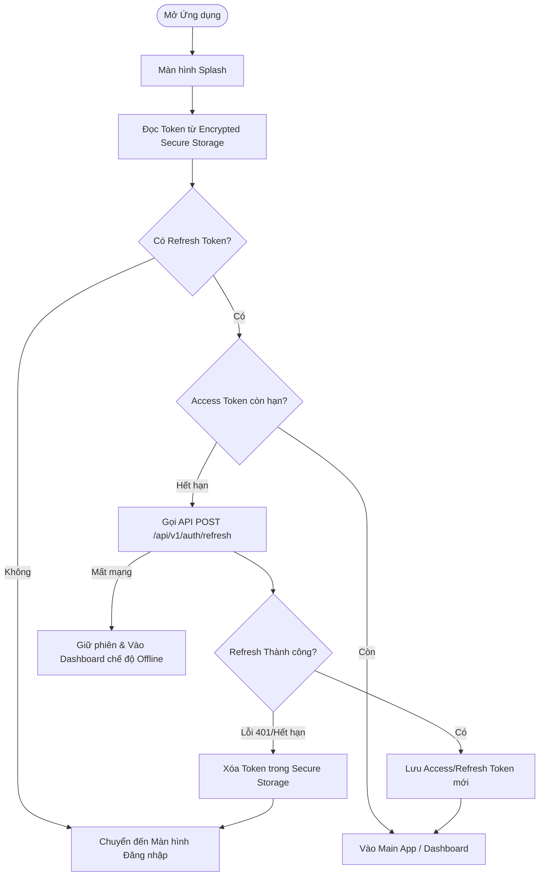
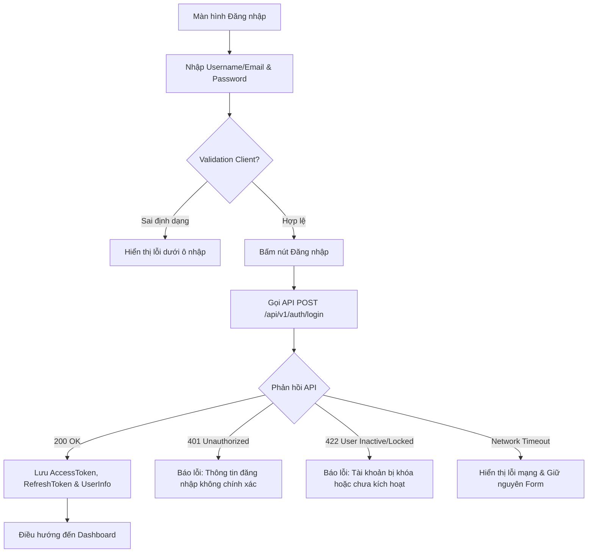
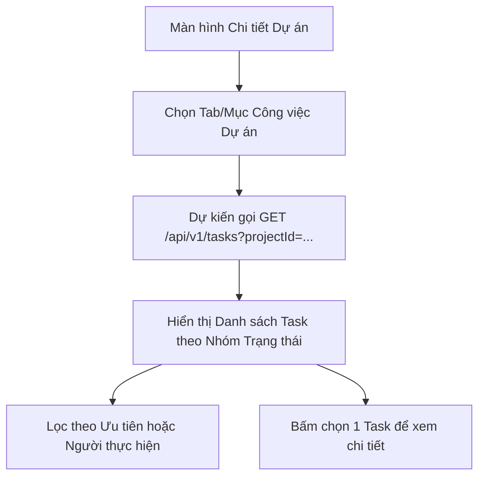
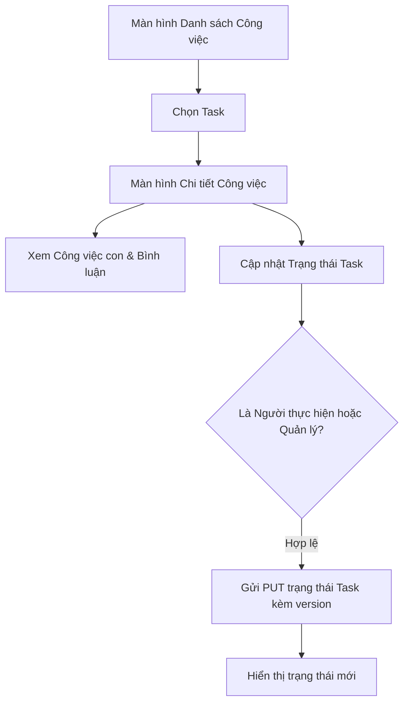
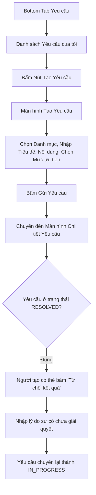
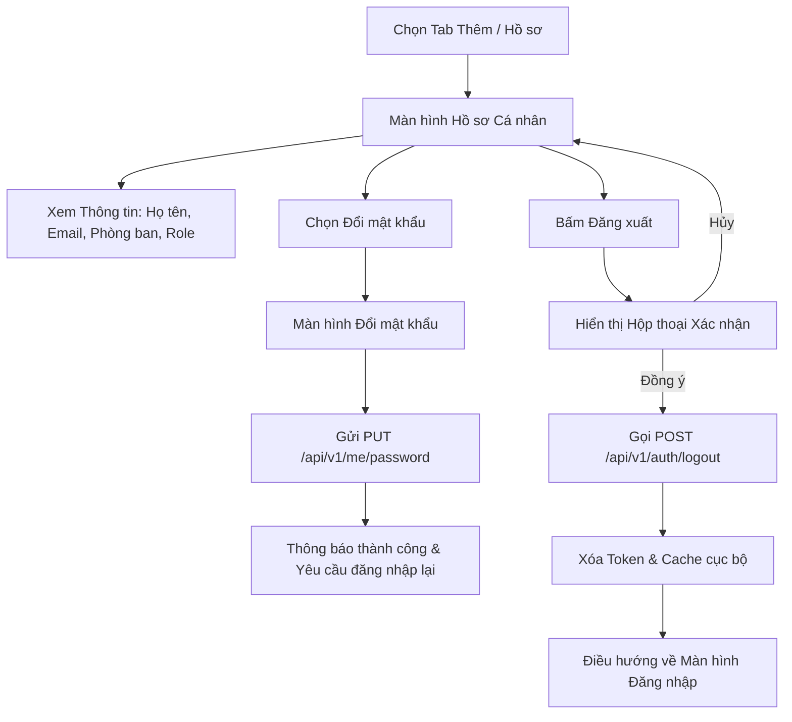

# 01. USER FLOWS - WORKSPHERE MOBILE

Tài liệu này đặc tả chi tiết 11 luồng tương tác người dùng trọng tâm của ứng dụng di động WorkSphere, bao quát đầy đủ kịch bản chuẩn (Happy Path), kịch bản phụ, lỗi, mất mạng và phân quyền.

---

## Danh mục User Flows

- **FLOW-01**: Khởi động, Phục hồi phiên làm việc (Session Restore) và Điều hướng
- **FLOW-02**: Đăng nhập hệ thống (Authentication)
- **FLOW-03**: Khám phá Danh sách và Xem Chi tiết Dự án (Project Exploration)
- **FLOW-04**: Quản lý Thành viên Dự án (Project Members Management)
- **FLOW-05**: Theo dõi và Tạo Mốc Tiến độ Dự án (Milestones Tracking)
- **FLOW-06**: Chuyển đổi Trạng thái Dự án (Project Status Transition)
- **FLOW-07**: Xem Danh sách Công việc thuộc Dự án (Project Tasks View - `DESIGN_ONLY_BACKEND_NOT_READY`)
- **FLOW-08**: Khám phá Chi tiết Công việc và Cập nhật Trạng thái (Task Detail & Update - `DESIGN_ONLY_BACKEND_NOT_READY`)
- **FLOW-09**: Tạo và Theo dõi Yêu cầu Dịch vụ Nội bộ (Service Request Lifecycle - `DESIGN_ONLY_BACKEND_NOT_READY`)
- **FLOW-10**: Nhận Thông báo và Điều hướng Sâu (Notification & Deep Linking - `DESIGN_ONLY_BACKEND_NOT_READY`)
- **FLOW-11**: Quản lý Hồ sơ cá nhân, Đổi mật khẩu và Đăng xuất (Profile & Session Termination)

---

## FLOW-01: Khởi động, Phục hồi phiên làm việc và Điều hướng



- **Actor**: Tất cả người dùng (Nhân viên, Trưởng nhóm, Quản lý dự án, Quản trị viên).
- **Starting point**: Biểu tượng ứng dụng WorkSphere trên màn hình chính điện thoại.
- **Preconditions**: Ứng dụng đã được cài đặt trên thiết bị Android/iOS.
- **Happy path**:
  1. Người dùng mở ứng dụng, màn hình Splash hiển thị biểu trưng WorkSphere.
  2. Ứng dụng đọc `refreshToken` được lưu trong Secure Storage (EncryptedSharedPreferences / Keychain).
  3. Access token còn hạn hoặc được refresh thành công qua `POST /api/v1/auth/refresh`.
  4. Ứng dụng chuyển tiếp êm dịu (fade animation) vào màn hình Dashboard (Bottom Tab đầu tiên).
- **Alternative path**:
  - Người dùng mở ứng dụng lần đầu hoặc đã đăng xuất trước đó: Không có token trong bộ nhớ, chuyển sang màn hình Đăng nhập (Login Screen).
- **Error path**:
  - `refreshToken` hết hạn hoặc đã bị thu hồi (`INVALID_TOKEN`, `SESSION_EXPIRED`): Xóa sạch token cục bộ, hiển thị Snackbar thông báo phiên hết hạn và điều hướng đến Login Screen.
- **Permission denied**: Không áp dụng tại bước Splash.
- **Offline behavior**: Nếu không có kết nối Internet nhưng Access token còn hạn (chưa quá 15 phút), ứng dụng cho phép vào Dashboard và hiển thị Offline Banner thông báo dữ liệu có thể chưa cập nhật.
- **End state**: Người dùng ở trạng thái đăng nhập tại Dashboard hoặc sẵn sàng nhập thông tin tại Login Screen.
- **API dependency**: `POST /api/v1/auth/refresh` (Backend Status: `READY`).

---

## FLOW-02: Đăng nhập hệ thống (Authentication)



- **Actor**: Người dùng chưa đăng nhập.
- **Starting point**: Màn hình Login Screen (`SCR-AUTH-02`).
- **Preconditions**: Thiết bị có kết nối mạng (trừ khi thử lại khi mất mạng).
- **Happy path**:
  1. Người dùng nhập tên đăng nhập/email và mật khẩu.
  2. Bấm nút "Đăng nhập". Nút chuyển sang trạng thái Loading (Spinner), khóa trường nhập liệu.
  3. Gửi request `POST /api/v1/auth/login`.
  4. Backend trả `200 OK` chứa `accessToken`, `refreshToken`, và thông tin User.
  5. Mobile lưu token vào Secure Storage, lưu thông tin profile vào User Context, điều hướng vào Dashboard.
- **Alternative path**:
  - Người dùng bấm "Quên mật khẩu": Điều hướng đến Forgot Password Screen (`SCR-AUTH-03`).
- **Error path**:
  - Sai tài khoản/mật khẩu: Nhận HTTP 401 với mã `INVALID_CREDENTIALS`, hiển thị alert lỗi, con trỏ focus vào ô mật khẩu.
  - Tài khoản bị khóa: Nhận HTTP 422 với mã `USER_LOCKED`, hiển thị thông báo liên hệ quản trị viên.
- **Permission denied**: Không áp dụng.
- **Offline behavior**: Khi mất mạng, hiển thị Banner "Không có kết nối mạng, vui lòng kiểm tra kết nối". Giữ nguyên thông tin form đã nhập để người dùng không phải gõ lại.
- **End state**: Người dùng đăng nhập thành công vào Main App.
- **API dependency**: `POST /api/v1/auth/login` (Backend Status: `READY`).

---

## FLOW-03: Khám phá Danh sách và Xem Chi tiết Dự án

```mermaid
flowchart TD
    TabProject[Chọn Tab Dự án] --> LoadList[Gọi GET /api/v1/projects]
    LoadList --> RenderList[Hiển thị Danh sách Dự án]
    RenderList --> FilterSearch[Tìm kiếm hoặc Lọc theo Status/Priority]
    FilterSearch --> ReloadList[Cập nhật Danh sách lọc]
    RenderList --> SelectProject[Bấm vào 1 Thẻ Dự án]
    SelectProject --> CallDetail[Gọi GET /api/v1/projects/{projectId}]
    CallDetail --> RenderDetail[Hiển thị Chi tiết: Info, Mốc, Thành viên, Quyền]
```

- **Actor**: Người dùng có quyền `PROJECT_READ` (Nhân viên, Trưởng nhóm, PM, Admin).
- **Starting point**: Bottom Tab "Dự án" hoặc danh sách dự án gần đây tại Dashboard.
- **Preconditions**: Đã đăng nhập hợp lệ.
- **Happy path**:
  1. Người dùng bấm tab "Dự án". Mobile hiển thị Skeleton Loading và gọi `GET /api/v1/projects`.
  2. Danh sách dự án hiển thị với đầy đủ: Tên, Mã, Trạng thái (Badge), Tiến độ %, Người quản lý, Số thành viên.
  3. Người dùng chọn 1 dự án. Mobile truyền `projectId` qua Navigation và mở `ProjectDetailScreen`.
  4. Màn hình Chi tiết gọi `GET /api/v1/projects/{projectId}`, hiển thị chi tiết tiến độ, danh sách mốc tiến độ (Milestones) và các nút thao tác tương ứng với `allowedActions`.
- **Alternative path**:
  - Kéo xuống để làm mới (Pull-to-refresh).
  - Sử dụng Search Bar để tìm kiếm theo tên/mã dự án, hoặc bấm Filter Chip chọn trạng thái `ACTIVE`, `ON_HOLD`,...
- **Error path**:
  - Không tìm thấy dự án (`PROJECT_NOT_FOUND`): Hiển thị thông báo dự án không tồn tại hoặc đã bị xóa, cung cấp nút quay về danh sách.
- **Permission denied**:
  - Nếu tài khoản không có quyền `PROJECT_READ`: Backend trả HTTP 403, mobile hiển thị màn hình `PermissionDeniedState` với thông điệp: "Bạn không có quyền xem thông tin dự án".
- **Offline behavior**: Nếu không có mạng, hiển thị danh sách đã cache gần nhất kèm Banner Offline; nếu chưa có cache, hiển thị Empty State kèm nút "Thử lại".
- **End state**: Người dùng xem chi tiết dự án và nắm bắt được các hành động được phép (`allowedActions`).
- **API dependency**: `GET /api/v1/projects`, `GET /api/v1/projects/{projectId}` (Backend Status: `READY`).

---

## FLOW-04: Quản lý Thành viên Dự án (Project Members)

```mermaid
flowchart TD
    PrjDetail[Màn hình Chi tiết Dự án] --> ClickMembers[Bấm Xem Tất cả Thành viên]
    ClickMembers --> MemberList[Màn hình Danh sách Thành viên]
    MemberList --> CheckCanManage{allowedActions có MANAGE_MEMBERS?}
    CheckCanManage -- Có --> ShowFab[Hiển thị Nút Thêm Thành viên]
    CheckCanManage -- Không --> ViewOnly[Chỉ xem danh sách & vai trò]
    ShowFab --> ClickAdd[Bấm Thêm Thành viên]
    ClickAdd --> OpenAddModal[Mở Bottom Sheet Thêm Thành viên]
    OpenAddModal --> SelectUserRole[Chọn Người dùng & Project Role]
    SelectUserRole --> SubmitAdd[Gửi POST /api/v1/projects/{id}/members]
    SubmitAdd --> RefreshMembers[Tải lại danh sách & Cập nhật memberCount]
```

- **Actor**: Quản lý dự án (`PROJECT_MANAGER`) hoặc người có quyền `PROJECT_MEMBER_MANAGE`.
- **Starting point**: Màn hình `ProjectDetailScreen` (`SCR-PRJ-02`).
- **Preconditions**: Dự án đang hoạt động (`DRAFT` hoặc `ACTIVE`).
- **Happy path**:
  1. Người dùng chọn mục "Thành viên" trong chi tiết dự án.
  2. Mobile mở `ProjectMemberListScreen`, gọi `GET /api/v1/projects/{projectId}/members`.
  3. Người dùng bấm nút "+" (FAB), mở Bottom Sheet thêm thành viên.
  4. Chọn người dùng từ danh sách nhân viên công ty, chọn vai trò (`TEAM_LEADER`, `MEMBER`, `OBSERVER`).
  5. Bấm "Thêm". Gửi `POST /api/v1/projects/{projectId}/members`.
  6. Backend trả `201 Created`. Mobile đóng Bottom Sheet, hiển thị Snackbar thành công, làm mới danh sách thành viên.
- **Alternative path (Sửa vai trò hoặc Xóa thành viên)**:
  - Chọn thành viên hiện tại -> Đổi vai trò -> Gửi `PUT /api/v1/projects/{id}/members/{memberId}`.
  - Vuốt sang trái (Swipe to delete) hoặc bấm nút xóa -> Xác nhận hộp thoại -> Gửi `DELETE /api/v1/projects/{id}/members/{memberId}`.
- **Error path**:
  - Thêm người đã có trong dự án: Báo lỗi `PROJECT_MEMBER_ALREADY_EXISTS`.
  - Cố gắng xóa hoặc giáng cấp Project Manager duy nhất còn lại: Báo lỗi `PROJECT_MANAGER_REQUIRED` ("Không thể giáng cấp/xóa Project Manager duy nhất của dự án").
- **Permission denied**: Người dùng chỉ có vai trò `MEMBER` hoặc `OBSERVER` sẽ bị ẩn nút Thêm/Sửa/Xóa thành viên.
- **Offline behavior**: Chặn thao tác thêm/sửa/xóa thành viên khi ngoại tuyến.
- **End state**: Danh sách thành viên dự án được cập nhật chính xác.
- **API dependency**: `GET`, `POST`, `PUT`, `DELETE` trên `/api/v1/projects/{projectId}/members` (Backend Status: `READY`).

---

## FLOW-05: Theo dõi và Tạo Mốc Tiến độ Dự án (Milestones)

```mermaid
flowchart TD
    PrjDetail[Màn hình Chi tiết Dự án] --> MilestoneSection[Khu vực Mốc Tiến độ]
    MilestoneSection --> ClickViewAll[Bấm Xem Tất cả Mốc]
    ClickViewAll --> MilestoneList[Màn hình Danh sách Milestone]
    MilestoneList --> CheckRole{Có quyền PROJECT_UPDATE?}
    CheckRole -- Có --> ShowAddBtn[Hiển thị Nút Tạo Mốc]
    CheckRole -- Không --> ReadOnlyMilestone[Chỉ xem danh sách mốc]
    ShowAddBtn --> ClickCreate[Bấm Tạo Mốc Mới]
    ClickCreate --> FormMilestone[Nhập Tên, Mô tả, Hạn chót dueDate]
    FormMilestone --> SubmitMilestone[Gửi POST /api/v1/projects/{id}/milestones]
    SubmitMilestone --> SuccessMilestone[Hiển thị mốc mới ở trạng thái PLANNED]
```

- **Actor**: Người dùng tham gia dự án (Xem) hoặc Quản lý dự án (Tạo).
- **Starting point**: Màn hình `ProjectDetailScreen` (`SCR-PRJ-02`).
- **Preconditions**: Dự án chưa bị hủy (`CANCELLED`) hoặc hoàn thành (`COMPLETED`).
- **Happy path**:
  1. Người dùng mở danh sách mốc tiến độ của dự án.
  2. Bấm nút "Thêm mốc tiến độ". Mở form tạo mốc.
  3. Nhập Tên mốc, Mô tả, và chọn ngày hạn chót (`dueDate`) qua Date Picker.
  4. Bấm "Tạo mốc". Gửi request `POST /api/v1/projects/{projectId}/milestones`.
  5. Backend trả `201 Created` với trạng thái ban đầu là `PLANNED`.
  6. Mốc mới xuất hiện trong danh sách sắp xếp theo thứ tự ngày tăng dần.
- **Error path**:
  - Tên mốc để trống: Client báo lỗi validation tức thì.
  - Dự án đã hoàn thành hoặc bị hủy: Backend trả lỗi `PROJECT_NOT_ACTIVE`.
- **Permission denied**: Thành viên không có quyền `PROJECT_UPDATE` không thấy nút tạo mốc.
- **Offline behavior**: Cho phép xem danh sách mốc đã cache, khóa form tạo mốc mới.
- **End state**: Mốc tiến độ mới được ghi nhận vào dự án.
- **API dependency**: `GET` và `POST` trên `/api/v1/projects/{projectId}/milestones` (Backend Status: `READY`).

---

## FLOW-06: Chuyển đổi Trạng thái Dự án (Project Status Transition)

```mermaid
flowchart TD
    PrjDetail[Màn hình Chi tiết Dự án] --> ClickStatus[Bấm vào Badge Trạng thái hoặc Menu]
    ClickStatus --> CheckAllowed{allowedActions chứa CHANGE_STATUS?}
    CheckAllowed -- Không --> Deny[Không mở hộp thoại]
    CheckAllowed -- Có --> OpenSheet[Mở Bottom Sheet Đổi Trạng thái]
    OpenSheet --> RenderOptions[Chỉ hiển thị các trạng thái hợp lệ theo ma trận]
    RenderOptions --> SelectStatus[Chọn trạng thái mới & Nhập Lý do]
    SelectStatus --> SendReq[Gửi PUT /api/v1/projects/{id}/status kèm version]
    SendReq --> CheckResult{Kết quả API}
    CheckResult -- 200 OK --> UpdateUI[Cập nhật Badge & Ghi nhận lịch sử]
    CheckResult -- 409 Conflict --> ShowConflict[Báo OPTIMISTIC_LOCK_CONFLICT & Tải lại]
    CheckResult -- 422 Invalid Transition --> ShowTrError[Báo lỗi chuyển trạng thái không hợp lệ]
```

- **Actor**: Quản lý dự án (`PROJECT_MANAGER`) có quyền `PROJECT_UPDATE`.
- **Starting point**: Màn hình `ProjectDetailScreen` (`SCR-PRJ-02`).
- **Preconditions**: Dự án chưa ở trạng thái kết thúc (`COMPLETED`, `CANCELLED`).
- **Happy path**:
  1. Quản lý dự án bấm vào nút "Đổi trạng thái" hoặc chạm vào Badge trạng thái.
  2. Mobile mở Modal Bottom Sheet hiển thị các trạng thái được phép chuyển đến:
     - Nếu đang `DRAFT`: Chỉ cho chọn `ACTIVE` hoặc `CANCELLED`.
     - Nếu đang `ACTIVE`: Chỉ cho chọn `ON_HOLD`, `COMPLETED`, hoặc `CANCELLED`.
     - Nếu đang `ON_HOLD`: Chỉ cho chọn `ACTIVE` hoặc `CANCELLED`.
  3. Người dùng chọn trạng thái đích, nhập lý do thay đổi (tùy chọn).
  4. Bấm "Xác nhận". Mobile gửi `PUT /api/v1/projects/{projectId}/status` kèm `version` hiện tại.
  5. Backend thực hiện đổi trạng thái và ghi log vào `project_status_histories` trong cùng một transaction.
  6. Mobile nhận `200 OK`, cập nhật trạng thái hiển thị, hiển thị Toast thành công.
- **Error path**:
  - `OPTIMISTIC_LOCK_CONFLICT`: Một người quản trị khác đã thay đổi dữ liệu dự án trước đó. Mobile thông báo "Dữ liệu dự án đã bị thay đổi, vui lòng tải lại" và tự động làm mới lại dữ liệu mới nhất.
  - `PROJECT_STATUS_TRANSITION_INVALID`: Bị từ chối nếu chuyển bước không hợp lệ.
- **Permission denied**: Người dùng thông thường không có quyền thấy nút chuyển trạng thái.
- **Offline behavior**: Chặn thao tác khi mất mạng.
- **End state**: Dự án chuyển sang trạng thái mới, lịch sử trạng thái được bảo toàn.
- **API dependency**: `PUT /api/v1/projects/{projectId}/status` (Backend Status: `READY`).

---

## FLOW-07: Xem Danh sách Công việc thuộc Dự án (Project Tasks View)

> **Lưu ý**: Module Task thuộc Phase 7. Luồng này tuân thủ bản đồ màn hình `03_MOBILE_SCREEN_MAP.md` nhưng được đánh dấu **`DESIGN_ONLY_BACKEND_NOT_READY`**.



- **Actor**: Thành viên dự án.
- **Starting point**: `ProjectDetailScreen` (`SCR-PRJ-02`).
- **Preconditions**: Dự án đang ở trạng thái `ACTIVE`.
- **Happy path**:
  1. Người dùng bấm mục "Công việc" bên trong chi tiết dự án.
  2. Mobile hiển thị danh sách các task thuộc dự án được phân nhóm theo `TODO`, `IN_PROGRESS`, `DONE`.
  3. Hiển thị thông tin ngắn gọn: Tiêu đề, Người thực hiện (Avatar), Hạn chót, Mức độ ưu tiên.
- **Backend readiness**: **`DESIGN_ONLY_BACKEND_NOT_READY`** (Sẽ kích hoạt kết nối API khi hoàn thành Phase 7).

---

## FLOW-08: Khám phá Chi tiết Công việc và Cập nhật Trạng thái (Task Detail & Update)

> **Lưu ý**: Module Task thuộc Phase 7. Được đánh dấu **`DESIGN_ONLY_BACKEND_NOT_READY`**.



- **Actor**: Người thực hiện công việc (Assignee) hoặc Trưởng nhóm/Quản lý dự án.
- **Starting point**: Bottom Tab "Công việc" hoặc danh sách công việc trong dự án.
- **Preconditions**: Đã đăng nhập.
- **Happy path**:
  1. Chọn task từ danh sách. Mở `TaskDetailScreen`.
  2. Xem tiêu đề, mô tả, tệp đính kèm, checklist công việc con, danh sách bình luận.
  3. Người thực hiện kéo trượt hoặc chọn nút chuyển trạng thái sang `IN_PROGRESS` hoặc `COMPLETED`.
  4. Trạng thái cập nhật tức thời trên giao diện.
- **Backend readiness**: **`DESIGN_ONLY_BACKEND_NOT_READY`**.

---

## FLOW-09: Tạo và Theo dõi Yêu cầu Dịch vụ Nội bộ (Service Request Lifecycle)

> **Lưu ý**: Module Service Request thuộc Phase 8. Được đánh dấu **`DESIGN_ONLY_BACKEND_NOT_READY`**.



- **Actor**: Nhân viên công ty (Requester).
- **Starting point**: Bottom Tab "Yêu cầu".
- **Preconditions**: Đã đăng nhập.
- **Happy path**:
  1. Người dùng bấm nút Tạo yêu cầu hỗ trợ (IT, Hành chính, Cơ sở vật chất).
  2. Điền thông tin sự cố, đính kèm ảnh chụp màn hình/thiết bị hỏng.
  3. Bấm Gửi. Yêu cầu tạo mới ở trạng thái `OPEN`.
  4. Khi nhân viên kỹ thuật xử lý xong (`RESOLVED`), nếu người dùng kiểm tra thấy lỗi vẫn còn, bấm nút "Từ chối kết quả" (Reject Resolution), nhập lý do và yêu cầu chuyển lại `IN_PROGRESS` theo đúng quy chuẩn `03_MOBILE_SCREEN_MAP.md` mục 9.2.
- **Backend readiness**: **`DESIGN_ONLY_BACKEND_NOT_READY`**.

---

## FLOW-10: Nhận Thông báo và Điều hướng Sâu (Notification & Deep Linking)

> **Lưu ý**: Module Notification thuộc Phase 10 (được đánh dấu **`CONTRACT_ONLY_NOT_IMPLEMENTED`**).
> Scheme `worksphere://` là đề xuất kỹ thuật client (`DESIGN_PROPOSAL - NOT_CANONICAL`), chưa có quy chuẩn chính thức trong canonical docs. Ứng dụng mobile sẽ phân giải URI này thành các route nội bộ của React Navigation.

```mermaid
flowchart TD
    PushNotif[Nhận Push Notification hoặc Mở Tab Thông báo] --> ClickNotif[Bấm vào 1 Thông báo]
    ClickNotif --> MarkRead[Đánh dấu Đã đọc]
    MarkRead --> ParseLink{Phân loại Thực thể}
    ParseLink -- Dự án --> NavProject[Mở worksphere://projects/{id}]
    ParseLink -- Công việc --> NavTask[Mở worksphere://tasks/{id}]
    ParseLink -- Yêu cầu --> NavRequest[Mở worksphere://service-requests/{id}]
    ParseLink -- Tài sản --> NavAsset[Mở worksphere://assets/{id}]
```

- **Actor**: Tất cả người dùng.
- **Starting point**: Thanh thông báo hệ điều hành (Push) hoặc Màn hình Thông báo trong ứng dụng.
- **Preconditions**: Ứng dụng đã đăng nhập.
- **Happy path**:
  1. Người dùng nhận thông báo (ví dụ: "Bạn đã được thêm vào dự án WS-2026-001").
  2. Chạm vào thông báo. Ứng dụng xử lý Deep Link dạng `worksphere://projects/{id}` (`DESIGN_PROPOSAL`).
  3. Điều hướng trực tiếp đến màn hình `ProjectDetailScreen` tương ứng với ID được truyền.
- **Backend readiness**: **`CONTRACT_ONLY_NOT_IMPLEMENTED`** (Notification API chưa triển khai).


---

## FLOW-11: Quản lý Hồ sơ cá nhân, Đổi mật khẩu và Đăng xuất (Profile & Session Termination)



- **Actor**: Tất cả người dùng đã đăng nhập.
- **Starting point**: Tab "Thêm" -> Chọn "Hồ sơ cá nhân" (`SCR-ACC-01`).
- **Preconditions**: Đang có phiên làm việc hoạt động.
- **Happy path**:
  1. Người dùng xem thông tin cá nhân: Họ tên, Email, Phòng ban, Vai trò hệ thống.
  2. Bấm "Đổi mật khẩu" -> Nhập mật khẩu cũ, mật khẩu mới, xác nhận mật khẩu mới -> Gọi `PUT /api/v1/me/password`.
  3. Khi muốn kết thúc phiên làm việc: Bấm nút "Đăng xuất" ở cuối trang.
  4. Hộp thoại xác nhận hiển thị "Bạn có chắc chắn muốn đăng xuất khỏi WorkSphere?".
  5. Bấm "Đăng xuất". Ứng dụng gửi `POST /api/v1/auth/logout` kèm `refreshToken`.
  6. Xóa token trong Secure Storage, xóa thông tin profile trong bộ nhớ đệm, điều hướng về `LoginScreen`.
- **Error path**:
  - Đổi mật khẩu sai mật khẩu cũ: Báo lỗi `INVALID_CREDENTIALS`.
  - Mất mạng khi đăng xuất: Vẫn chủ động xóa sạch dữ liệu phiên cục bộ trên thiết bị và chuyển về màn hình đăng nhập để đảm bảo an toàn cho người dùng.
- **End state**: Toàn bộ dữ liệu phiên trên máy được dọn dẹp, người dùng ở trạng thái chưa đăng nhập.
- **API dependency**: `GET /api/v1/me`, `PUT /api/v1/me/password`, `POST /api/v1/auth/logout` (Backend Status: `READY`).
