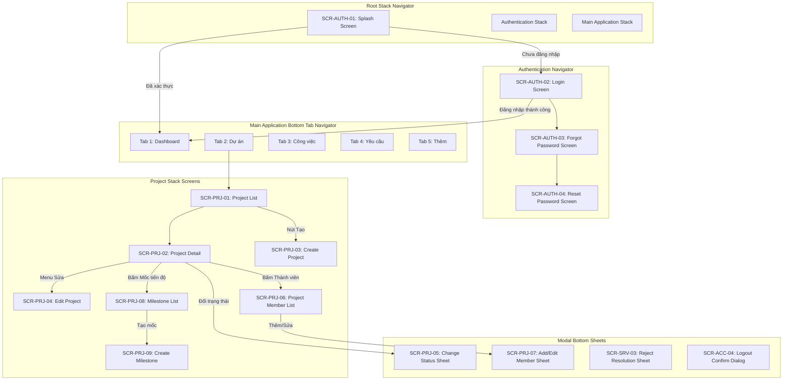

# 03. NAVIGATION MAP - WORKSPHERE MOBILE

Tài liệu này đặc tả kiến trúc điều hướng 3 cấp của ứng dụng WorkSphere Mobile dựa trên React Navigation, bao gồm Root Navigator, Authentication Navigator, Main Application Tab Navigator, Stack Screens, Modal Bottom Sheets, và cơ chế Deep Linking.

---

## 1. Sơ đồ Cây Điều Hướng Tổng Thể



---

## 2. Quy tắc Điều hướng Cốt lõi (Coding Standards Rule)

Tuân thủ nghiêm ngặt theo [docs/09_CODING_STANDARDS.md](file:///d:/WorkSphere/docs/09_CODING_STANDARDS.md) mục 19.5:

1. **Chỉ truyền ID tối thiểu qua Route Params**:
   - **ĐÚNG**: `navigation.navigate('ProjectDetail', { projectId: '2abdd1d8-db24-4632-b307-082a0e681ff1' })`
   - **SAI**: `navigation.navigate('ProjectDetail', { project: projectObject })`
   - **Lý do**: Tránh lỗi serialization của React Navigation, ngăn chặn dữ liệu bị stale (cũ) khi màn hình chi tiết được mở, và đảm bảo cơ chế Deep Linking hoạt động đồng nhất.
2. **Quản lý Token và Phiên (Session)**:
   - Khi token hết hạn không thể refresh (HTTP 401): Root Navigator lập tức reset navigation state về `AuthNavigator` (`index: 0, routes: [{ name: 'Login' }]`).
   - Đăng xuất (`Logout`): Xóa sạch session trong Secure Storage trước khi điều hướng về màn hình Đăng nhập.
3. **Phân quyền và Hiển thị theo Điều kiện**:
   - Nút hành động (Ví dụ: "Tạo dự án", "Đổi trạng thái", "Thêm thành viên") chỉ hiển thị khi `allowedActions` hoặc `permissions` của người dùng cho phép.
   - Nếu người dùng truy cập màn hình không có quyền bằng Deep Link hoặc route trực tiếp, màn hình hiển thị component `PermissionDeniedState` thay vì crash app.

---

## 3. Cấu trúc Các Navigator

### 3.1. Root Navigator (`RootStack`)
- Quản lý 2 trạng thái ứng dụng: Chưa đăng nhập (`Auth`) và Đã đăng nhập (`Main`).
- Chuyển đổi giữa 2 stack bằng state `isAuthenticated` từ Authentication Context.

```typescript
// Type definition mẫu cho Root Navigator
export type RootStackParamList = {
  Splash: undefined;
  Auth: undefined;
  Main: undefined;
};
```

### 3.2. Authentication Navigator (`AuthStack`)
- Màn hình bao gồm:
  - `Login`: Không có nút back.
  - `ForgotPassword`: Có nút back quay về Login.
  - `ResetPassword`: Nhận params `{ token?: string, email?: string }`.

```typescript
export type AuthStackParamList = {
  Login: undefined;
  ForgotPassword: { email?: string };
  ResetPassword: { token: string };
};
```

### 3.3. Main Bottom Tab Navigator (`MainTab`)
- 5 Tabs cố định:
  1. `DashboardTab` -> Stack chứa `DashboardScreen`.
  2. `ProjectTab` -> Stack chứa `ProjectListScreen`, `ProjectDetailScreen`,...
  3. `TaskTab` -> Stack chứa `TaskListScreen`, `TaskDetailScreen`,...
  4. `ServiceRequestTab` -> Stack chứa `ServiceRequestListScreen`,...
  5. `MoreTab` -> Stack chứa `MoreMenuScreen`, `ProfileScreen`, `SettingsScreen`,...

### 3.4. Project Stack Navigator (`ProjectStack`)
- Quản lý luồng màn hình thuộc phân hệ Dự án:

```typescript
export type ProjectStackParamList = {
  ProjectList: undefined;
  ProjectDetail: { projectId: string };
  CreateProject: undefined;
  EditProject: { projectId: string };
  ProjectMembers: { projectId: string };
  MilestoneList: { projectId: string };
  CreateMilestone: { projectId: string };
};
```

---

## 4. Cơ chế Deep Linking [DESIGN_PROPOSAL - NOT_CANONICAL]

> [!NOTE]
> Scheme `worksphere://` và các liên kết sâu dưới đây là đề xuất kỹ thuật (`DESIGN_PROPOSAL - NOT_CANONICAL`) phục vụ xử lý luồng thông báo Push Notification (FLOW-10). Scheme này **chưa có quy chuẩn bắt buộc trong canonical docs**.
> Khi triển khai, ứng dụng mobile ánh xạ trực tiếp vào hệ thống màn hình nội bộ React Navigation đã được duyệt trong [docs/03_MOBILE_SCREEN_MAP.md](file:///d:/WorkSphere/docs/03_MOBILE_SCREEN_MAP.md), tuyệt đối không tạo thêm route hoặc màn hình ngoài luồng.

| Deep Link Pattern | Màn hình Đích | Tham số trích xuất | Backend Readiness |
|---|---|---|---|
| `worksphere://dashboard` | `SCR-MAIN-01` | Không | `BLOCKED_BY_GAP` (`DASHBOARD_AGGREGATED_API_GAP`) |
| `worksphere://projects` | `SCR-PRJ-01` | Không | `IMPLEMENTED_AND_TESTED` |
| `worksphere://projects/{projectId}` | `SCR-PRJ-02` | `projectId` (UUID) | `IMPLEMENTED_AND_TESTED` |
| `worksphere://projects/{projectId}/members` | `SCR-PRJ-06` | `projectId` (UUID) | `IMPLEMENTED_AND_TESTED` |
| `worksphere://projects/{projectId}/milestones`| `SCR-PRJ-08` | `projectId` (UUID) | `IMPLEMENTED_AND_TESTED` |
| `worksphere://tasks/{taskId}` | `SCR-TSK-02` | `taskId` (UUID) | `CONTRACT_ONLY_NOT_IMPLEMENTED` |
| `worksphere://service-requests/{requestId}` | `SCR-SRV-02` | `requestId` (UUID) | `CONTRACT_ONLY_NOT_IMPLEMENTED` |
| `worksphere://assets/{assetId}` | `SCR-AST-02` | `assetId` (UUID) | `CONTRACT_ONLY_NOT_IMPLEMENTED` |
| `worksphere://profile` | `SCR-ACC-01` | Không | `IMPLEMENTED_AND_TESTED` |

### Quy tắc xử lý Deep Link:
1. Khi ứng dụng đang đóng: Khởi động qua Splash -> Kiểm tra token -> Nếu hợp lệ, mở thẳng màn hình đích tương ứng với ID trong link.
2. Khi người dùng chưa đăng nhập: Lưu lại Deep Link đích vào `pendingRedirect` -> Sau khi đăng nhập thành công tại `LoginScreen`, tự động chuyển đến màn hình đích thay vì về Dashboard mặc định.
