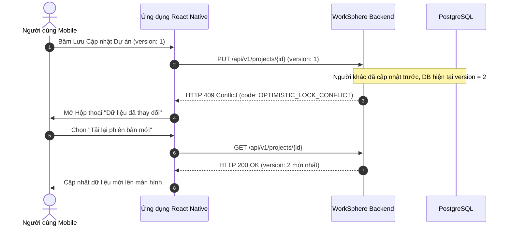

# 07. UI STATE MATRIX - WORKSPHERE MOBILE

Tài liệu này chuẩn hóa ma trận 12 trạng thái giao diện người dùng (UI States) trên WorkSphere Mobile, đảm bảo tất cả các màn hình danh sách, chi tiết, biểu mẫu và hộp thoại đều có phản hồi trực quan hoàn chỉnh.

---

## 1. Danh mục 12 Trạng thái Giao diện

1. **`INITIAL`**: Trạng thái khởi tạo, chưa có dữ liệu trong bộ nhớ.
2. **`LOADING`**: Đang tải dữ liệu ban đầu từ server (sử dụng Skeleton hoặc Spinner).
3. **`SUCCESS`**: Dữ liệu tải thành công và có nội dung hiển thị bình thường.
4. **`EMPTY`**: Dữ liệu tải thành công nhưng danh sách rỗng (0 bản ghi).
5. **`ERROR`**: Lỗi tải dữ liệu do lỗi mạng hoặc lỗi máy chủ (HTTP 500, Timeout).
6. **`OFFLINE`**: Thiết bị mất kết nối Internet, hiển thị dữ liệu từ cache cục bộ kèm banner cảnh báo.
7. **`REFRESHING`**: Người dùng thực hiện thao tác kéo xuống để làm mới (Pull-to-refresh).
8. **`LOADING_MORE`**: Đang tải thêm dữ liệu ở cuối danh sách (Infinite scroll pagination).
9. **`SUBMITTING`**: Đang gửi dữ liệu từ biểu mẫu lên server (Form submission).
10. **`VALIDATION_ERROR`**: Dữ liệu nhập vào form không hợp lệ (Báo lỗi tại trường hoặc đầu form).
11. **`PERMISSION_DENIED`**: Người dùng bị từ chối quyền truy cập (HTTP 403 Forbidden).
12. **`OPTIMISTIC_LOCK_CONFLICT`**: Xung đột phiên bản dữ liệu (HTTP 409 Conflict).

---

## 2. Ma trận Ánh xạ Trạng thái theo Loại Màn hình

| Trạng thái | Màn hình Danh sách (List Screen) | Màn hình Chi tiết (Detail Screen) | Màn hình Biểu mẫu (Form Screen) | Hộp thoại / Sheet (Modal) |
|---|---|---|---|---|
| **`INITIAL`** | Hiển thị nền trống với thanh TopAppBar | Hiển thị khung sườn tĩnh với TopAppBar | Hiển thị form trắng hoặc form với giá trị khởi tạo | Chưa mở hộp thoại |
| **`LOADING`** | 3-4 `SkeletonCard` nhấp nháy toàn màn hình | `SkeletonDetail` hiển thị khung chữ nhật giả lập | Khóa các trường và hiển thị Spinner giữa form | Spinner nhỏ trong sheet |
| **`SUCCESS`** | Danh sách các Card (Project, Task, Member) | Thông tin chi tiết, mốc, thành viên đầy đủ | Form sẵn sàng nhập liệu | Nội dung sheet hiển thị đầy đủ |
| **`EMPTY`** | Minh họa `EmptyState` + nút hành động tạo | Thông báo "Nội dung không tồn tại" | Không áp dụng | Danh sách lựa chọn rỗng |
| **`ERROR`** | `ErrorState` + Nút "Thử lại" | `ErrorState` + Nút "Quay lại" hoặc "Thử lại" | Banner lỗi đầu form, giữ nguyên dữ liệu đã gõ | Banner lỗi đỏ trong sheet |
| **`OFFLINE`** | Danh sách cache + `OfflineBanner` màu vàng cam | Nội dung cache + `OfflineBanner` | Khóa nút gửi + cảnh báo cần mạng để lưu | Khóa xác nhận khi mất mạng |
| **`REFRESHING`**| Con quay RefreshControl quay ở đầu list | Tương tự list, làm mới toàn bộ thông số | Không áp dụng | Không áp dụng |
| **`LOADING_MORE`**| `PaginationFooter` hiển thị spinner cuối list | Không áp dụng | Không áp dụng | Không áp dụng |
| **`SUBMITTING`** | Không áp dụng | Không áp dụng | Nút bấm chính biến thành Spinner, khóa form | Nút xác nhận biến thành Spinner |
| **`VALIDATION_ERROR`**| Không áp dụng | Không áp dụng | Viền đỏ ô nhập + Text lỗi đỏ dưới trường nhập | Báo lỗi dưới ô nhập trong sheet |
| **`PERMISSION_DENIED`**| Màn hình `PermissionDeniedState` (Khóa xem) | `PermissionDeniedState` ("Không có quyền xem") | Nút submit bị vô hiệu hóa hoặc ẩn form | Không cho phép mở sheet |
| **`OPTIMISTIC_LOCK_CONFLICT`**| Tự động reload danh sách khi có conflict | Hiển thị Modal Cảnh báo Xung đột Phiên bản | Hiển thị Dialog Xung đột + Giữ bản nháp | Đóng sheet + Báo lỗi xung đột |

---

## 3. Đặc tả Chuyên sâu cho Xử lý `OPTIMISTIC_LOCK_CONFLICT`

Trạng thái **Optimistic Lock Conflict (HTTP 409)** xảy ra khi người dùng đang chỉnh sửa Dự án, Công việc hoặc Tài sản nhưng một người dùng khác đã lưu thay đổi thành công trước đó (lệch trường `version`).

### 3.1. Hành vi Trải nghiệm Người dùng (UX Rules)
1. **Tuyệt đối không ghi đè tự động**: Không âm thầm gửi lại request để đè dữ liệu của người khác.
2. **Không hiển thị thông tin kỹ thuật**: Nghiêm cấm đưa stack trace, mã exception Java (`ObjectOptimisticLockingFailureException`) hoặc tên cột database lên giao diện.
3. **Thông điệp rõ ràng, thân thiện**:
   - Tiêu đề: **"Dữ liệu đã thay đổi"**
   - Nội dung: *"Thông tin dự án vừa được cập nhật bởi một thành viên khác trong hệ thống. Để tránh mất dữ liệu mới, vui lòng tải lại phiên bản mới nhất."*
4. **Cung cấp nút hành động khắc phục**:
   - Nút chính (Primary): **"Tải lại phiên bản mới"** -> Gọi lại API `GET` để nạp dữ liệu và version mới nhất vào form/chi tiết.
   - Nút phụ (Secondary): **"Giữ bản nháp & Đóng"** -> Cho phép người dùng copy lại những gì họ vừa gõ vào clipboard hoặc giữ tạm để không bị mất công gõ lại.

### 3.2. Sơ đồ Xử lý Lỗi Optimistic Lock

---

## 4. Xử lý Trạng thái Ngoại tuyến (Offline Behavior)

- Khi thiết bị ngắt mạng (phát hiện qua `NetInfo`):
  1. Hiển thị thanh `OfflineBanner` màu vàng cam (#D97706) ngay dưới `TopAppBar`: *"Bạn đang ngoại tuyến. Dữ liệu hiển thị có thể chưa phải mới nhất."*
  2. Các tác vụ ghi dữ liệu (Tạo dự án, Đổi trạng thái, Thêm thành viên, Sửa công việc) sẽ làm mờ nút Submit và thông báo: *"Cần có kết nối mạng để thực hiện thao tác này"*.
  3. Khi có mạng trở lại: Tự động ẩn banner và kích hoạt `refresh()` nền để đồng bộ dữ liệu mới nhất.
