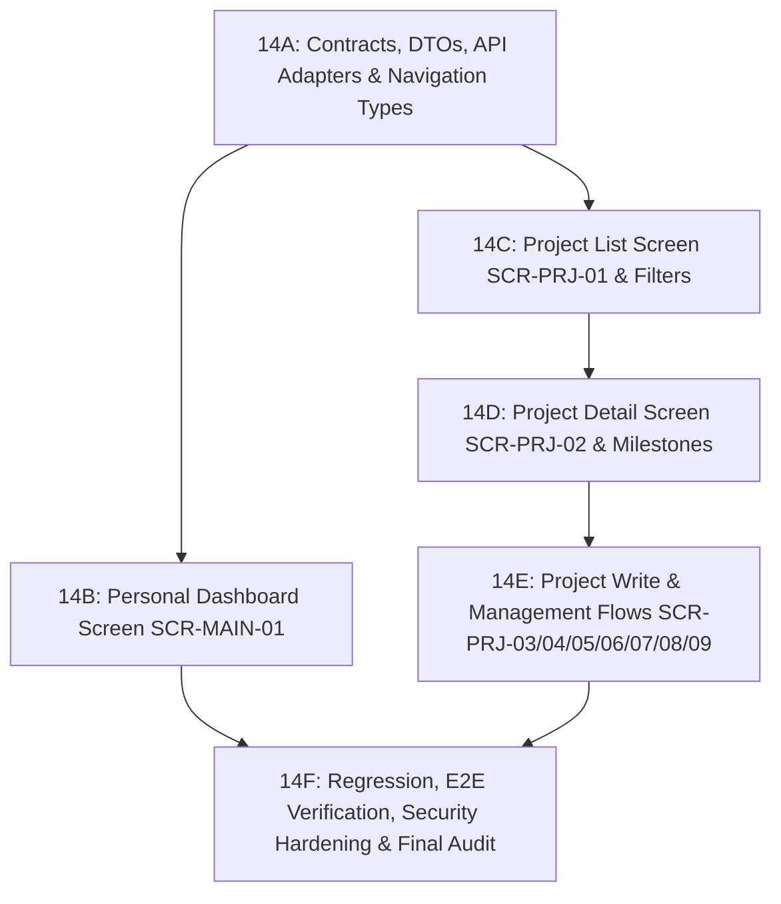

# PHASE 14 DASHBOARD & PROJECTS CONTRACT RECONCILIATION
## WorkSphere Mobile Dashboard & Projects Contract & Architecture Freeze

- **Repository**: `D:\WorkSphere`
- **Reconciliation Date**: 2026-10-19
- **Baseline Checkpoint**: `9572b3ba65eec63cf37b62ca49c709babc4e5732`
- **Pre-Phase 14 Audit**: `PRE_PHASE_14_AUDIT_PUSHED_READY_FOR_DECISION_FREEZE`
- **Phase 13 Mobile Authentication Status**: `CLOSED` (Memory Checkpoint Closed)
- **Phase 14 Implementation Status**: `NOT STARTED`
- **Governing Policies**: `AGENTS.md`, `D-057`, `D-060`

---

## 1. Checkpoint & Baseline

| Thuộc tính | Trạng thái thực tế | Ghi chú |
| :--- | :--- | :--- |
| **Git Branch** | `main` | Nhánh canonical duy nhất |
| **Current HEAD** | `9572b3ba65eec63cf37b62ca49c709babc4e5732` | Commit báo cáo kiểm toán Pre-Phase 14 |
| **origin/main** | `9572b3ba65eec63cf37b62ca49c709babc4e5732` | Đồng bộ 100% |
| **Working Tree** | Clean (`0` uncommitted, `0` untracked) | Không có tệp bẩn |
| **Phase 13 Baseline** | `CLOSED` | 38/38 test suites, 325/325 tests PASS, clean Android build |
| **Phase 14 Source** | `NOT STARTED` | Chưa triển khai bất kỳ mã nguồn chức năng nào |

---

## 2. Canonical Scope Freeze

Đối chiếu giữa [docs/08_DEVELOPMENT_ROADMAP.md](file:///d:/WorkSphere/docs/08_DEVELOPMENT_ROADMAP.md) Mục 18, [docs/03_MOBILE_SCREEN_MAP.md](file:///d:/WorkSphere/docs/03_MOBILE_SCREEN_MAP.md) Mục 6 & 7, [design/02_SCREEN_INVENTORY.md](file:///d:/WorkSphere/design/02_SCREEN_INVENTORY.md), và [docs/06_API_CONTRACT.md](file:///d:/WorkSphere/docs/06_API_CONTRACT.md) Mục 10 & 11:

### Phân loại phạm vi:
1. **Bắt buộc triển khai trong Phase 14 (`REQUIRED_PHASE_14`)**:
   - `SCR-MAIN-01`: Personal Dashboard Screen (`GET /api/v1/dashboard/me`).
   - `SCR-PRJ-01`: Project List Screen (`GET /api/v1/projects`).
   - `SCR-PRJ-02`: Project Detail Screen (`GET /api/v1/projects/{projectId}`).
   - `SCR-PRJ-06`: Project Member List Screen (`GET /api/v1/projects/{projectId}/members`).
   - `SCR-PRJ-08`: Milestone List Screen (`GET /api/v1/projects/{projectId}/milestones`).
2. **Giao diện có điều kiện phân quyền nhưng bắt buộc triển khai (`CONDITIONAL_UI_BUT_REQUIRED_IMPLEMENTATION`)**:
   - `SCR-PRJ-03`: Create Project Screen (`POST /api/v1/projects`, PM/Admin only, khởi tạo `DRAFT`).
   - `SCR-PRJ-04`: Edit Project Screen (`PUT /api/v1/projects/{projectId}`, Optimistic lock qua `version`).
   - `SCR-PRJ-05`: Change Project Status Modal Sheet (`PUT /api/v1/projects/{projectId}/status`, ma trận trạng thái hợp lệ).
   - `SCR-PRJ-07`: Add/Edit Project Member Sheet (`POST`/`PUT`/`DELETE` `/api/v1/projects/{projectId}/members`, bảo vệ D-013).
   - `SCR-PRJ-09`: Create Milestone Screen / Sheet (`POST /api/v1/projects/{projectId}/milestones`).
3. **Hoãn lại theo canonical (`DEFERRED`)**:
   - `PROJECT_DASHBOARD_PROJECTION_DEFERRED`: `GET /projects/{projectId}/dashboard` (Phase 11 deferral; không chặn Personal Dashboard hay Project Detail).
4. **Ngoài phạm vi Phase 14 Dashboard + Projects (`OUT_OF_SCOPE`)**:
   - Task screens (`SCR-TSK-01` .. `SCR-TSK-06`): Thuộc phân hệ Task Module (sẽ triển khai trong subphases riêng sau khi hoàn thành Dashboard & Projects).
   - Service Request (`SCR-SRV-01` .. `06`) & Asset (`SCR-AST-01` .. `06`) $\rightarrow$ Phase 15.

---

## 3. Screen Ownership Freeze

Mỗi màn hình bắt buộc thuộc về đúng một subphase duy nhất:

| Mã UI Artifact | Tên Màn hình / Modal | Subphase Phụ Trách | Route Name | Route Param | Quyền Hạn Kiểm Tra |
| :--- | :--- | :---: | :--- | :--- | :--- |
| `SCR-MAIN-01` | Dashboard Screen | **14B** | `Dashboard` | `undefined` | `AUTHENTICATED` |
| `SCR-PRJ-01` | Project List Screen | **14C** | `Projects` | `undefined` | `PROJECT_READ` |
| `SCR-PRJ-02` | Project Detail Screen | **14D** | `ProjectDetail` | `{ projectId: string }` | `PROJECT_READ` |
| `SCR-PRJ-03` | Create Project Screen | **14E** | `CreateProject` | `undefined` | `PROJECT_CREATE` |
| `SCR-PRJ-04` | Edit Project Screen | **14E** | `EditProject` | `{ projectId: string }` | `PROJECT_UPDATE` |
| `SCR-PRJ-05` | Change Status Modal Sheet | **14E** | *Modal Component* | `{ projectId: string, currentStatus: string, version: number }` | `PROJECT_UPDATE` |
| `SCR-PRJ-06` | Project Member List Screen | **14E** | `ProjectMembers` | `{ projectId: string }` | `PROJECT_READ` |
| `SCR-PRJ-07` | Add/Edit Member Sheet | **14E** | *Modal Component* | `{ projectId: string }` | `PROJECT_MEMBER_MANAGE` |
| `SCR-PRJ-08` | Milestone List Screen | **14E** | `ProjectMilestones` | `{ projectId: string }` | `PROJECT_READ` |
| `SCR-PRJ-09` | Create Milestone Screen | **14E** | *Modal Component* | `{ projectId: string }` | `PROJECT_UPDATE` |

---

## 4. Dashboard DTO Freeze

### 4.1. Endpoint Khóa
- `GET /dashboard/me` thông qua `apiClient.get('/dashboard/me')`.
- `baseURL` của `apiClient` đã chứa tiền tố `/api/v1` (tuyệt đối không tạo đường dẫn `/api/v1/api/v1`).

### 4.2. Cấu Trúc Khóa Đối Soát Backend DTO
Khóa khớp nối hoàn toàn với `PersonalDashboardResponse.java`:

```typescript
export interface TaskDashboardSummary {
  todo: number;
  inProgress: number;
  inReview: number;
  completed: number;
  overdue: number;
  dueSoon: number;
}

export interface ServiceRequestDashboardSummary {
  open: number;
  inProgress: number;
  waitingForUser: number;
  resolved: number;
}

export interface ProjectDashboardSummary {
  active: number;
  onHold: number;
}

export interface UpcomingTaskItem {
  id: string; // UUID
  projectId: string; // UUID
  projectName: string;
  title: string;
  status: string; // TaskStatus
  priority: string; // TaskPriority
  dueDate: string; // ISO-8601 Instant
}

export interface RecentNotificationItem {
  id: string; // UUID
  type: string; // NotificationType
  title: string;
  message: string;
  referenceType: string; // NotificationReferenceType
  referenceId: string; // UUID
  read: boolean;
  createdAt: string; // ISO-8601 Instant
}

export interface PersonalDashboardData {
  tasks: TaskDashboardSummary;
  serviceRequests: ServiceRequestDashboardSummary;
  projects: ProjectDashboardSummary;
  upcomingTasks: UpcomingTaskItem[];
  recentNotifications: RecentNotificationItem[];
}
```

### 4.3. Nguyên Tắc Xử Lý
- **Không tổng hợp client-side**: Backend SQL đã đếm chính xác theo active assignment và membership; Mobile hiển thị trực tiếp.
- **Nullability**: Các đối tượng `tasks`, `serviceRequests`, `projects` không bao giờ null (backend trả empty default nếu không có dòng). `upcomingTasks` và `recentNotifications` luôn là mảng (`[]` khi rỗng).

---

## 5. Project Summary DTO Freeze (GET /projects)

Khóa khớp nối hoàn toàn với `ProjectSummaryResponse.java`:

```typescript
export interface ProjectManagerSummary {
  id: string; // UUID
  fullName: string;
  avatarUrl: string | null;
}

export interface ProjectTaskSummary {
  total: number;
  completed: number;
  overdue: number;
}

export interface ProjectSummary {
  id: string; // UUID
  code: string; // ví dụ: "WS-2026-001"
  name: string;
  description: string | null;
  status: ProjectStatus;
  priority: ProjectPriority;
  manager: ProjectManagerSummary;
  startDate: string; // YYYY-MM-DD
  plannedEndDate: string; // YYYY-MM-DD
  progressPercent: number; // BigDecimal từ backend
  memberCount: number;
  taskSummary: ProjectTaskSummary;
  createdAt: string; // ISO-8601 Instant
  updatedAt: string; // ISO-8601 Instant
}
```

---

## 6. Project Detail DTO Freeze (GET /projects/{projectId})

Khóa khớp nối hoàn toàn với `ProjectDetailResponse.java`:

```typescript
export interface ProjectDepartmentDetail {
  id: string; // UUID
  code: string;
  name: string;
}

export interface MilestoneItem {
  id: string; // UUID
  projectId: string; // UUID
  name: string;
  description: string | null;
  dueDate: string; // YYYY-MM-DD
  completedAt: string | null; // ISO-8601 Instant
  status: 'PENDING' | 'IN_PROGRESS' | 'COMPLETED' | 'CANCELLED';
  createdBy: string; // UUID
  createdAt: string; // ISO-8601 Instant
  version: number;
}

export interface ProjectDetail {
  id: string; // UUID
  code: string;
  name: string;
  description: string | null;
  status: ProjectStatus;
  priority: ProjectPriority;
  manager: ProjectManagerSummary;
  department: ProjectDepartmentDetail | null;
  startDate: string; // YYYY-MM-DD
  plannedEndDate: string; // YYYY-MM-DD
  actualEndDate: string | null; // YYYY-MM-DD
  progressPercent: number;
  memberCount: number;
  milestones: MilestoneItem[];
  recentTasks: unknown[];
  allowedActions: string[]; // Set<String> từ backend
  createdAt: string;
  updatedAt: string;
  version: number; // Long @Version
}
```

---

## 7. Enums Freeze

Định nghĩa chính xác theo backend domain mà không thay đổi giá trị:

```typescript
export type ProjectStatus = 'DRAFT' | 'ACTIVE' | 'ON_HOLD' | 'COMPLETED' | 'CANCELLED';

export type ProjectPriority = 'LOW' | 'MEDIUM' | 'HIGH' | 'CRITICAL';

export type ProjectRole = 'PROJECT_MANAGER' | 'TEAM_LEADER' | 'MEMBER' | 'OBSERVER';
```

- **Quy tắc hiển thị**:
  - Không sao chép màu sắc hoặc nhãn cứng vào feature code; tái sử dụng toàn bộ từ `StatusBadge` và `PriorityBadge` đã được kiểm toán.

---

## 8. Pagination Freeze

- **Chỉ số trang**: **0-based** (`page = 0` là trang đầu tiên).
- **Kích thước mặc định**: `20` (`size = 20`, tối đa `100`).
- **Khóa cấu trúc `PagedData<T>`**:
  ```typescript
  export interface PagedData<T> {
    items: T[];
    page: number;
    size: number;
    totalItems: number;
    totalPages: number;
    hasNext: boolean;
    hasPrevious: boolean;
  }
  ```
- **Hành vi Mobile**:
  - Tải trang ban đầu: `page = 0`.
  - Phân trang cuộn xuống: Nếu `hasNext === true` và `!loadingMore`, gọi tiếp `page + 1`.
  - Khi thay đổi tìm kiếm hoặc bộ lọc: Bắt buộc reset `page = 0` và xóa/thay thế danh sách cũ.

---

## 9. Search Contract Freeze

- **Cơ chế**: Server-side search.
- **Tên query parameter**: `search`.
- **Hành vi xử lý**:
  - Trim chuỗi tìm kiếm trước khi gửi request (`search.trim()`).
  - Cho phép gửi tìm kiếm khi có từ $\ge 1$ ký tự hợp lệ.
  - Áp dụng **Debounce 300ms** thông qua `useRef` + `setTimeout` nội bộ (không cài đặt thêm dependency).
  - Khi từ khóa thay đổi: Hủy generation cũ, reset `page = 0`.

---

## 10. Filter Contract Freeze

Chỉ đóng băng các bộ lọc thực sự tồn tại ở backend `ProjectController.java`:

| Bộ Lọc | Query Param | Kiểu Dữ Liệu Backend | Giá Trị Hợp Lệ | Giá Trị Mặc Định |
| :--- | :--- | :--- | :--- | :--- |
| **Trạng thái** | `status` | `ProjectStatus` enum | `DRAFT`, `ACTIVE`, `ON_HOLD`, `COMPLETED`, `CANCELLED` | `undefined` (Tất cả) |
| **Độ ưu tiên** | `priority` | `ProjectPriority` enum| `LOW`, `MEDIUM`, `HIGH`, `CRITICAL` | `undefined` (Tất cả) |
| **Phòng ban** | `departmentId`| `UUID` | UUID của phòng ban tồn tại | `undefined` (Tất cả) |
| **Quản lý** | `managerId` | `UUID` | UUID của người dùng quản lý | `undefined` (Tất cả) |

- **Hành vi Mobile**: Hiển thị bộ lọc trạng thái dạng Filter Chips (`Tất cả`, `Đang thực hiện`, `Bản nháp`, `Tạm dừng`, `Hoàn thành`). Khi chọn chip mới, reset `page = 0`.

---

## 11. Sort Contract Freeze

- **Tên query parameter**: `sort=property,direction` (ví dụ: `createdAt,desc`).
- **Whitelist trường được backend chấp nhận**:
  `createdAt`, `name`, `code`, `startDate`, `plannedEndDate`, `priority`, `status`.
- **Mặc định**: `createdAt,desc`.
- **Giao diện Mobile**: Chỉ hiển thị các tùy chọn sắp xếp an toàn:
  - Mới nhất: `createdAt,desc`
  - Cũ nhất: `createdAt,asc`
  - Tên (A-Z): `name,asc`
  - Tên (Z-A): `name,desc`
  - Hạn chót: `plannedEndDate,asc`

---

## 12. Access Scope Freeze

Khóa theo câu lệnh truy vấn thực tế tại `projectRepository.searchProjects` và `ProjectApplicationService`:

1. **`EMPLOYEE` (có `PROJECT_READ`)**: Chỉ xem các dự án mà mình là thành viên đang hoạt động (`project_members.user_id = principal.id AND is_active = true`).
2. **`TEAM_LEADER` (có `PROJECT_READ`)**: Cùng phạm vi thành viên như EMPLOYEE.
3. **`PROJECT_MANAGER` (có `PROJECT_READ`)**: Xem các dự án mình là thành viên và các dự án do mình làm Project Manager.
4. **`ADMIN`**: Xem toàn bộ các dự án chưa bị xóa mềm trong hệ thống (`deleted = false`).

---

## 13. Allowed Actions & UI Visibility Freeze

Backend tính toán và trả về tập hợp chuỗi hành động trong `ProjectDetailResponse.allowedActions`:
- Các giá trị chuỗi backend có thể phát ra:
  - `UPDATE`: Cho phép sửa thông tin dự án.
  - `MANAGE_MEMBERS`: Cho phép thêm/sửa/xóa thành viên.
  - `CHANGE_STATUS`: Cho phép mở modal chuyển trạng thái.
  - `CREATE_TASK`: Cho phép tạo công việc trong dự án (chỉ khi `status == ACTIVE`).
  - `CREATE_MILESTONE`: Cho phép tạo mốc tiến độ (chỉ khi `status == ACTIVE`).

### Quy tắc hiển thị Mobile:
- **Nguyên tắc**: Ẩn/hiện nút bấm là tiện ích trải nghiệm (UX convenience), **không phải cơ chế bảo mật**. Backend luôn là nơi thực thi kiểm tra quyền cuối cùng.
- **Nút "Tạo dự án" tại danh sách**: Chỉ hiển thị khi `currentUser.roles` chứa `PROJECT_MANAGER` hoặc `ADMIN` (hoặc có quyền `PROJECT_CREATE`).
- **Nút "Sửa dự án"**: Chỉ hiển thị khi `allowedActions.includes('UPDATE')`.
- **Nút "Đổi trạng thái"**: Chỉ hiển thị khi `allowedActions.includes('CHANGE_STATUS')`.
- **Nút "Thêm thành viên"**: Chỉ hiển thị khi `allowedActions.includes('MANAGE_MEMBERS')`.
- **Hành động không xác định (Unknown Action)**: Mobile bỏ qua an toàn, tuyệt đối không kích hoạt giao diện đặc quyền.

---

## 14. Optimistic Locking Freeze

- **Cơ chế**: Entity `Project` có trường `@Version private Long version;`.
- **Bắt buộc**: Mọi request cập nhật (`PUT /api/v1/projects/{projectId}` và `PUT /api/v1/projects/{projectId}/status`) phải gửi kèm `version: number`.
- **Xử lý xung đột HTTP 409 (`OPTIMISTIC_LOCK_CONFLICT`)**:
  - Không tự động retry request PUT.
  - Hiển thị thông báo thân thiện: *"Dữ liệu dự án đã bị thay đổi bởi người dùng khác. Vui lòng làm mới để lấy phiên bản mới nhất."*
  - Cung cấp nút *"Tải lại dữ liệu"* để nạp `version` mới nhất từ server.
  - Giữ lại nội dung người dùng vừa nhập vào form để họ không bị mất công gõ lại.

---

## 15. Status Transitions Matrix Freeze

Khóa theo phương thức `Project.changeStatus` của Backend:

| Trạng Thái Hiện Tại | Trạng Thái Đích Hợp Lệ | Trạng Thái Bị Chặn |
| :--- | :--- | :--- |
| **`DRAFT`** | `ACTIVE`, `CANCELLED` | `COMPLETED`, `ON_HOLD` |
| **`ACTIVE`** | `ON_HOLD`, `COMPLETED`, `CANCELLED` | `DRAFT` |
| **`ON_HOLD`** | `ACTIVE`, `CANCELLED` | `DRAFT`, `COMPLETED` |
| **`COMPLETED`** | *Không có (Terminal)* | Tất cả (`PROJECT_ALREADY_COMPLETED`) |
| **`CANCELLED`** | *Không có (Terminal)* | Tất cả (`PROJECT_ALREADY_CANCELLED`) |

- **Modal Đổi Trạng Thái (`SCR-PRJ-05`)**: Chỉ hiển thị các nút lựa chọn trạng thái đích nằm trong tập hợp hợp lệ tương ứng với trạng thái hiện tại.

---

## 16. Membership & D-013 Invariant Freeze

- **Vai trò thành viên (`ProjectRole`)**: `PROJECT_MANAGER`, `TEAM_LEADER`, `MEMBER`, `OBSERVER`.
- **Bảo toàn bất biến D-013**:
  - Khi cố gắng xóa hoặc hạ vai trò của Project Manager duy nhất còn lại của dự án, backend ném `BusinessRuleException("PROJECT_MANAGER_REQUIRED", "Không thể xóa hoặc thay đổi vai trò của Project Manager duy nhất của dự án")`.
  - Mobile bắt mã lỗi `PROJECT_MANAGER_REQUIRED` và hiển thị cảnh báo rõ ràng cho người dùng.
- **Danh sách thành viên (`SCR-PRJ-06`)**:
  - Phân trang 0-based qua `GET /projects/{projectId}/members`.
  - Hiển thị avatar, tên, email, vai trò và trạng thái active.

---

## 17. Milestone Freeze

- **Màn hình tóm tắt**: `ProjectDetailScreen` (`SCR-PRJ-02`) hiển thị danh sách mốc tiến độ tóm tắt lấy từ `projectDetail.milestones`.
- **Màn hình danh sách đầy đủ**: `SCR-PRJ-08` (`ProjectMilestoneListScreen`) gọi `GET /projects/{projectId}/milestones` (sắp xếp `dueDate ASC`).
- **Tạo mốc tiến độ**: `SCR-PRJ-09` (`CreateMilestoneModal`) gọi `POST /projects/{projectId}/milestones` với `CreateMilestoneRequest` (`name: string`, `description?: string`, `dueDate: string`).
- **Quyền tạo mốc**: Chỉ khả dụng khi `allowedActions.includes('CREATE_MILESTONE')` và dự án ở trạng thái `ACTIVE`.

---

## 18. Navigation Freeze

Khóa cấu trúc Route và Type Params trong React Navigation:

```typescript
export type MainTabParamList = {
  Dashboard: undefined;
  Projects: undefined;
  Tasks: undefined;
  ServiceRequests: undefined;
  More: undefined;
  // Stack screens
  Profile: undefined;
  EditProfile: undefined;
  ChangePassword: undefined;
  Settings: undefined;
  // Phase 14 Project Stack Screens
  ProjectDetail: { projectId: string };
  CreateProject: undefined;
  EditProject: { projectId: string };
  ProjectMembers: { projectId: string };
  ProjectMilestones: { projectId: string };
};
```

> [!IMPORTANT]
> **Quy định bất biến**:
> - Tuyệt đối chỉ truyền UUID chuỗi (`projectId: string`).
> - Cấm truyền đối tượng dự án, danh sách quyền, hoặc access token qua route params.

---

## 19. Data Loading Architecture Freeze

- **Không thêm dependency**: Không React Query, không Redux, không SWR.
- **Mô hình 3 lớp phân tách**:
  1. **Transport Layer**: `dashboardApi.ts`, `projectApi.ts` (các hàm async thuần túy gọi `apiClient`, validate DTO và unwrap).
  2. **Custom Hook Layer**: `useDashboard`, `useProjects`, `useProjectDetail` (quản lý loading, error, refresh, pagination, concurrency).
  3. **View Layer**: Components và Screens nhận props/hooks để render giao diện.

---

## 20. Concurrency & Request Strategy Freeze

- **Generation Counter Pattern (Latest-Request-Wins)**:
  - Sử dụng `fetchGenerationRef = useRef(0)`.
  - Tăng `++fetchGenerationRef.current` ngay trước khi gửi request.
  - Chỉ áp dụng kết quả khi `currentGeneration === fetchGenerationRef.current` và component vẫn mounted.
- **Xử lý khi lọc/tìm kiếm**:
  - Hủy hiệu lực generation cũ.
  - Reset `page = 0`.
  - Xóa dữ liệu nối trang cũ để tránh hiển thị kết quả chắp vá.
- **Nối trang không trùng lặp (Deduplication)**:
  - Khi phân trang cuộn xuống (`append`), luôn deduplicate theo `item.id`.
  - Giữ nguyên thứ tự sắp xếp của backend.

---

## 21. Error Policy Freeze

Ánh xạ mã lỗi chuẩn sang giao diện tiếng Việt:
- `401 Unauthorized`: Xử lý tự động qua `apiClient` interceptor (single-flight refresh hoặc điều hướng về Login).
- `403 Forbidden`: Hiển thị thông báo *"Bạn không có quyền thực hiện thao tác này."*
- `404 Not Found`: Hiển thị *"Dự án không tồn tại hoặc đã bị xóa."*
- `409 Conflict`:
  - `OPTIMISTIC_LOCK_CONFLICT`: *"Dữ liệu đã bị cập nhật bởi người khác. Vui lòng tải lại phiên bản mới nhất."*
  - `PROJECT_CODE_ALREADY_EXISTS`: *"Mã dự án đã tồn tại trên hệ thống."*
  - `PROJECT_MEMBER_ALREADY_EXISTS`: *"Người dùng đã là thành viên của dự án."*
- `422 Unprocessable Entity`:
  - `PROJECT_STATUS_TRANSITION_INVALID`: *"Chuyển đổi trạng thái dự án không hợp lệ."*
  - `PROJECT_MANAGER_REQUIRED`: *"Không thể xóa hoặc thay đổi vai trò của Project Manager duy nhất."*
  - `PROJECT_NOT_ACTIVE`: *"Dự án không ở trạng thái hoạt động."*
- `Network Error`: *"Không thể kết nối đến máy chủ. Vui lòng kiểm tra đường truyền mạng."* (kèm nút Thử lại).

---

## 22. Dashboard Failure Policy Freeze

- **Initial Load Failure**: Do `GET /dashboard/me` là endpoint atomic duy nhất, lỗi nạp ban đầu hiển thị `ErrorState` toàn màn hình kèm nút "Thử lại".
- **Pull-to-Refresh Failure**: Giữ lại toàn bộ dữ liệu dashboard hiện tại đang hiển thị, hiển thị banner hoặc toast thông báo lỗi làm mới mà không xóa trắng màn hình.

---

## 23. Component Ownership Freeze

- **Thành phần dùng chung (`shared/components/`)**:
  - `StatusBadge` (quản lý toàn bộ màu sắc và nhãn của `ProjectStatus`).
  - `PriorityBadge` (quản lý toàn bộ màu sắc và nhãn của `ProjectPriority`).
  - `SearchBar` (ô tìm kiếm có clear button và touch target 48dp).
  - `LoadingIndicator`, `ErrorState`, `EmptyState`, `ConfirmationDialog`.
- **Thành phần phân hệ (`features/projects/components/` & `features/dashboard/components/`)**:
  - `ProjectCard`: Thẻ dự án hiển thị mã, tên, tiến độ %, quản lý và badges.
  - `MetricCard`: Thẻ số liệu đếm số công việc/dự án/yêu cầu.
  - `ProjectMemberRow`: Dòng hiển thị thành viên dự án.
  - `MilestoneItemRow`: Dòng hiển thị mốc tiến độ.

---

## 24. Test Strategy Freeze

- **14A**: Kiểm thử đơn vị DTO guards, API endpoints, serialization và error mapping.
- **14B**: Kiểm thử đơn vị `DashboardScreen` (loading, success, empty, error, pull-to-refresh).
- **14C**: Kiểm thử đơn vị `ProjectsScreen` (initial fetch, pagination, load more, debounced search, filter chips, pull-to-refresh, deduplication).
- **14D**: Kiểm thử đơn vị `ProjectDetailScreen` (load detail by ID, badges, milestones, action guards).
- **14E**: Kiểm thử biểu mẫu tạo dự án, sửa dự án (409 conflict), modal đổi trạng thái, danh sách thành viên.
- **14F**: Tích hợp hồi quy toàn bộ test suite, kiểm thử E2E có điều kiện, quét bảo mật, audit độc lập cuối.

---

## 25. E2E Policy Freeze

- Kế thừa quyết định Phase 13: Nếu không có biến môi trường credentials kiểm thử trên máy host (`WORKSPHERE_DEV_E2E_USER_ENABLED`, `WORKSPHERE_E2E_*`), kiểm thử live E2E được bỏ qua an toàn với mã:
  ```text
  PROJECT_E2E_CREDENTIALS_NOT_AVAILABLE_SAFE_SKIP
  ```
- Tuyệt đối không hardcode mật khẩu hay credential vào mã nguồn test.

---

## 26. External Reuse Governance Freeze (D-057)

- Không cài đặt thư viện ngoài nào trong Phase 14.
- Tái sử dụng `FlatList` của React Native Core cho danh sách phân trang.
- Tái sử dụng `AbortController` của Axios cho cơ chế hủy request.

---

## 27. Deferred Boundaries Freeze

- `PROJECT_DASHBOARD_PROJECTION_DEFERRED`: Chỉ áp dụng cho endpoint `GET /projects/{projectId}/dashboard`. **Tuyệt đối không chặn** Personal Dashboard `GET /dashboard/me`, Project List `GET /projects`, hay Project Detail `GET /projects/{id}`.
- `TASK_SCREENS_DEFERRED_TO_TASK_SUBPHASE`: Các màn hình Task tách biệt rõ ràng với Dashboard & Projects.

---

## 28. Subphase Implementation Plan (14A - 14F)



---

## 29. Entry Criteria Cho Subphase 14A

Subphase 14A chỉ được phép bắt đầu khi:
1. Báo cáo đối soát này (`reports/PHASE_14_CONTRACT_RECONCILIATION.md`) được ban hành.
2. Quyết định kiến trúc `D-061` được ghi nhận vào `reports/DECISIONS.md`.
3. Bộ nhớ dự án `reports/PROJECT_STATE.md` và `reports/HANDOFF.md` được cập nhật đồng bộ.
4. Git commit và push thành công lên `origin/main` với working tree sạch sẽ 100%.

---

## 30. Kết Luận

Toàn bộ hợp đồng dữ liệu, DTOs, luồng phân trang, tìm kiếm, lọc, ma trận phân quyền và lộ trình subphases cho Phase 14 Mobile Dashboard & Projects đã được khóa chính thức và đóng băng quyết định kiến trúc.

```text
PHASE_14_DECISION_FREEZE_PASS_READY_FOR_14A
```
