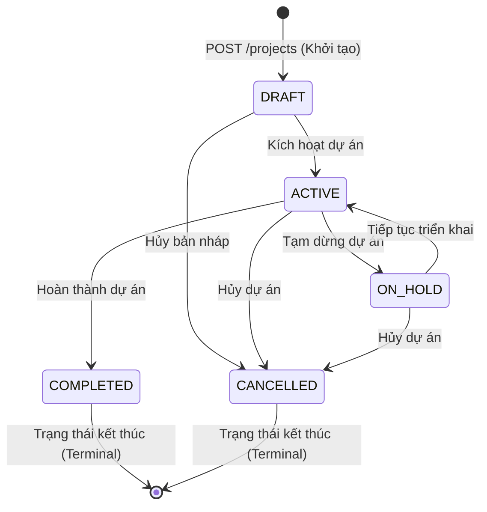
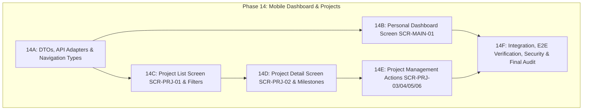

# PRE-PHASE 14 DASHBOARD & PROJECTS AUDIT
## WorkSphere Mobile Dashboard and Projects Subsystem Readiness Audit

- **Repository**: `D:\WorkSphere`
- **Audit Date**: 2026-10-19
- **Baseline Checkpoint**: `373fe31f3a86944b53da225616ff45363cd5fca8`
- **Phase 13 Mobile Authentication Status**: `IMPLEMENTED, AUDITED, HARDENED, RECONCILED, MEMORY_CHECKPOINT_CLOSED`
- **Phase 14 Mobile Dashboard and Projects Status**: `NOT STARTED (PRE-AUDIT INVENTORY)`
- **Governing Policies**: `AGENTS.md`, `D-057` (External Resource Governance), `D-060` (Multi-Agent Orchestration & Isolation)

---

## 1. Checkpoint Verification

| Thuộc tính | Trạng thái thực tế | Ghi chú |
| :--- | :--- | :--- |
| **Git Branch** | `main` | Nhánh canonical duy nhất |
| **Current HEAD** | `373fe31f3a86944b53da225616ff45363cd5fca8` | Commit đóng memory checkpoint Phase 13 |
| **Remote origin/main** | `373fe31f3a86944b53da225616ff45363cd5fca8` | Đồng bộ 100% với remote |
| **Working Tree** | Clean (`0` uncommitted, `0` untracked) | Không có tệp bị sửa đổi hoặc rác |
| **Phase 13 Baseline** | `CLOSED` | 38/38 test suites, 325/325 tests PASS, clean Android build |
| **Phase 14 Source** | `NOT STARTED` | Chưa có bất kỳ source code Phase 14 nào |

---

## 2. Canonical Scope & Roadmap Alignment

Căn cứ theo [docs/08_DEVELOPMENT_ROADMAP.md](file:///d:/WorkSphere/docs/08_DEVELOPMENT_ROADMAP.md) Mục 18, [docs/03_MOBILE_SCREEN_MAP.md](file:///d:/WorkSphere/docs/03_MOBILE_SCREEN_MAP.md) Mục 6 & 7, [design/02_SCREEN_INVENTORY.md](file:///d:/WorkSphere/design/02_SCREEN_INVENTORY.md), và [docs/06_API_CONTRACT.md](file:///d:/WorkSphere/docs/06_API_CONTRACT.md) Mục 10 & 11:

### Phân loại phạm vi triển khai:

#### A. MUST_IMPLEMENT_PHASE_14 (Phạm vi cốt lõi bắt buộc)
1. **`SCR-MAIN-01` (Dashboard Screen)**:
   - Route: `Dashboard` (Tab 1 trong `MainTabNavigator`).
   - Quyền: `AUTHENTICATED` (Tất cả người dùng đã đăng nhập).
   - API phụ thuộc: `GET /api/v1/dashboard/me`.
   - Chức năng: Thẻ số liệu tổng quan công việc (todo, inProgress, overdue), yêu cầu dịch vụ (open, inProgress, waitingForUser, resolved), dự án tham gia (active, onHold); danh sách Top 5 công việc sắp đến hạn (`upcomingTasks`); danh sách Top 5 thông báo gần nhất (`recentNotifications`); làm mới dữ liệu kéo-để-tải (`Pull-to-Refresh`).
2. **`SCR-PRJ-01` (Project List Screen)**:
   - Route: `Projects` (Tab 2 trong `MainTabNavigator`).
   - Quyền: `PROJECT_READ`.
   - API phụ thuộc: `GET /api/v1/projects`.
   - Chức năng: Danh sách phân trang 0-based; tìm kiếm thời gian thực theo tên và mã dự án (debounced search); bộ lọc trạng thái (`Tất cả`, `ACTIVE`, `DRAFT`, `ON_HOLD`, `COMPLETED`); hiển thị tiến độ %, thành viên, quản lý, hạn chót; chuyển hướng vào chi tiết dự án.
3. **`SCR-PRJ-02` (Project Detail Screen)**:
   - Route: `ProjectDetail` (Stack Screen nhận param `{ projectId: string }`).
   - Quyền: `PROJECT_READ`.
   - API phụ thuộc: `GET /api/v1/projects/{projectId}`.
   - Chức năng: Hiển thị thông tin toàn diện (mã, tên, mô tả, phòng ban, quản lý, ngày bắt đầu/kết thúc, tiến độ %, phiên bản `@Version`); danh sách mốc tiến độ (`milestones`); số lượng thành viên; các nút hành động điều hành dựa trên `allowedActions` từ backend.
4. **`SCR-PRJ-06` (Project Member List Screen)**:
   - Route: `ProjectMemberList` (`{ projectId: string }`).
   - Quyền: `PROJECT_READ`.
   - API phụ thuộc: `GET /api/v1/projects/{projectId}/members`.
   - Chức năng: Xem danh sách thành viên dự án, phân loại vai trò (`PROJECT_MANAGER`, `TEAM_LEADER`, `MEMBER`, `OBSERVER`), trạng thái hoạt động.
5. **`SCR-PRJ-08` (Milestone List Screen)**:
   - Route: `ProjectMilestoneList` (`{ projectId: string }`).
   - Quyền: `PROJECT_READ`.
   - API phụ thuộc: `GET /api/v1/projects/{projectId}/milestones`.
   - Chức năng: Xem các mốc quan trọng, hạn chót, trạng thái hoàn thành.

#### B. OPTIONAL_IF_CANONICAL / CONDITIONAL ACTIONS (Thao tác quản trị dự án dành cho PM / Admin)
1. **`SCR-PRJ-03` (Create Project Screen)**:
   - Quyền: `PROJECT_CREATE` (chỉ hiển thị cho Project Manager / Admin).
   - API: `POST /api/v1/projects` (luôn khởi tạo ở trạng thái `DRAFT`).
2. **`SCR-PRJ-04` (Edit Project Screen)**:
   - Quyền: `PROJECT_UPDATE` (và `allowedActions` chứa `UPDATE`).
   - API: `PUT /api/v1/projects/{projectId}` (Optimistic lock với `version`).
3. **`SCR-PRJ-05` (Change Project Status Modal Sheet)**:
   - Quyền: `PROJECT_UPDATE` (và `allowedActions` chứa `CHANGE_STATUS`).
   - API: `PUT /api/v1/projects/{projectId}/status` (chuyển trạng thái theo ma trận hợp lệ).
4. **`SCR-PRJ-07` (Add/Edit Project Member Sheet)**:
   - Quyền: `PROJECT_MEMBER_MANAGE` (và `allowedActions` chứa `MANAGE_MEMBERS`).
   - API: `POST` / `PUT` / `DELETE` `/api/v1/projects/{projectId}/members`.
5. **`SCR-PRJ-09` (Create Milestone Screen)**:
   - Quyền: `PROJECT_UPDATE` (và `allowedActions` chứa `CREATE_MILESTONE`).
   - API: `POST /api/v1/projects/{projectId}/milestones`.

#### C. DEFERRED (Hoãn lại có căn cứ canonical)
- `PROJECT_DASHBOARD_PROJECTION_DEFERRED`: Endpoint `GET /projects/{projectId}/dashboard` đã được hoãn chính thức từ Phase 11.
- `TASK_SCREENS_DEFERRED_TO_TASK_SUBPHASE`: Các màn hình Task (`SCR-TSK-01` đến `SCR-TSK-06`) thuộc phân hệ Task Module, tách biệt rõ ràng với Dashboard và Project Module.

#### D. PHASE_15_OR_LATER (Phân hệ giai đoạn sau)
- Service Request Module (`SCR-SRV-01` .. `06`) $\rightarrow$ Phase 15.
- Asset Module (`SCR-AST-01` .. `06`) $\rightarrow$ Phase 15.
- Notification Full Management (`SCR-NOT-01`) $\rightarrow$ Phase 15.

---

## 3. Screen Inventory & Navigation Architecture

| Mã Màn hình | Tên Màn hình / UI Artifact | Navigator Phụ Trách | Route Name | Route Params | Quyền Hạn | Trạng thái Backend |
| :--- | :--- | :--- | :--- | :--- | :--- | :---: |
| `SCR-MAIN-01` | Dashboard Screen | `MainTabNavigator` | `Dashboard` | `undefined` | `AUTHENTICATED` | `READY` (`GET /dashboard/me`) |
| `SCR-PRJ-01` | Project List Screen | `MainTabNavigator` | `Projects` | `undefined` | `PROJECT_READ` | `READY` (`GET /projects`) |
| `SCR-PRJ-02` | Project Detail Screen | `MainTabNavigator` (Hidden Tab/Stack) | `ProjectDetail` | `{ projectId: string }` | `PROJECT_READ` | `READY` (`GET /projects/{id}`) |
| `SCR-PRJ-03` | Create Project Screen | `MainTabNavigator` (Hidden Tab/Stack) | `CreateProject` | `undefined` | `PROJECT_CREATE` | `READY` (`POST /projects`) |
| `SCR-PRJ-04` | Edit Project Screen | `MainTabNavigator` (Hidden Tab/Stack) | `EditProject` | `{ projectId: string }` | `PROJECT_UPDATE` | `READY` (`PUT /projects/{id}`) |
| `SCR-PRJ-05` | Change Status Modal | Bottom Sheet Modal | *Modal Component* | `{ projectId: string, currentStatus: string, version: number }` | `PROJECT_UPDATE` | `READY` (`PUT /projects/{id}/status`) |
| `SCR-PRJ-06` | Project Member List | `MainTabNavigator` (Hidden Tab/Stack) | `ProjectMembers` | `{ projectId: string }` | `PROJECT_READ` | `READY` (`GET /projects/{id}/members`) |
| `SCR-PRJ-07` | Add Member Sheet | Bottom Sheet Modal | *Modal Component* | `{ projectId: string }` | `PROJECT_MEMBER_MANAGE` | `READY` (`POST /projects/{id}/members`) |
| `SCR-PRJ-08` | Milestone List Screen | `MainTabNavigator` (Hidden Tab/Stack) | `ProjectMilestones` | `{ projectId: string }` | `PROJECT_READ` | `READY` (`GET /projects/{id}/milestones`) |
| `SCR-PRJ-09` | Create Milestone Screen | `MainTabNavigator` (Hidden Tab/Stack) | `CreateMilestone` | `{ projectId: string }` | `PROJECT_UPDATE` | `READY` (`POST /projects/{id}/milestones`) |

> [!IMPORTANT]
> **Quy tắc điều hướng canonical (Coding Standards Rule 19.5)**:
> Route params tuyệt đối chỉ chứa ID tối thiểu (`projectId: string`). Cấm truyền nguyên đối tượng Project qua navigation params nhằm triệt tiêu lỗi serialization, ngăn chặn dữ liệu stale và hỗ trợ deep linking chuẩn xác.

---

## 4. Dashboard Contract & Backend Inventory

### 4.1. Endpoint Khảo Sát
- **HTTP Method**: `GET`
- **Path**: `/api/v1/dashboard/me` (Context path: `/api/v1`, Controller: `@RequestMapping("/api/v1/dashboard")`, Method: `@GetMapping("/me")`).
- **Controller**: `com.worksphere.dashboard.web.DashboardController`
- **Application Service**: `com.worksphere.dashboard.application.DashboardApplicationService`
- **Persistence Repository**: `com.worksphere.dashboard.infrastructure.persistence.DashboardQueryRepository`
- **Quyền yêu cầu**: `@PreAuthorize("isAuthenticated()")`
- **Trạng thái triển khai**: `EXISTING_API` (Đã hoàn thiện và kiểm toán tại Phase 11, 5/5 MockMvc tests PASS).

### 4.2. Cấu Trúc Payload & Phân Tích Nullability
Response bọc trong phong bì chuẩn `ApiResponse<PersonalDashboardResponse>`:
```json
{
  "success": true,
  "data": {
    "tasks": {
      "todo": 5,
      "inProgress": 3,
      "inReview": 1,
      "completed": 12,
      "overdue": 2,
      "dueSoon": 3
    },
    "serviceRequests": {
      "open": 2,
      "inProgress": 1,
      "waitingForUser": 0,
      "resolved": 3
    },
    "projects": {
      "active": 3,
      "onHold": 1
    },
    "upcomingTasks": [
      {
        "id": "UUID",
        "projectId": "UUID",
        "projectName": "WorkSphere Mobile App",
        "title": "Hoàn thiện màn hình Dashboard",
        "status": "IN_PROGRESS",
        "priority": "HIGH",
        "dueDate": "2026-10-18T17:00:00Z"
      }
    ],
    "recentNotifications": [
      {
        "id": "UUID",
        "type": "TASK_ASSIGNED",
        "title": "Bạn được giao công việc mới",
        "message": "Xây dựng màn hình đăng nhập",
        "referenceType": "TASK",
        "referenceId": "UUID",
        "read": false,
        "createdAt": "2026-10-16T14:30:00Z"
      }
    ]
  },
  "message": null,
  "timestamp": "2026-10-19T08:30:00Z",
  "traceId": "string"
}
```

### 4.3. Các Đặc Điểm Nghiệp Vụ Của Dashboard
1. **Phạm vi cá nhân tuyệt đối**:
   - `tasks`: Chỉ đếm task mà người dùng hiện tại có phân công hoạt động (`task_assignments.is_active = TRUE`) và chưa bị xóa mềm.
   - `serviceRequests`: Chỉ đếm yêu cầu do người dùng tạo HOẶC đang được phân công xử lý trực tiếp (`COUNT(DISTINCT sr.id)` không trùng).
   - `projects`: Chỉ đếm dự án mà người dùng là thành viên hoạt động (`project_members.is_active = TRUE`). ADMIN tại `/dashboard/me` không bypass quy tắc này.
2. **Quy tắc thời gian (Time Policy)**:
   - Sử dụng `java.time.Clock` tiêm phụ thuộc; `now` lấy tại thời điểm request.
   - `overdue`: `due_date < now` và `status NOT IN ('COMPLETED', 'CANCELLED')`.
   - `dueSoon`: `now <= due_date < now + 72 hours` và `status NOT IN ('COMPLETED', 'CANCELLED')`.
3. **Hiệu năng & Aggregation**:
   - Backend sử dụng câu lệnh native query gom nhóm trong một transaction read-only.
   - Mobile **không cần thực hiện tính toán tổng hợp (client aggregation)** hay tải danh sách lớn để đếm thủ công.
4. **Kết luận Gap**: `DASHBOARD_API_GAP = NONE`.

---

## 5. Project API Matrix & Backend Inventory

Toàn bộ API thuộc phân hệ Project đã được cài đặt đầy đủ trong `com.worksphere.project.web.ProjectController`:

| # | Endpoint | Method | Quyền yêu cầu | Input DTO | Output DTO | Optimistic Lock | Trạng thái |
| :---: | :--- | :---: | :--- | :--- | :--- | :---: | :---: |
| 1 | `/api/v1/projects` | `GET` | `PROJECT_READ` | Query params (page, size, sort, search, status, priority, managerId, departmentId) | `ApiResponse<PagedData<ProjectSummaryResponse>>` | Không | `EXISTING_API` |
| 2 | `/api/v1/projects` | `POST` | `PROJECT_CREATE` | `CreateProjectRequest` | `ApiResponse<ProjectDetailResponse>` (Status luôn là `DRAFT`) | Không | `EXISTING_API` |
| 3 | `/api/v1/projects/{projectId}` | `GET` | `PROJECT_READ` | Path param `{projectId}` | `ApiResponse<ProjectDetailResponse>` (Gồm `allowedActions`, `milestones`, `version`) | Không | `EXISTING_API` |
| 4 | `/api/v1/projects/{projectId}` | `PUT` | `PROJECT_UPDATE` | `UpdateProjectRequest` | `ApiResponse<ProjectDetailResponse>` | **Có** (`version`) | `EXISTING_API` |
| 5 | `/api/v1/projects/{projectId}/status` | `PUT` | `PROJECT_UPDATE` | `ChangeProjectStatusRequest` (`status`, `reason`, `version`) | `ApiResponse<ProjectDetailResponse>` | **Có** (`version`) | `EXISTING_API` |
| 6 | `/api/v1/projects/{projectId}/members` | `GET` | `PROJECT_READ` | Path `{projectId}`, Query (page, size, role, active) | `ApiResponse<PagedData<ProjectMemberResponse>>` | Không | `EXISTING_API` |
| 7 | `/api/v1/projects/{projectId}/members` | `POST` | `PROJECT_MEMBER_MANAGE`| `AddProjectMemberRequest` (`userId`, `projectRole`) | `ApiResponse<ProjectMemberResponse>` | Không | `EXISTING_API` |
| 8 | `/api/v1/projects/{projectId}/members/{memberId}` | `PUT` | `PROJECT_MEMBER_MANAGE`| `UpdateProjectMemberRoleRequest` (`projectRole`) | `ApiResponse<ProjectMemberResponse>` | Không | `EXISTING_API` |
| 9 | `/api/v1/projects/{projectId}/members/{memberId}` | `DELETE` | `PROJECT_MEMBER_MANAGE`| Path `{projectId}`, `{memberId}` | `ApiResponse<Void>` (`successNoContent`) | D-013 Guard | `EXISTING_API` |
| 10 | `/api/v1/projects/{projectId}/milestones` | `POST` | `PROJECT_UPDATE` | `CreateMilestoneRequest` (`name`, `description`, `dueDate`) | `ApiResponse<MilestoneResponse>` | Không | `EXISTING_API` |
| 11 | `/api/v1/projects/{projectId}/milestones` | `GET` | `PROJECT_READ` | Path `{projectId}` | `ApiResponse<List<MilestoneResponse>>` | Không | `EXISTING_API` |

---

## 6. Project List Pagination Contract

### 6.1. Chi Tiết Hợp Đồng Phân Trang Backend
Căn cứ `com.worksphere.shared.response.PagedData`:
- **Chỉ số trang (Page Indexing)**: **0-based** (`page = 0` là trang đầu tiên).
- **Kích thước trang mặc định (Default Size)**: `20` (`size = 20`).
- **Kích thước trang tối đa (Max Size)**: `100`.
- **Cấu trúc trường trong DTO**:
  - `items`: Mảng phần tử kiểu `T[]` (không dùng tên `content`).
  - `page`: Số trang hiện tại (`int`, 0-based).
  - `size`: Số phần tử trên mỗi trang (`int`).
  - `totalItems`: Tổng số phần tử (`long`).
  - `totalPages`: Tổng số trang (`int`).
  - `hasNext`: Cờ có trang tiếp theo (`boolean`).
  - `hasPrevious`: Cờ có trang trước đó (`boolean`).

### 6.2. Đối Soát Với Mobile Shared Type
Tệp [mobile/src/shared/api/apiTypes.ts](file:///d:/WorkSphere/mobile/src/shared/api/apiTypes.ts) đã định nghĩa hoàn toàn đồng nhất:
```typescript
export interface PagedData<T> {
  items: T[];
  page: number;
  size: number;
  totalItems: number;
  totalPages: number;
  hasNext: boolean;
  hasPrevious: boolean;
}
```
$\rightarrow$ **Kết luận**: Hợp đồng phân trang hoàn toàn khớp, không cần sửa đổi backend và không phát sinh gap.

---

## 7. Search, Filter & Sort Strategy

### 7.1. Tìm Kiếm (Search)
- **Cơ chế**: Server-side search.
- **Query Parameter**: `search` (ví dụ: `/projects?search=WorkSphere`).
- **Hành vi Backend**: `projectRepository.searchProjects` thực hiện truy vấn case-insensitive `LOWER(p.name) LIKE LOWER(:search) OR LOWER(p.code) LIKE LOWER(:search)` với parameter binding an toàn.
- **Mobile Strategy**: Tái sử dụng `SearchBar` component; áp dụng debounce 350ms bằng `useRef` + `setTimeout` (không cài thêm thư viện lodash); khi từ khóa thay đổi, reset trang về `0`.

### 7.2. Lọc Dữ Liệu (Filter)
- **Status Filter**: Query param `status` (`DRAFT`, `ACTIVE`, `ON_HOLD`, `COMPLETED`, `CANCELLED`).
- **Priority Filter**: Query param `priority` (`LOW`, `MEDIUM`, `HIGH`, `CRITICAL`).
- **Department Filter**: Query param `departmentId` (UUID).
- **Manager Filter**: Query param `managerId` (UUID).
- **Mobile Strategy**: Hiển thị thanh cuộn ngang Filter Chips (`Tất cả`, `Đang thực hiện`, `Bản nháp`, `Tạm dừng`, `Hoàn thành`). Khi chọn chip mới, reset page về `0`.

### 7.3. Sắp Xếp (Sorting)
- **Query Parameter**: `sort=property,direction` (ví dụ: `sort=createdAt,desc`).
- **Whitelist trường sắp xếp tại Backend**:
  `createdAt`, `name`, `code`, `startDate`, `plannedEndDate`, `priority`, `status`.
- **Mặc định**: `createdAt,desc`.
- **Mobile Strategy**: Không cho phép client gửi các trường nằm ngoài danh sách whitelist trên.

---

## 8. Project Detail Inventory & Field Mapping

| Trường Trong Canonical UI | Backend DTO Field | Kiểu Dữ Liệu | Khả Dụng | Ghi Chú |
| :--- | :--- | :--- | :---: | :--- |
| **Mã dự án** | `code` | `String` | `AVAILABLE` | Ví dụ: "WS-2026-001" |
| **Tên dự án** | `name` | `String` | `AVAILABLE` | 3 - 200 ký tự |
| **Mô tả** | `description` | `String` | `AVAILABLE` | Nullable |
| **Trạng thái** | `status` | `ProjectStatus` | `AVAILABLE` | Render bằng `StatusBadge` |
| **Độ ưu tiên** | `priority` | `ProjectPriority` | `AVAILABLE` | Render bằng `PriorityBadge` |
| **Quản lý dự án** | `manager` | `ManagerDetail` | `AVAILABLE` | Chứa `id`, `fullName`, `avatarUrl` |
| **Phòng ban** | `department` | `DepartmentDetail` | `AVAILABLE` | Chứa `id`, `code`, `name` |
| **Ngày bắt đầu** | `startDate` | `LocalDate` | `AVAILABLE` | ISO-8601 YYYY-MM-DD |
| **Ngày kết thúc dự kiến**| `plannedEndDate` | `LocalDate` | `AVAILABLE` | ISO-8601 YYYY-MM-DD |
| **Ngày kết thúc thực tế** | `actualEndDate` | `LocalDate` | `AVAILABLE` | Nullable |
| **Tiến độ %** | `progressPercent` | `BigDecimal` | `AVAILABLE` | Hiển thị dạng ProgressBar + Text |
| **Số lượng thành viên** | `memberCount` | `long` | `AVAILABLE` | Số lượng thành viên active |
| **Mốc tiến độ** | `milestones` | `List<MilestoneResponse>` | `AVAILABLE` | Danh sách mốc sắp xếp theo dueDate ASC |
| **Công việc gần đây** | `recentTasks` | `List<Object>` | `DEFERRED` | Trả `[]` (Task module thuộc Phase 7+) |
| **Quyền thao tác** | `allowedActions` | `Set<String>` | `AVAILABLE` | `UPDATE`, `MANAGE_MEMBERS`, `CHANGE_STATUS`, `CREATE_TASK`, `CREATE_MILESTONE` |
| **Phiên bản khóa lạc quan** | `version` | `Long` | `AVAILABLE` | Dùng gửi kèm khi PUT để bắt `OPTIMISTIC_LOCK_CONFLICT` |
| **Thời gian tạo / sửa** | `createdAt`, `updatedAt` | `Instant` | `AVAILABLE` | ISO-8601 UTC |

$\rightarrow$ **Kết luận**: Mọi trường giao diện thiết yếu của Project Detail đều sẵn sàng 100%.

---

## 9. Project Status Model & Allowed Transitions

Căn cứ `com.worksphere.project.domain.Project.changeStatus`:



### Chi Tiết Ma Trận Trạng Thái:
1. **`DRAFT` (Bản nháp)**:
   - Màu giao diện: Info / Xanh lam (`infoContainer`, `#0284C7`).
   - Chuyển tiếp hợp lệ: `ACTIVE`, `CANCELLED`.
   - Cấm chuyển trực tiếp sang `COMPLETED` hay `ON_HOLD`.
2. **`ACTIVE` (Đang thực hiện)**:
   - Màu giao diện: Success / Xanh lá (`successContainer`, `#16A34A`).
   - Chuyển tiếp hợp lệ: `ON_HOLD`, `COMPLETED`, `CANCELLED`.
3. **`ON_HOLD` (Tạm dừng)**:
   - Màu giao diện: Warning / Vàng cam (`warningContainer`, `#D97706`).
   - Chuyển tiếp hợp lệ: `ACTIVE`, `CANCELLED`.
4. **`COMPLETED` (Hoàn thành)**:
   - Màu giao diện: Success đậm (`#047857`).
   - **Terminal State**: Cấm mọi chuyển đổi trạng thái khi đã COMPLETED (`PROJECT_ALREADY_COMPLETED`, HTTP 422/400).
5. **`CANCELLED` (Đã hủy)**:
   - Màu giao diện: Error / Đỏ (`errorContainer`, `#DC2626`).
   - **Terminal State**: Cấm mọi chuyển đổi trạng thái khi đã CANCELLED (`PROJECT_ALREADY_CANCELLED`, HTTP 422/400).

---

## 10. Role & Permission Matrix

Căn cứ các bản di trú CSDL `V011`, `V014`, `V015` và code `ProjectApplicationService`:

| Quyền Hạn (Authority) | EMPLOYEE | TEAM_LEADER | PROJECT_MANAGER | ADMIN | Logic Kiểm Tra Bổ Sung Tại Backend |
| :--- | :---: | :---: | :---: | :---: | :--- |
| **`PROJECT_READ`** | Có | Có | Có | Có | Scoped: Người dùng chỉ thấy dự án mình là thành viên (`is_active = true`); ADMIN thấy toàn bộ dự án. |
| **`PROJECT_CREATE`** | Không | Không | **Có** | **Có** | Phân quyền mức hệ thống (System Authority). Người tạo tự động trở thành PM của dự án. |
| **`PROJECT_UPDATE`** | Không | Không | **Có** | **Có** | Kiểm tra quyền sở hữu: Phải là Project Manager của chính dự án đó hoặc ADMIN. |
| **`PROJECT_MEMBER_MANAGE`** | Không | Không | **Có** | **Có** | Bảo vệ D-013: Cấm xóa hoặc giáng cấp Project Manager duy nhất còn lại (`PROJECT_MANAGER_REQUIRED`). |

> [!NOTE]
> **Rào chắn giao diện mobile**:
> Mobile sử dụng `allowedActions` được backend trả về trực tiếp trong `ProjectDetailResponse` để ẩn/hiện nút "Chỉnh sửa", "Đổi trạng thái", "Thêm thành viên". Nếu người dùng cố tình gửi request vượt quyền, backend từ chối với HTTP 403 `FORBIDDEN` hoặc HTTP 422.

---

## 11. Mobile Foundation Reuse Map

| Thành Phần Hiện Hữu | Vị Trí Mã Nguồn | Đánh Giá Tái Sử Dụng | Ứng Dụng Trong Phase 14 |
| :--- | :--- | :---: | :--- |
| `apiClient` | `shared/api/apiClient.ts` | **`REUSE_AS_IS`** | Gọi toàn bộ API Dashboard & Project; tự động gắn Bearer Token và điều phối single-flight refresh khi token hết hạn. |
| `isApiResponse`, `unwrapApiResponse` | `shared/api/apiEnvelope.ts` | **`REUSE_AS_IS`** | Mở phong bì chuẩn `ApiResponse<T>`, trích xuất dữ liệu an toàn, chuyển đổi lỗi nghiệp vụ. |
| `PagedData<T>`, `PageRequest` | `shared/api/apiTypes.ts` | **`REUSE_AS_IS`** | Định nghĩa cấu trúc phân trang 0-based đồng nhất cho Project List và Member List. |
| `AppButton` | `shared/components/AppButton.tsx` | **`REUSE_AS_IS`** | Nút bấm thao tác (Làm mới, Thử lại, Tạo dự án, Lưu cập nhật, Đổi trạng thái). |
| `AppTextInput` | `shared/components/AppTextInput.tsx` | **`REUSE_AS_IS`** | Các ô nhập biểu mẫu tạo/sửa dự án và lý do chuyển trạng thái. |
| `SearchBar` | `shared/components/SearchBar.tsx` | **`REUSE_AS_IS`** | Ô tìm kiếm thời gian thực trên danh sách dự án với nút xóa nhanh và touch target 48dp. |
| `StatusBadge` | `shared/components/StatusBadge.tsx` | **`REUSE_AS_IS`** | Hiển thị badge trạng thái dự án (`DRAFT`, `ACTIVE`, `ON_HOLD`, `COMPLETED`, `CANCELLED`). |
| `PriorityBadge` | `shared/components/PriorityBadge.tsx` | **`REUSE_AS_IS`** | Hiển thị badge độ ưu tiên dự án (`LOW`, `MEDIUM`, `HIGH`, `CRITICAL`). |
| `LoadingIndicator` | `shared/components/LoadingIndicator.tsx` | **`REUSE_AS_IS`** | Hiển thị trạng thái đang tải toàn màn hình hoặc inline spinner khi tải thêm trang. |
| `ErrorState` | `shared/components/ErrorState.tsx` | **`REUSE_AS_IS`** | Hiển thị lỗi tải dữ liệu kèm nút "Thử lại" và `traceId`. |
| `EmptyState` | `shared/components/EmptyState.tsx` | **`REUSE_AS_IS`** | Hiển thị khi danh sách dự án rỗng hoặc không có kết quả tìm kiếm. |
| `ConfirmationDialog` | `shared/components/ConfirmationDialog.tsx` | **`REUSE_AS_IS`** | Hộp thoại xác nhận trước khi hủy dự án hoặc xóa thành viên. |
| `ThemeProvider` | `app/providers/ThemeProvider.tsx` | **`REUSE_AS_IS`** | Màu sắc ngữ nghĩa, typography, spacing, border radii chuẩn hóa. |
| `AuthProvider` | `app/auth/` | **`REUSE_AS_IS`** | Lấy thông tin `currentUser` để chào mừng trên Dashboard và kiểm tra vai trò người dùng. |
| `ProjectCard` | *Chưa có* | **`NEW_FEATURE_COMPONENT`** | Thành phần thẻ dự án hiển thị mã, tên, badge, progress bar, hạn chót và thành viên. |
| `MetricCard` | *Chưa có* | **`NEW_FEATURE_COMPONENT`** | Thành phần thẻ số liệu hiển thị tóm tắt công việc/yêu cầu/dự án trên Dashboard. |

---

## 12. External Reuse & Governance (Tuân thủ D-057)

- **Nguyên tắc**: Tối đa hóa tái sử dụng mã nguồn và pattern nội bộ hiện có; không thêm thư viện ngoài khi các công cụ có sẵn đủ đáp ứng.
- **Tài nguyên xem xét**:
  1. *React Native FlatList Official Guide* (`Tier 1`): Tham khảo cơ chế tối ưu danh sách dài (`keyExtractor`, `initialNumToRender`, `maxToRenderPerBatch`, `windowSize`, `onEndReachedThreshold: 0.5`).
  2. *Axios Official Request Cancellation* (`Tier 1`): Tham khảo cơ chế `AbortController` tích hợp sẵn trong Axios $\ge 0.22.0$ (dự án dùng Axios `^1.20.0`).
- **Quyết định**: Không cài đặt thư viện mới (không React Query, không SWR, không Lodash). Không clone mã nguồn ngoài vào WorkSphere.

---

## 13. Data Fetching & Concurrency Strategy

### 13.1. Kiến Trúc Data Fetching
- Sử dụng React custom hooks kết hợp `useEffect`, `useCallback`, `useState`, `useRef`.
- Tách biệt rõ ràng 3 lớp theo chuẩn kiến trúc:
  - **API Adapter Layer** (`features/projects/api/projectApi.ts`, `features/dashboard/api/dashboardApi.ts`): Giao tiếp HTTP thuần túy với `apiClient`.
  - **Hook / State Layer** (`useProjects`, `useDashboard`, `useProjectDetail`): Quản lý vòng đời dữ liệu, phân trang, caching trong component, và xử lý concurrency.
  - **Presentation Layer** (`DashboardScreen`, `ProjectsScreen`, `ProjectDetailScreen`): Nhận props/state và render giao diện.

### 13.2. Chiến Lược Xử Lý Stale Request & Race Conditions
Trong các màn hình tìm kiếm, lọc và phân trang, người dùng thao tác liên tục có thể gây ra race condition (request gửi trước về sau request gửi sau).
- **Giải pháp áp dụng**: **Generation Counter Pattern (Latest-Request-Wins)** kết hợp `isMounted` flag:
  ```typescript
  const fetchGenerationRef = useRef(0);

  const fetchProjects = useCallback(async (params, reset = false) => {
    const currentGen = ++fetchGenerationRef.current;
    setLoading(true);
    try {
      const pagedData = await projectApi.getProjects(params);
      if (currentGen !== fetchGenerationRef.current) {
        // Bỏ qua response cũ do đã có request mới hơn được phát hành
        return;
      }
      setProjects((prev) => (reset ? pagedData.items : deduplicateById([...prev, ...pagedData.items])));
      setHasNext(pagedData.hasNext);
      setPage(pagedData.page);
    } catch (err) {
      if (currentGen !== fetchGenerationRef.current) return;
      setError(mapApiError(err));
    } finally {
      if (currentGen === fetchGenerationRef.current) {
        setLoading(false);
      }
    }
  }, []);
  ```
- **Deduplication Invariant**: Khi nối các trang (`append`), luôn deduplicate theo `item.id` để bảo vệ danh sách không bị trùng lặp phần tử nếu dữ liệu database có sự dịch chuyển trong lúc phân trang.

---

## 14. UX States & Error Mapping

Mỗi màn hình trong Phase 14 phải hỗ trợ đầy đủ 6 trạng thái giao diện:

| Trạng Thái | Biểu Hiện Dashboard | Biểu Hiện Project List | Biểu Hiện Project Detail |
| :--- | :--- | :--- | :--- |
| **Loading (Initial)** | Skeleton card / LoadingIndicator toàn màn hình | Skeleton list items nhấp nháy hoặc spinner trung tâm | Spinner toàn màn hình kèm thông điệp "Đang tải dự án..." |
| **Success** | Hiển thị metric cards, upcoming tasks và recent notifications | Render FlatList danh sách các `ProjectCard` | Hiển thị toàn bộ thông tin chi tiết, milestones và nút hành động |
| **Empty** | `EmptyState`: "Hôm nay bạn không có công việc hoặc thông báo nào cần xử lý." | `EmptyState`: "Không tìm thấy dự án nào phù hợp với bộ lọc." | Không áp dụng (Detail luôn có dữ liệu nếu ID hợp lệ) |
| **Error (Initial)** | `ErrorState` báo lỗi tải bảng điều khiển kèm nút "Thử lại" | `ErrorState` báo lỗi tải danh sách kèm nút "Thử lại" | `ErrorState` báo lỗi (hoặc component Không tìm thấy dự án) |
| **Refreshing** | Spinner xoay tại đầu trang (`Pull-to-Refresh`) | Spinner xoay tại đầu FlatList (`refreshing={isRefreshing}`) | Kéo xuống để tải lại chi tiết và mốc tiến độ |
| **Loading More** | Không áp dụng (Dashboard không phân trang) | Spinner nhỏ tại chân danh sách (`ListFooterComponent`) | Không áp dụng (Detail không phân trang) |

### Xử Lý Mã Lỗi HTTP Chuyên Biệt:
- **`401 Unauthorized`**: Xử lý tự động bởi `apiClient` interceptor (single-flight refresh hoặc điều hướng về Login).
- **`403 Forbidden`**: Hiển thị thông báo "Bạn không có quyền truy cập dữ liệu dự án này."
- **`404 Not Found`**: Hiển thị "Dự án không tồn tại hoặc đã bị xóa."
- **`409 Conflict (OPTIMISTIC_LOCK_CONFLICT)`**: Hiển thị "Dữ liệu dự án đã bị cập nhật bởi người khác. Vui lòng làm mới để lấy phiên bản mới nhất." kèm nút "Tải lại dữ liệu".
- **`422 Unprocessable Entity`**: Hiển thị lỗi nghiệp vụ vi phạm workflow (ví dụ: chuyển trạng thái sai, xóa PM cuối cùng).
- **`Network Error`**: Hiển thị "Không thể kết nối đến máy chủ. Vui lòng kiểm tra đường truyền." kèm nút thử lại.

---

## 15. Accessibility & Performance Evaluation

### 15.1. Khả Năng Tiếp Cận (Accessibility)
- **Kích thước vùng bấm (Touch Target)**: Mọi thẻ dự án, nút lọc, nút bấm, ô nhập liệu đều đạt tối thiểu $48\text{dp} \times 48\text{dp}$ (`theme.minTouchTarget`).
- **Semantic Roles**:
  - Tiêu đề màn hình: `accessibilityRole="header"`.
  - Ô tìm kiếm: `accessibilityRole="search"`.
  - Nút bấm hành động: `accessibilityRole="button"`.
  - Thông báo lỗi: `accessibilityRole="alert"`.
  - Trạng thái bận: `accessibilityState={{ busy: true }}`.
- **Accessibility Labels**: Cung cấp nhãn mô tả rõ ràng cho Screen Readers (ví dụ: "Dự án: WorkSphere Mobile, Mã: WS-2026-001, Trạng thái: Đang thực hiện, Tiến độ 42.5%").

### 15.2. Hiệu Năng (Performance)
- **Tối ưu danh sách dài**: Cấu hình FlatList hợp lý (`initialNumToRender={8}`, `maxToRenderPerBatch={10}`, `windowSize={5}`, `removeClippedSubviews={true}`).
- **Tránh Render Lại Vô Ích**: Sử dụng `React.memo` cho `ProjectCard` và `MetricCard`; memoize hàm `renderItem` bằng `useCallback`.
- **Tránh Lồng ScrollView**: Tuyệt đối không lồng FlatList bên trong một ScrollView cùng chiều dọc; sử dụng `ListHeaderComponent` của FlatList để render các khối tiêu đề/bộ lọc nếu cần.

---

## 16. Security & Privacy Review

- **Quản lý Token**: Toàn bộ access token được lưu trữ duy nhất trong bộ nhớ tạm (`accessTokenStore`), không rò rỉ ra state component hay log.
- **Không rò rỉ ID nội bộ**: Giao diện chỉ hiển thị mã dự án nghiệp vụ (`code`), không hiển thị UUID cơ sở dữ liệu trên thẻ danh sách.
- **Bảo mật phân quyền**:
  - Mobile chỉ ẩn/hiện nút dựa trên `allowedActions` và vai trò để nâng cao trải nghiệm người dùng.
  - Backend là nơi thực thi kiểm soát truy cập tối cao; mọi request đều được kiểm tra `@PreAuthorize` và xác thực quyền sở hữu.
- **Phiên đăng xuất (Logout Isolation)**: Khi đăng xuất, AuthProvider chuyển trạng thái về `UNAUTHENTICATED`, RootNavigator tự động gỡ bỏ toàn bộ cây `MainTabNavigator` khỏi bộ nhớ, đảm bảo không còn dữ liệu dự án/dashboard nào lưu lại trong session.

---

## 17. Test Inventory & Coverage Strategy

### 17.1. Backend Coverage Hiện Tại
- `ProjectMockMvcTest.java`: 659 dòng, kiểm thử toàn diện mọi luồng Project (Tạo dự án, Tìm kiếm, Phân trang, Cập nhật, Khóa lạc quan, Chuyển trạng thái, Thành viên, Quyền PM, Milestones).
- `DashboardMockMvcTest.java`: Kiểm thử `GET /dashboard/me` (5/5 PASS).

### 17.2. Kế Hoạch Kiểm Thử Mobile Phase 14
Cần xây dựng tối thiểu các bộ kiểm thử đơn vị và tích hợp component:
1. **API & Adapter Tests**:
   - `dashboardApi.test.ts`: Kiểm thử lấy dữ liệu bảng điều khiển, ánh xạ DTO, unwrap envelope.
   - `projectApi.test.ts`: Kiểm thử danh sách phân trang, tìm kiếm, chi tiết dự án, tạo/sửa dự án, chuyển trạng thái, thành viên.
2. **Dashboard Component Tests**:
   - `DashboardScreen.test.tsx`: Kiểm thử render trạng thái loading, success với các summary cards, empty state, error state, pull-to-refresh, chuyển hướng khi chạm vào task.
3. **Project List Component Tests**:
   - `ProjectsScreen.test.tsx`: Kiểm thử nạp dữ liệu ban đầu, phân trang cuộn xuống (load more), tìm kiếm debounced, chọn filter chip, empty filter result, pull-to-refresh.
4. **Project Detail Component Tests**:
   - `ProjectDetailScreen.test.tsx`: Kiểm thử nạp dữ liệu chi tiết bằng ID, render badges, hiển thị danh sách milestones, ẩn/hiện nút hành động theo `allowedActions`.
5. **Project Management Tests**:
   - `CreateProjectScreen.test.tsx`: Biểu mẫu tạo dự án, validation, gửi request thành công.
   - `ChangeProjectStatusModal.test.tsx`: Kiểm thử ma trận trạng thái hợp lệ, nhập lý do, xử lý Optimistic Lock 409.

---

## 18. Gap Classification Matrix

| Mã Gap Token | Phân Loại | Trạng Thái | Đánh Giá Tác Động & Hướng Xử Lý |
| :--- | :---: | :---: | :--- |
| `DASHBOARD_API_GAP` | - | **RESOLVED / NONE** | `GET /api/v1/dashboard/me` đã hoàn thiện và kiểm thử tại Phase 11. |
| `PROJECT_LIST_API_GAP` | - | **RESOLVED / NONE** | `GET /api/v1/projects` đầy đủ chức năng tìm kiếm, lọc, phân trang. |
| `PROJECT_DETAIL_API_GAP` | - | **RESOLVED / NONE** | `GET /api/v1/projects/{projectId}` đầy đủ dữ liệu và `allowedActions`. |
| `PROJECT_PERMISSION_CONTRACT_GAP`| - | **RESOLVED / NONE** | Phân quyền CSDL và bảo vệ nghiệp vụ (`PROJECT_READ/CREATE/UPDATE/MANAGE`) hoàn thiện. |
| `PROJECT_PAGINATION_CONTRACT_GAP`| - | **RESOLVED / NONE** | Phân trang 0-based của `PagedData` khớp 100% giữa Spring Boot và React Native. |
| `PROJECT_STATUS_CONTRACT_GAP` | - | **RESOLVED / NONE** | `ProjectStatus` enum khớp tuyệt đối với 5 trạng thái và `StatusBadge`. |
| `PROJECT_DASHBOARD_PROJECTION_DEFERRED` | DEFERRED | **DEFERRED (CANONICAL)** | `GET /projects/{projectId}/dashboard` hoãn theo API contract Phase 11. |
| `MOBILE_PROJECT_NAVIGATION_GAP` | INFORMATIONAL | **PLANNED FOR 14A/14D** | Cần bổ sung route `ProjectDetail: { projectId: string }` vào navigation types. |
| `MOBILE_PROJECT_COMPONENT_GAP` | INFORMATIONAL | **PLANNED FOR 14B/14C** | Cần tạo mới `ProjectCard.tsx` và `MetricCard.tsx` phục vụ hiển thị. |

$\rightarrow$ **Kết luận**: **KHÔNG CÓ BLOCKING GAP**. Toàn bộ hợp đồng API, cơ sở dữ liệu và hạ tầng mobile đã sẵn sàng 100%.

---

## 19. Proposed Phase 14 Subphase Implementation Plan

Dựa trên kết quả khảo sát thực tế, lộ trình triển khai Phase 14 được chia thành 6 subphases nguyên tử:



### Chi Tiết Từng Subphase:
1. **Subphase 14A: DTOs, API Adapters, Error Mappers & Navigation Typing**:
   - Mục tiêu: Xây dựng các kiểu dữ liệu TypeScript, type guards, API adapters cho Dashboard và Projects; cập nhật navigation types với route params chuẩn.
   - Tệp được phép sửa/tạo: `mobile/src/features/dashboard/api/*`, `mobile/src/features/projects/api/*`, `mobile/src/app/navigation/types.ts`.
   - Unit tests: Kiểm thử độc lập API adapters và mappers với Jest.
2. **Subphase 14B: Personal Dashboard Screen (`SCR-MAIN-01`)**:
   - Mục tiêu: Thay thế Placeholder Dashboard bằng giao diện thật; tích hợp `GET /dashboard/me`; hiển thị các metric summary cards; danh sách Top 5 công việc sắp đến hạn; danh sách thông báo gần nhất; pull-to-refresh.
   - Tệp được phép: `mobile/src/features/dashboard/*`.
   - Unit tests: `DashboardScreen.test.tsx` (kiểm thử mọi trạng thái giao diện).
3. **Subphase 14C: Project List Screen (`SCR-PRJ-01`) & Search/Filter/Pagination**:
   - Mục tiêu: Thay thế Placeholder Projects bằng danh sách dự án thật; tích hợp `GET /projects`; phân trang 0-based `onEndReached`; tìm kiếm debounced; lọc theo trạng thái; thẻ `ProjectCard`.
   - Tệp được phép: `mobile/src/features/projects/screens/ProjectsScreen.tsx`, `mobile/src/features/projects/components/ProjectCard.tsx`.
   - Unit tests: `ProjectsScreen.test.tsx`.
4. **Subphase 14D: Project Detail Screen (`SCR-PRJ-02`) & Milestone List (`SCR-PRJ-08`)**:
   - Mục tiêu: Xây dựng màn hình chi tiết dự án; hiển thị tiến độ, phòng ban, quản lý, mốc tiến độ; điều hướng bằng `projectId`; ẩn/hiện nút hành động theo `allowedActions`.
   - Tệp được phép: `mobile/src/features/projects/screens/ProjectDetailScreen.tsx`, `mobile/src/app/navigation/MainTabNavigator.tsx`.
   - Unit tests: `ProjectDetailScreen.test.tsx`.
5. **Subphase 14E: Project Actions & Management (`SCR-PRJ-03`, `04`, `05`, `06`)**:
   - Mục tiêu: Biểu mẫu tạo dự án mới (`DRAFT`); chỉnh sửa thông tin dự án kèm version optimistic locking; modal sheet chuyển trạng thái theo ma trận; màn hình danh sách thành viên.
   - Tệp được phép: `mobile/src/features/projects/screens/*`, `mobile/src/features/projects/components/*`.
   - Unit tests: Kiểm thử các biểu mẫu và xử lý lỗi 409 conflict.
6. **Subphase 14F: Tích Hợp Toàn Diện, Hardening, Quét An Ninh & Kiểm Toán Cuối**:
   - Mục tiêu: Chạy toàn bộ test suite mobile và backend; kiểm tra lint và typecheck; xác minh trên Android emulator; quét bảo mật; lập báo cáo hoàn thành Phase 14.

---

## 20. Entry Criteria Cho Phase 14

Giai đoạn 14 có thể chính thức bước vào triển khai khi:
1. Bản kiểm toán tiền khả thi này (`reports/PRE_PHASE_14_DASHBOARD_PROJECTS_AUDIT.md`) được phê duyệt và lưu trữ trên Git.
2. Trạng thái dự án trong `PROJECT_STATE.md` và `HANDOFF.md` được cập nhật đồng bộ.
3. Không có bất kỳ thay đổi nào ngoài thư mục `reports/` trong tác vụ này.
4. Có chỉ thị nhiệm vụ chính thức bắt đầu Subphase 14A.

---

## 21. Kết Luận

Kiểm toán tiền khả thi xác nhận:
- Toàn bộ backend APIs cho Personal Dashboard (`GET /dashboard/me`) và Project Management (`/projects`) đã sẵn sàng, hoạt động ổn định và có độ bao phủ kiểm thử cao.
- Không tồn tại blocking gap nào về hợp đồng, phân quyền, phân trang, hay luồng trạng thái.
- Hệ thống sẵn sàng 100% để bước vào bước Decision Freeze / Contract Reconciliation và bắt đầu triển khai Phase 14.

```text
PRE_PHASE_14_AUDIT_PUSHED_READY_FOR_DECISION_FREEZE
```
