# STAGE 20 COURSE-CODE EVIDENCE MAP

> **Trạng thái tài liệu**: `CONTENT_CONTRACT_FROZEN` (Khóa hợp đồng nội dung và ánh xạ mã nguồn minh chứng Stage 20A)
> **Chính sách học liệu**: `LOCAL_ONLY_REFERENCE` (Học liệu bài giảng lưu trữ tham chiếu cục bộ, không commit vào Git)
> **Tiêu chuẩn ranh giới**: `LOCAL_OPERABILITY_READY` (Chưa triển khai Staging/Production/Registry/UAT Sign-off)
> **Tài liệu tham chiếu chung**: [WORKSPHERE_PROJECT_OVERVIEW_AND_RUN_GUIDE.md](WORKSPHERE_PROJECT_OVERVIEW_AND_RUN_GUIDE.md) (Hướng dẫn tổng quan & vận hành dự án)

---

# PHẦN I — TỔNG QUAN & MA TRẬN ĐIỀU HÀNH (EXECUTIVE SUMMARY)

## 1. Tổng Quan Hệ Thống WorkSphere
WorkSphere là nền tảng quản trị vận hành doanh nghiệp toàn diện theo kiến trúc **Modular Monolith** (Backend Spring Boot 4.1.1, Java 21 LTS) kết hợp ứng dụng di động đa nền tảng **React Native 0.88.0** (TypeScript, React 19.3.0). Hệ thống cung cấp các phân hệ lõi: Quản lý Định danh & Phân quyền (Identity & RBAC), Quản lý Dự án & Nhiệm vụ (Project & Task), Quản lý Yêu cầu Dịch vụ Nội bộ (Service Request), Quản lý Tài sản Doanh nghiệp (Asset Management), Hệ thống Thông báo (Notification), và Quản trị Tệp đính kèm (File Storage).

## 2. Bốn Môn Học Cốt Lõi & Môn Bổ Trợ
Dự án WorkSphere phục vụ thẩm định và bảo vệ cho 4 môn học chuyên ngành chính quy tại Trường Đại học CMC:
1. **Kỹ năng lập trình nâng cao**: Thẩm định kiến trúc Backend Spring Boot, IoC/DI, AOP/Filter cross-cutting concerns, Spring Data JPA, RESTful API contract, Spring Security/JWT, và kiểm thử tự động với Testcontainers.
2. **Phát triển ứng dụng di động**: Thẩm định ứng dụng React Native, Component hierarchy, State/Props, FlatList tối ưu, React Navigation Stack/Tab, REST API client với Axios interceptors, lưu trữ an toàn Keychain và kiểm thử thiết bị Android.
3. **Quản lý dự án công nghệ thông tin**: Thẩm định hồ sơ lập kế hoạch quản lý dự án phần mềm WorkSphere theo chuẩn PMI/Agile: Scope (SOW, WBS, WBS Dictionary), Schedule (Activity list, PERT 3 điểm, PDM/CPM đường găng, Gantt), HR (Sơ đồ tổ chức, RACI matrix, Resource leveling).
4. **Triển khai phần mềm**: Thẩm định quy trình DevOps, Git Flow SCM, CI/CD GitHub Actions, Multi-stage Docker packaging, Docker Compose orchestration, Logging/Metrics Prometheus, Backup/Restore rehearsal, và Rollback an toàn.
- **Môn An toàn thông tin**: `STATUS = SUPPORTING_KNOWLEDGE_ONLY` (Không có bài tập lớn riêng, không làm báo cáo/slide riêng; đóng vai trò luận điểm bảo vệ bổ trợ về JWT HMAC-SHA256, Bcrypt, Spring Security filter chain, non-root container UID 10001, và zero-secret leak).

## 3. Bốn Vai Trò Chuẩn Canonical (Canonical Roles)
Hệ thống tuân thủ nghiêm ngặt 4 vai trò được seed trong migration [`V011__seed_roles_and_permissions.sql`](file:///d:/WorkSphere/backend/src/main/resources/db/migration/V011__seed_roles_and_permissions.sql):
- `EMPLOYEE`: Nhân viên tiêu chuẩn, thực thi công việc được giao và gửi yêu cầu dịch vụ.
- `TEAM_LEADER`: Trưởng nhóm chuyên môn, điều phối và phân công thành viên trong đội ngũ.
- `PROJECT_MANAGER`: Quản lý dự án, kiểm soát tiến độ, cột mốc và phê duyệt phạm vi dự án.
- `ADMIN`: Quản trị viên hệ thống, quản lý tài khoản người dùng, phòng ban và cấu hình danh mục.
*(Tuyệt đối loại bỏ các từ khóa ngoài canonical như `SUPER_ADMIN` hoặc `MANAGER`).*

## 4. Bảng Sự Thật Phiên Bản Công Cụ & Thư Viện (Toolchain Truth)
- **Spring Boot**: `4.1.1` (Khai báo tại `backend/pom.xml`)
- **Java**: `21` (Eclipse Temurin 21 LTS)
- **React Native**: `0.88.0` (Khai báo tại `mobile/package.json`)
- **React**: `19.3.0`
- **Node.js**: `24.19.0` (Khai báo cố định tại `mobile/.node-version`; CI workflow `ci.yml` sử dụng `node-version-file: mobile/.node-version` $\rightarrow$ `TOOLCHAIN_ALIGNED`, không bị drift)
- **Gradle**: `9.4.1` (Khai báo tại `mobile/android/gradle/wrapper/gradle-wrapper.properties`)
- **Android SDK**: `compileSdkVersion = 37`, `targetSdkVersion = 36` (Khai báo tại `mobile/android/build.gradle`)
- **PostgreSQL**: `15-alpine` (Khai báo tại `compose.yaml`)

## 5. Ma Trận Deliverables Báo Cáo, Mẫu & Slide (Report & Deliverable Matrix)

| Môn học | Template Status | Báo cáo bắt buộc | Quy định số trang | Nguồn quy định | Slide thuyết trình | Nhóm trưởng | Số thành viên |
| :--- | :---: | :---: | :---: | :---: | :---: | :--- | :---: |
| **Kỹ năng lập trình nâng cao** | `NOT_PROVIDED_BY_INSTRUCTOR` | **REQUIRED** | **60 – 70 trang** | `USER_CONFIRMED` | `PROJECT_DEFENSE_RECOMMENDED` (15–20 slides) | Nguyễn Minh Hiếu | 5 |
| **Phát triển ứng dụng di động** | `PROVIDED_BY_INSTRUCTOR` | **REQUIRED** | **~30 trang** | `USER_CONFIRMED` + `INSTRUCTOR_TEMPLATE` | `PROJECT_DEFENSE_RECOMMENDED` (12–15 slides) | Nguyễn Văn Cường | 4 |
| **Quản lý dự án CNTT** | `PROVIDED_BY_INSTRUCTOR` | **REQUIRED** | **12 – 20 trang chính** | `INSTRUCTOR_TEMPLATE` (Docx BTL) | `INSTRUCTOR_REQUIRED` (8–12 slides theo mẫu) | Nguyễn Minh Hiếu | 4 |
| **Triển khai phần mềm** | `NOT_PROVIDED_BY_INSTRUCTOR` | **REQUIRED** | **25 – 35 trang** | `PROJECT_PROPOSAL` | `PROJECT_DEFENSE_RECOMMENDED` (15–20 slides) | Nguyễn Minh Hiếu | 5 |
| **An toàn thông tin** | `NOT_APPLICABLE` | **NOT_REQUIRED** | N/A | N/A | **NOT_REQUIRED** | N/A | N/A |

## 6. Danh Sách Nhân Sự Nhóm Cố Định (Team Rosters)
- **Phát triển ứng dụng di động (4 thành viên)**:
  1. Nguyễn Văn Cường (Trưởng nhóm - MSV: `BIT240048`)
  2. Hoàng Bảo Long (MSV: `BIT240142`)
  3. Vũ Thị Thu Hướng (MSV: `BIT240113`)
  4. Lê Anh Tú (MSV: `BIT230423`)
- **Kỹ năng lập trình nâng cao (5 thành viên)**:
  1. Nguyễn Minh Hiếu (Trưởng nhóm - MSV: `BIT247729`)
  2. Nguyễn Văn Cường (MSV: `BIT240048`)
  3. Hoàng Bảo Long (MSV: `BIT240142`)
  4. Vũ Thị Thu Hướng (MSV: `BIT240113`)
  5. Nguyễn Đức Khiêm (MSV: `BIT240125`)
- **Quản lý dự án CNTT (4 thành viên)**:
  1. Nguyễn Minh Hiếu (Trưởng nhóm - MSV: `BIT247729`)
  2. Nguyễn Văn Cường (MSV: `BIT240048`)
  3. Vũ Thị Thu Hướng (MSV: `BIT240113`)
  4. Hoàng Bảo Long (MSV: `BIT240142`)
- **Triển khai phần mềm (5 thành viên)**:
  1. Nguyễn Minh Hiếu (Trưởng nhóm - MSV: `BIT247729`)
  2. Nguyễn Văn Cường (MSV: `BIT240048`)
  3. Vũ Thị Thu Hướng (MSV: `BIT240113`)
  4. Hoàng Bảo Long (MSV: `BIT240142`)
  5. Nguyễn Đức Khiêm (MSV: `BIT240125`)

---

# PHẦN II — ÁNH XẠ CHI TIẾT MÔN HỌC - MÃ NGUỒN (DETAILED TRACEABILITY)

## MÔN 1: KỸ NĂNG LẬP TRÌNH NÂNG CAO

### 1.1. Mục Tiêu Môn Học
Nắm vững kiến trúc phần mềm hướng đối tượng, làm chủ hệ sinh thái Spring Framework và Spring Boot; thiết kế tầng dữ liệu chuẩn ORM/JPA, xây dựng RESTful Web Services an toàn với Spring Security/JWT; làm chủ kỹ thuật kiểm thử tự động và vận hành giám sát backend.

### 1.2. Bảng Ánh Xạ Khái Niệm - Mã Nguồn Minh Chứng

| Chủ đề / Khái niệm bài giảng | Trạng thái hiện thực | Đường dẫn mã nguồn chính xác | Lớp / Hàm / Cấu hình cụ thể | Bằng chứng kiểm thử & Báo cáo | Độ tin cậy | Hướng dẫn mở mã khi bảo vệ |
| :--- | :---: | :--- | :--- | :--- | :---: | :--- |
| **Kiến trúc Spring Boot & Auto-Config** | `IMPLEMENTED` | [`backend/src/main/java/com/worksphere/BackendApplication.java`](file:///d:/WorkSphere/backend/src/main/java/com/worksphere/BackendApplication.java) | `@SpringBootApplication`, `main()` | `mvnw package` BUILD SUCCESS | `HIGH` | Mở `BackendApplication.java` chỉ ra cách Spring Boot kích hoạt component scanning và auto-configuration cho Modular Monolith. |
| **Spring IoC & Dependency Injection** | `IMPLEMENTED` | [`backend/src/main/java/com/worksphere/project/application/ProjectApplicationService.java`](file:///d:/WorkSphere/backend/src/main/java/com/worksphere/project/application/ProjectApplicationService.java) | `@Service`, Constructor Injection với `ProjectRepository`, `MilestoneRepository` | `ProjectApplicationServiceTest.java` | `HIGH` | Mở constructor chỉ ra quy tắc bất biến (immutable final fields) thay vì `@Autowired` trên field. |
| **Cross-Cutting Concern & Filter Lifecycle** | `CROSS_CUTTING_IMPLEMENTED_WITH_FILTER` | [`backend/src/main/java/com/worksphere/shared/logging/RequestCorrelationFilter.java`](file:///d:/WorkSphere/backend/src/main/java/com/worksphere/shared/logging/RequestCorrelationFilter.java) | `doFilterInternal()`, MDC lifecycle, Header `X-Request-ID` | `RequestCorrelationFilterTest.java`, `ROADMAP_STAGE_19A_REQUEST_LOGGING.md` | `HIGH` | **Lưu ý**: Không nói là `@Aspect`. Trình bày: Đây là Cross-Cutting Concern xử lý bằng Servlet Filter kế thừa `OncePerRequestFilter`. |
| **Transaction Management Proxy** | `TRANSACTION_PROXY_EVIDENCE_ONLY` | [`backend/src/main/java/com/worksphere/task/application/TaskApplicationService.java`](file:///d:/WorkSphere/task/application/TaskApplicationService.java) | `@Transactional` trên các phương thức mutation | Concurrency tests | `HIGH` | Giải thích: Spring sử dụng CGLIB/Dynamic Proxy bọc quanh Service để rollback tự động khi có RuntimeException. |
| **Spring Data JPA & Optimistic Locking** | `IMPLEMENTED` | [`backend/src/main/java/com/worksphere/project/domain/Project.java`](file:///d:/WorkSphere/backend/src/main/java/com/worksphere/project/domain/Project.java) | `@Entity`, `@Table(name = "projects")`, `@Version private Long version;` | `ProjectRepositoryTest.java`, Flyway `V003` | `HIGH` | Mở trường `@Version` giải thích cách chống xung đột ghi đồng thời (Lost Updates) không cần lock cứng DB. |
| **Flyway Database Migration** | `IMPLEMENTED` | [`backend/src/main/resources/db/migration/`](file:///d:/WorkSphere/backend/src/main/resources/db/migration/) | 17 tệp migrations (`V001` đến `V017`) | Flyway test suite, `ROADMAP_STAGE_19D_RESTORE_REHEARSAL.md` | `HIGH` | Mở `V011__seed_roles_and_permissions.sql` chỉ ra 4 roles chuẩn và tính bất biến forward-only của schema. |
| **RESTful API & Global Exception** | `IMPLEMENTED` | [`backend/src/main/java/com/worksphere/project/web/ProjectController.java`](file:///d:/WorkSphere/backend/src/main/java/com/worksphere/project/web/ProjectController.java), [`backend/src/main/java/com/worksphere/shared/api/GlobalExceptionHandler.java`](file:///d:/WorkSphere/backend/src/main/java/com/worksphere/shared/api/GlobalExceptionHandler.java) | `@RestController`, `@PostMapping`, `@ExceptionHandler`, chuẩn hóa `ApiResponse<T>` | `ProjectControllerMockMvcTest.java` | `HIGH` | Mở `GlobalExceptionHandler` chỉ ra cách bắt `MethodArgumentNotValidException` và trả về mã lỗi 400 chuẩn RFC. |
| **Spring Security & JWT Filter** | `IMPLEMENTED` | [`backend/src/main/java/com/worksphere/shared/config/SecurityConfig.java`](file:///d:/WorkSphere/backend/src/main/java/com/worksphere/shared/config/SecurityConfig.java), [`backend/src/main/java/com/worksphere/shared/security/JwtAuthenticationFilter.java`](file:///d:/WorkSphere/backend/src/main/java/com/worksphere/shared/security/JwtAuthenticationFilter.java) | `SecurityFilterChain`, `JwtAuthenticationFilter`, Stateless Session | `AuthenticationIntegrationTest.java` | `HIGH` | Mở `SecurityConfig.java` chỉ ra các permitAll paths (`/actuator/health`, `/actuator/prometheus`) và authenticated paths. |
| **Testing với Testcontainers** | `IMPLEMENTED` | [`backend/src/test/java/com/worksphere/shared/AbstractPostgresIntegrationTest.java`](file:///d:/WorkSphere/backend/src/test/java/com/worksphere/shared/AbstractPostgresIntegrationTest.java) | `PostgreSQLContainer<?>`, `@DynamicPropertySource` | 351 tests passed 100% | `HIGH` | Mở class cha kiểm thử chứng minh việc khởi tạo database PostgreSQL thật trong Docker container khi chạy test. |

### 1.3. Câu Hỏi Phản Biện Điển Hình & Câu Trả Lời Mẫu
- **Hỏi**: *"Tại sao nhóm không dùng `@Autowired` trực tiếp trên các thuộc tính của Service mà lại dùng Constructor Injection?"*
  - **Trả lời ngắn**: Dùng Constructor Injection giúp các dependency là `final` (bất biến), ngăn ngừa NullPointerException, loại bỏ circular dependency và giúp dễ dàng viết Unit Test độc lập không cần Spring Context.
- **Hỏi**: *"Nhóm có sử dụng AOP trong dự án không? RequestCorrelationFilter có phải là Aspect không?"*
  - **Trả lời chính xác**: Dự án áp dụng bản chất của AOP thông qua cơ chế Transaction Proxy của Spring (`@Transactional`). Còn `RequestCorrelationFilter` là một giải pháp xử lý Cross-Cutting Concern ở tầng mạng HTTP bằng Servlet Filter (`OncePerRequestFilter`), không cấu hình bằng `@Aspect` để tối ưu hiệu năng và bắt trọn vẹn cả các request không vào Controller.

---

## MÔN 2: PHÁT TRIỂN ỨNG DỤNG DI ĐỘNG

### 2.1. Mục Tiêu Môn Học
Phát triển ứng dụng di động hoàn chỉnh với React Native và TypeScript; xây dựng giao diện component tái sử dụng, điều hướng đa màn hình (React Navigation), đồng bộ dữ liệu qua REST API, quản lý trạng thái phiên đăng nhập và bảo mật thông tin lưu trữ.

### 2.2. Bảng Ánh Xạ Khái Niệm - Mã Nguồn Minh Chứng

| Chủ đề / Khái niệm bài giảng | Trạng thái hiện thực | Đường dẫn mã nguồn chính xác | Lớp / Hook / Tệp cụ thể | Bằng chứng kiểm thử & Báo cáo | Độ tin cậy | Hướng dẫn mở mã khi bảo vệ |
| :--- | :---: | :--- | :--- | :--- | :---: | :--- |
| **Component Hierarchy & Layout** | `IMPLEMENTED` | [`mobile/src/features/dashboard/screens/DashboardScreen.tsx`](file:///d:/WorkSphere/mobile/src/features/dashboard/screens/DashboardScreen.tsx), [`mobile/src/shared/components/AppButton.tsx`](file:///d:/WorkSphere/mobile/src/shared/components/AppButton.tsx) | StyleSheet, SafeAreaView, View, Text | `DashboardScreen.test.tsx` | `HIGH` | Mở `DashboardScreen.tsx` chỉ ra cách phân tách các thẻ thống kê công việc thành component con độc lập. |
| **State, Props & Lifecycle** | `IMPLEMENTED` | [`mobile/src/features/tasks/screens/TasksScreen.tsx`](file:///d:/WorkSphere/mobile/src/features/tasks/screens/TasksScreen.tsx) | `useState`, `useEffect`, `useCallback` | `TasksScreen.test.tsx` | `HIGH` | Chỉ ra cách `useEffect` kích hoạt tải danh sách công việc khi màn hình focus và quản lý loading state. |
| **FlatList Tối Ưu Hiển Thị Danh Sách** | `IMPLEMENTED` | [`mobile/src/features/tasks/screens/TasksScreen.tsx`](file:///d:/WorkSphere/mobile/src/features/tasks/screens/TasksScreen.tsx) | `FlatList`, `renderItem`, `keyExtractor`, `refreshControl` | Jest tests: 1,144 tests passed | `HIGH` | Mở `FlatList` chỉ ra `keyExtractor={(item) => item.id}` và cơ chế kéo để làm mới (`onRefresh`). |
| **React Navigation (Stack & Tab)** | `IMPLEMENTED` | [`mobile/src/app/navigation/RootNavigator.tsx`](file:///d:/WorkSphere/mobile/src/app/navigation/RootNavigator.tsx), [`mobile/src/app/navigation/MainTabNavigator.tsx`](file:///d:/WorkSphere/mobile/src/app/navigation/MainTabNavigator.tsx) | `createNativeStackNavigator`, `createBottomTabNavigator` | `AppNavigator.test.tsx` | `HIGH` | Mở `RootNavigator.tsx` chỉ ra luồng điều hướng rẽ nhánh giữa `AuthNavigator` và `MainTabNavigator`. |
| **REST API Integration với Axios** | `IMPLEMENTED` | [`mobile/src/shared/api/apiClient.ts`](file:///d:/WorkSphere/mobile/src/shared/api/apiClient.ts) | `axios.create()`, Request & Response Interceptors | `apiClient.test.ts` | `HIGH` | Mở interceptor chứng minh việc tự động đính kèm `Authorization: Bearer <token>` và xử lý bắt lỗi HTTP 401. |
| **Bảo Mật Lưu Trữ (Secure Storage vs AsyncStorage)** | `IMPLEMENTED` | [`mobile/src/shared/storage/secureStorage.ts`](file:///d:/WorkSphere/mobile/src/shared/storage/secureStorage.ts), [`mobile/src/shared/storage/storageKeys.ts`](file:///d:/WorkSphere/mobile/src/shared/storage/storageKeys.ts) | `react-native-keychain`, `@react-native-async-storage` | `secureStorage.test.ts`, `localStorage.test.ts` | `HIGH` | Mở `storageKeys.ts` chứng minh Refresh Token lưu trong Keychain, còn Theme/Onboarding lưu trong AsyncStorage. |
| **Android Build & Debug APK** | `RUNTIME_VERIFIED` | [`mobile/android/app/build.gradle`](file:///d:/WorkSphere/mobile/android/app/build.gradle) | `assembleDebug`, targetSdk 36 | APK output: `app-debug.apk` (~70MB) | `HIGH` | Chứng minh kết quả build APK debug thành công trên Android SDK 37/36. |

### 2.3. Câu Hỏi Phản Biện Điển Hình & Câu Trả Lời Mẫu
- **Hỏi**: *"Ứng dụng lưu trữ Access Token và Refresh Token ở đâu? Có nên lưu token trong AsyncStorage không?"*
  - **Trả lời chính xác**: Access Token được lưu hoàn toàn trong bộ nhớ RAM (`IN_MEMORY`) trong suốt phiên làm việc để tránh rò rỉ khi thiết bị bị root/jailbreak. Refresh Token được lưu trong `react-native-keychain` (`SECURE_STORAGE`) có mã hóa phần cứng. Tuyệt đối **không** lưu token trong `AsyncStorage` vì AsyncStorage là lưu trữ plain-text, rất dễ bị trích xuất trái phép.
- **Hỏi**: *"Khi gọi API bị lỗi 401 Unauthorized do token hết hạn, ứng dụng xử lý như thế nào để người dùng không bị văng ra ngoài?"*
  - **Trả lời chính xác**: Trong `apiClient.ts`, interceptor bắt lỗi 401, tạm giữ các request lại trong hàng đợi và gọi hàm `refreshAccessToken()`. Hàm này lấy refresh token từ Keychain gửi lên backend xin cấp Access Token mới, cập nhật lại memory và thực hiện lại request ban đầu tự động mà không làm gián đoạn người dùng.

---

## MÔN 3: QUẢN LÝ DỰ ÁN CÔNG NGHỆ THÔNG TIN

### 3.1. Mục Tiêu Môn Học
Nắm vững các miền tri thức quản lý dự án theo chuẩn PMI và mô hình phát triển phần mềm lặp (Agile/Iterative); lập hồ sơ dự án hoàn chỉnh gồm tuyên bố phạm vi (SOW), cấu trúc phân rã công việc (WBS), ước lượng và quản lý tiến độ (PERT, CPM, Gantt), quản lý nguồn lực nhân sự (RACI, tải nhân sự) và kiểm soát thay đổi.

> [!IMPORTANT]
> **Phân định ranh giới cốt lõi**: Báo cáo môn học tập trung vào **Quy trình quản lý quá trình phát triển dự án WorkSphere (Project Management of WorkSphere)**, hoàn toàn không phải chỉ mô tả tính năng "Quản lý dự án" bên trong phần mềm WorkSphere.

### 3.2. Bảng Ánh Xạ Khái Niệm - Hồ Sơ Kế Hoạch Minh Chứng

| Miền tri thức / Yêu cầu mẫu BTL | Trạng thái hiện thực | Tài liệu / Cấu trúc minh chứng | Nội dung thể hiện trong hồ sơ | Bằng chứng thực tế trong Git | Độ tin cậy |
| :--- | :---: | :--- | :--- | :--- | :---: |
| **Tổng quan dự án & Vòng đời** | `SYNTHESIS_REQUIRED` | Mục 1 & 2 Báo cáo QLDA | Bối cảnh doanh nghiệp, 4 mục tiêu SMART, phân tích Stakeholders, mô hình vòng đời kết hợp Agile Scrum + Iterative | `docs/01_PROJECT_SCOPE.md` | `HIGH` |
| **Tuyên bố phạm vi (SOW)** | `SYNTHESIS_REQUIRED` | Mục 3.1 Báo cáo QLDA | Mô tả công việc, ranh giới In-Scope (Backend, Mobile, CI/CD) và Out-of-Scope (Payment, K8s, Mobile Admin) | `docs/01_PROJECT_SCOPE.md` | `HIGH` |
| **Cấu trúc phân rã công việc WBS** | `SYNTHESIS_REQUIRED` | Mục 3.2 Báo cáo QLDA | WBS 3 cấp: Cấp 1 (Dự án WorkSphere), Cấp 2 (Gói sản phẩm: Backend, Mobile, DevOps, Test), Cấp 3 (Tối thiểu 16 gói công việc mã hóa WP-1.1 đến WP-4.3) | `docs/08_DEVELOPMENT_ROADMAP.md` | `HIGH` |
| **Từ điển WBS (WBS Dictionary)** | `SYNTHESIS_REQUIRED` | Mục 3.3 Báo cáo QLDA | 5 gói tiêu biểu: WP-1.1 (Identity Module), WP-1.2 (Project/Task), WP-2.1 (Mobile Auth), WP-3.1 (CI Pipeline), WP-4.1 (Backup/Restore) | Báo cáo chi tiết Stage 1 đến 19 | `HIGH` |
| **Ước lượng tiến độ PERT 3 điểm** | `SYNTHESIS_REQUIRED` | Mục 4.1 Báo cáo QLDA | Ước lượng 3 điểm: $T_e = \frac{O + 4M + P}{6}$ cho 3 hoạt động trọng yếu (Xây dựng Security filter, Thiết kế React Navigation, Cấu hình CI/CD) | Báo cáo Roadmap Stage 17, 18, 19 | `HIGH` |
| **Sơ đồ mạng PDM & Đường găng CPM** | `SYNTHESIS_REQUIRED` | Mục 4.2 Báo cáo QLDA | Sơ đồ mạng 16 hoạt động, tính toán sớm/muộn (ES, EF, LS, LF), độ dự trữ (Slack = 0), xác định đường găng Critical Path | Phân kỳ các Stage 16 $\rightarrow$ 17 $\rightarrow$ 18 $\rightarrow$ 19 | `HIGH` |
| **Biểu đồ tiến độ Gantt Chart** | `SYNTHESIS_REQUIRED` | Mục 4.3 Báo cáo QLDA | Biểu đồ tiến độ 16 tuần, các mốc giao nộp Milestone trọng yếu M1 $\rightarrow$ M5 | `reports/PROJECT_STATE.md` | `HIGH` |
| **Ma trận trách nhiệm RACI** | `SYNTHESIS_REQUIRED` | Mục 5.1 Báo cáo QLDA | Ma trận RACI cho 4 thành viên (Nguyễn Minh Hiếu [PM], Nguyễn Văn Cường, Hoàng Bảo Long, Vũ Thị Thu Hướng) gắn liền 16 gói WBS | Phân công nhóm chính thức | `HIGH` |
| **Bảng tải nhân sự & Điều hòa** | `SYNTHESIS_REQUIRED` | Mục 5.2 Báo cáo QLDA | Bảng phân bổ 20h/tuần/thành viên; kịch bản giải quyết xung đột khi giai đoạn tích hợp (Stage 18) bị quá tải | Git commit history liên môn | `HIGH` |

### 3.3. Câu Hỏi Phản Biện Điển Hình & Câu Trả Lời Mẫu
- **Hỏi**: *"Đường găng (Critical Path) của dự án WorkSphere đi qua những gói công việc nào? Nếu một công việc trên đường găng bị chậm 3 ngày thì tiến độ chung bị ảnh hưởng ra sao?"*
  - **Trả lời chính xác**: Đường găng của dự án đi qua chuỗi công việc có độ dự trữ bằng 0: Thiết kế CSDL (V001-V010) $\rightarrow$ Xây dựng Module Identity & API Contract $\rightarrow$ Hiện thực hóa luồng Auth trên Mobile $\rightarrow$ Kiểm thử Tích hợp E2E $\rightarrow$ Đóng gói Docker & Thiết lập CI/CD. Nếu bất kỳ công việc nào trên đường găng bị chậm 3 ngày, ngày kết thúc toàn bộ dự án sẽ bị trễ đúng 3 ngày (do Slack = 0), đòi hỏi PM phải áp dụng kỹ thuật nén tiến độ (Crashing hoặc Fast Tracking).

---

## MÔN 4: TRIỂN KHAI PHẦN MỀM

### 4.1. Mục Tiêu Môn Học
Làm chủ vòng đời DevOps; quản lý mã nguồn chuẩn Git Flow; xây dựng hệ thống tích hợp liên tục (CI) với GitHub Actions; đóng gói ứng dụng an toàn với Multi-stage Docker; điều phối môi trường cục bộ với Docker Compose; thiết lập giải pháp giám sát, sao lưu tự động và phục hồi thảm họa (Disaster Recovery).

### 4.2. Bảng Ánh Xạ Khái Niệm - Mã Nguồn Minh Chứng

| Chủ đề / Khái niệm bài giảng | Trạng thái hiện thực | Đường dẫn mã nguồn chính xác | Lớp / Cấu hình / Script cụ thể | Bằng chứng kiểm thử & Báo cáo | Độ tin cậy | Hướng dẫn mở mã khi bảo vệ |
| :--- | :---: | :--- | :--- | :--- | :---: | :--- |
| **Quản lý mã nguồn (SCM) & Branch Protection** | `IMPLEMENTED` | [`.github/workflows/ci.yml`](file:///d:/WorkSphere/.github/workflows/ci.yml) | Nhánh `main`, commit convention `feat:`, `fix:`, `docs:`, quy chuẩn ký SHA bất biến | `reports/runbooks/GITHUB_BRANCH_PROTECTION_CHECKLIST.md` | `HIGH` | Mở Git log chứng minh lịch sử commit nguyên tử và chính sách bảo vệ nhánh. |
| **Continuous Integration (CI Pipeline)** | `IMPLEMENTED` | [`.github/workflows/ci.yml`](file:///d:/WorkSphere/.github/workflows/ci.yml) | 5 jobs: Validate Repository, Backend Quality, Mobile Quality, Android Build, Docker Build | Remote CI Run #197 ID `40617577293` SUCCESS 100% | `HIGH` | Mở `ci.yml` chỉ ra ma trận 5 jobs kiểm định tự động, chạy trên runner Ubuntu. |
| **Containerization với Dockerfile** | `IMPLEMENTED` | [`backend/Dockerfile`](file:///d:/WorkSphere/backend/Dockerfile) | Multi-stage build (`builder` JDK 21 $\rightarrow$ `runner` JRE 21), non-root user UID 10001 | Image `worksphere-backend:stage17-local` (~591MB) | `HIGH` | Mở `Dockerfile` chỉ ra dòng `USER 10001` và chỉ thị `HEALTHCHECK` tích hợp sẵn. |
| **Điều phối Docker Compose** | `IMPLEMENTED` | [`compose.yaml`](file:///d:/WorkSphere/compose.yaml) | Services `postgres` và `backend`, bridge network `worksphere-network`, loopback `127.0.0.1:8080` | Container runtime verified, `ROADMAP_STAGE_17B_COMPOSE_ORCHESTRATION.md` | `HIGH` | Mở `compose.yaml` chứng minh biến môi trường bảo mật fail-fast (`:?is required`). |
| **Monitoring & Prometheus Metrics** | `IMPLEMENTED` | [`backend/pom.xml`](file:///d:/WorkSphere/backend/pom.xml), [`infrastructure/monitoring/prometheus.yml`](file:///d:/WorkSphere/infrastructure/monitoring/prometheus.yml) | `micrometer-registry-prometheus`, endpoint `/actuator/prometheus` | Runtime evidence: 415 lines metrics (JVM, HikariCP, HTTP) | `HIGH` | Mở `prometheus.yml` chỉ ra target nội bộ `backend:8080` và chu kỳ scrape 15s. |
| **Tự Động Hóa Sao Lưu (Backup)** | `IMPLEMENTED` | [`scripts/backup-local.ps1`](file:///d:/WorkSphere/scripts/backup-local.ps1), [`scripts/verify-backup.ps1`](file:///d:/WorkSphere/scripts/verify-backup.ps1) | `pg_dump --format=custom`, `uploads.tar.gz`, `manifest.json`, `SHA256SUMS.txt` | Rehearsal verified, `ROADMAP_STAGE_19C_BACKUP_FOUNDATION.md` | `HIGH` | Mở `backup-local.ps1` giải thích cách trích xuất dump nhị phân không làm lộ plain-text SQL. |
| **Phục Hồi Thảm Họa Cô Lập (Restore)** | `IMPLEMENTED` | [`scripts/restore-local.ps1`](file:///d:/WorkSphere/scripts/restore-local.ps1) | Quarantined prefix `worksphere-restore-test-*`, `pg_restore`, token confirmation | 100% data parity, `ROADMAP_STAGE_19D_RESTORE_REHEARSAL.md` | `HIGH` | Mở `restore-local.ps1` chỉ ra cơ chế chặn ghi đè volume canonical và token bảo vệ. |
| **Quy Trình Rollback Ứng Dụng** | `IMPLEMENTED` | [`scripts/rollback-local.ps1`](file:///d:/WorkSphere/scripts/rollback-local.ps1) | Swapping immutable image tags (`38795ee` $\rightarrow$ `e231a79`), schema V017 backward compatibility | Rehearsal verified, `ROADMAP_STAGE_19E_ROLLBACK_READINESS.md` | `HIGH` | Mở script giải thích quy tắc cấm dùng `:latest` và điều kiện `APP_ROLLBACK_SAFE`. |
| **Kubernetes (K8s) & Cloud Staging** | `CONCEPT_ONLY` | Không có manifest k8s trong repo | Kiến trúc Pod/Service/Ingress theo giáo trình | Giới hạn ranh giới đã ghi nhận | `LOW` | **Lưu ý**: Khẳng định rõ K8s là kiến thức bài giảng, dự án hiện đóng gói chuẩn Docker Compose cục bộ. |

### 4.3. Câu Hỏi Phản Biện Điển Hình & Câu Trả Lời Mẫu
- **Hỏi**: *"Tại sao trong Dockerfile của backend nhóm lại tạo thêm user mới với UID 10001 thay vì chạy bằng quyền root mặc định?"*
  - **Trả lời chính xác**: Chạy container bằng quyền root tiềm ẩn lỗ hổng nghiêm trọng về bảo mật (Container Escape). Nếu ứng dụng bị khai thác qua lỗ hổng RCE, kẻ tấn công sẽ có đặc quyền root trên máy host. Việc tạo user không đặc quyền `worksphere` (UID/GID 10001) tuân thủ nguyên tắc đặc quyền tối thiểu (Principle of Least Privilege).
- **Hỏi**: *"Khi thực hiện Rollback ứng dụng sang phiên bản cũ hơn, có cần phải rollback cả cơ sở dữ liệu không?"*
  - **Trả lời chính xác**: Tùy thuộc vào bản chất của các migration. Với WorkSphere, toàn bộ 17 migrations (V001–V017) là thay đổi bổ sung (không DROP bảng/cột, không RENAME), nên đạt trạng thái `APP_ROLLBACK_SAFE`, ứng dụng cũ vẫn chạy an toàn trên schema mới. Tuy nhiên, nếu có migration mang tính phá hủy cấu trúc (destructive migration), bắt buộc phải thực hiện `DATABASE_RESTORE` từ bản sao lưu trước đó.

---

# PHẦN III — PHÂN CÔNG HỌC TẬP & BẢO VỆ ĐỀ XUẤT (PROPOSED ASSIGNMENT)

> **Ghi chú**: Toàn bộ đề mục dưới đây được phân loại là **`PROPOSED_ASSIGNMENT_PENDING_USER_APPROVAL`**.

```mermaid
graph TD
    A["Dự Án WorkSphere"] --> B["Nguyễn Minh Hiếu (PM)"]
    A --> C["Nguyễn Văn Cường (Lead Mobile)"]
    A --> D["Hoàng Bảo Long"]
    A --> E["Vũ Thị Thu Hướng"]
    A --> F["Nguyễn Đức Khiêm"]
    A --> G["Lê Anh Tú"]

    B --> B1["Backend Modular Monolith Architecture"]
    B --> B2["IT Project Management Plan (WBS/CPM)"]
    B --> B3["DevOps CI/CD Pipeline & Orchestration"]

    C --> C1["React Native Architecture & Navigation"]
    C --> C2["Mobile API Client & Integration"]
    C --> C3["Module Service Request & Asset Backend"]

    D --> D1["Spring Security & JWT Architecture"]
    D --> D2["Mobile State & Async/Secure Storage"]
    D --> D3["Prometheus Observability & HR Plan"]

    E --> E1["Spring Data JPA & Flyway Migrations"]
    E --> E2["Mobile Testing & UI Verification"]
    E --> E3["Scope Management SOW & Backup Tools"]

    F --> F1["Servlet Filter Cross-Cutting Concerns"]
    F --> F2["Application Rollback & Recovery Policy"]
    F --> F3["Automated Testcontainers Framework"]

    G --> G1["Mobile Component Hierarchy & Styling"]
    G --> G2["FlatList Optimization & Form Validation"]
    G --> G3["Android Debug Build & Screen Flows"]
```



---

# PHẦN IV — KẾT LUẬN & DẤU MỐC KHÓA NỘI DUNG

Bản đồ mã nguồn minh chứng đã bao phủ toàn diện 4 môn học cốt lõi, loại bỏ 100% các khái niệm không tồn tại trong source code (không có SUPER_ADMIN, không ngụy tạo @Aspect, không lưu token vào AsyncStorage), và xác lập chính xác ranh giới thực tế của dự án.

```text
ROADMAP_STAGE_20A_EVIDENCE_MAP_FROZEN
```
