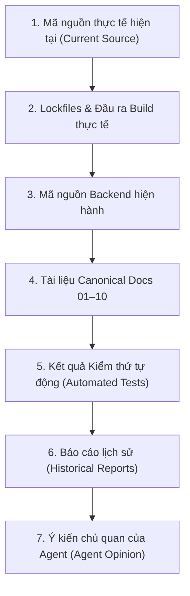

# WorkSphere Runbook: Multi-Agent Orchestration, Isolation and Review

## 1. Tổng Quan và Năng Lực Nền Tảng (Platform Capability)

Tài liệu này hướng dẫn quy trình vận hành, phân vai, cô lập Git và kiểm soát chất lượng khi sử dụng mô hình đa tác nhân (Multi-Agent) trong dự án WorkSphere.

### Bằng Chứng Năng Lực Nền Tảng Antigravity
Nền tảng Antigravity hiện tại đã được kiểm chứng hỗ trợ đầy đủ các công cụ điều phối tác nhân:
- **Tạo và Cấu hình Tác nhân**: `define_subagent` cho phép định nghĩa subagent với `name`, `description`, `system_prompt`, và giới hạn công cụ (`enable_write_tools`, `enable_subagent_tools`, `enable_mcp_tools`).
- **Khởi chạy Song song**: `invoke_subagent` nhận danh sách tác nhân, cấp phát `conversationID` riêng biệt, chạy ngầm (asynchronous background), chọn model độc lập (`inherit`, `flash_lite`, `flash`, `pro`).
- **Cô lập Không gian Làm việc**: Tham số `Workspace` hỗ trợ `'branch'` (tạo workspace nhánh mới độc lập) và `'share'` (chia sẻ repo như Git worktree).
- **Giao tiếp Hai Chiều**: `send_message` gửi và nhận thông điệp có cấu trúc giữa Coordinator và subagents.
- **Quản lý Tiến trình và Huỷ bỏ**: `manage_subagents` với các hành động `list`, `kill`, `kill_all` và báo cáo log URI thời gian thực.
- **Điều phối Thời gian**: `schedule` hỗ trợ cron hoặc timer one-shot với điều kiện hủy sớm `TimerCondition`.

**Phân loại năng lực chính thức:** **`TRUE_MULTI_AGENT`** (kèm chế độ dự phòng chuẩn **`SEQUENTIAL_MULTI_ROLE_MODE`**).

---

## 2. Tiêu Chí Kích Hoạt Multi-Agent (Standing Authority)

Agent được tự động kích hoạt multi-agent mà không cần xin phép riêng khi thỏa mãn:
1. Nhiệm vụ có ít nhất 2 luồng công việc độc lập về dữ liệu hoặc chức năng;
2. Đợt kiểm toán (audit) hoặc thẩm định chất lượng đòi hỏi phản biện chéo khách quan;
3. Tác vụ bao gồm nhiều hệ thống con không chỉnh sửa cùng tập hợp tệp;
4. Có thể phân vùng đầu ra rõ ràng cho từng tác nhân;
5. Kết quả được Coordinator tổng hợp và đối soát độc lập.

**Nghiêm cấm kích hoạt khi:**
- Tác vụ hẹp chỉ sửa 1–3 tệp có liên kết chặt chẽ;
- Tác vụ Git cấu thành một giao dịch nguyên tử duy nhất;
- Các tác nhân buộc phải sửa cùng một tệp đồng thời;
- Tác vụ liên quan đến việc xử lý thông tin xác thực nhạy cảm;
- Không đảm bảo được cơ chế cô lập tiến trình hoặc workspace;
- Chi phí điều phối vượt quá lợi ích mang lại.

---

## 3. Ma Trận Vai Trò Chuẩn (Standard Role Matrix)

| Vai trò | Trách nhiệm chính | Quyền hạn Ghi (Write) | Quyền hạn Git |
| :--- | :--- | :--- | :--- |
| **Coordinator** | Chia task, phân bổ scope, giám sát timeout, tổng hợp, quyết định | Không ghi mã nguồn | Không commit trực tiếp |
| **Contract Agent** | Đọc canonical docs, DTO backend, database schema, đối soát hợp đồng | Chỉ đọc (Read-only) | Không |
| **Implementation Agent** | Hiện thực hóa logic mã nguồn theo đúng scope được cấp | Ghi trong `allowed write paths` | Không commit |
| **Test Agent** | Chạy lint, typecheck, unit test, build test, thu thập bằng chứng | Không ghi mã nguồn | Không |
| **Security Agent** | Quét secret, token, quyền hạn, lỗ hổng, lưu trữ an toàn, giấy phép D-057 | Không ghi mã nguồn (Quyền VETO) | Không |
| **Reviewer Agent** | Đối soát source thực tế với hợp đồng và báo cáo của các agent khác | Chỉ đọc (Read-only) | Không |
| **Git Integrator** | Kiểm tra toàn bộ cổng, stage có chọn lọc, commit và push | Chỉ stage/commit tệp hợp lệ | Duy nhất được commit/push |

---

## 4. Quy Trình Cô Lập Git Bằng Worktree (Git Worktree Isolation)

Khi nhiều tác nhân cần chỉnh sửa mã nguồn song song, bắt buộc phải sử dụng Git worktree để ngăn chặn xung đột trên working tree chính.

### Bước 1: Tạo Worktree Cách Ly
```powershell
# Tạo nhánh tạm thời và worktree trong thư mục .external/worktrees/ (đã được .gitignore)
$taskId = "task-20261018-auth"
$role = "impl-auth"
$branchName = "temp/$taskId-$role"
$worktreePath = "D:\WorkSphere\.external\worktrees\$taskId-$role"

git branch $branchName HEAD
git worktree add $worktreePath $branchName
```

### Bước 2: Tác Nhân Thực Thi Trong Worktree
Implementation Agent chỉ được phép thao tác tệp và chạy kiểm thử trong đường dẫn `$worktreePath`. Working tree gốc tại `D:\WorkSphere` hoàn toàn không bị ảnh hưởng.

### Bước 3: Coordinator Kiểm Tra và Tích Hợp
```powershell
# Kiểm tra diff của worktree so với HEAD chính
git diff HEAD..$branchName

# Nếu kiểm thử PASS và diff hợp lệ: cherry-pick hoặc merge sạch
git merge --ff-only $branchName   # hoặc cherry-pick từng commit đã thẩm định
```

### Bước 4: Thu Hồi và Dọn Dẹp Worktree
```powershell
# Xóa bỏ worktree sau khi hoàn tất
git worktree remove $worktreePath --force
git branch -D $branchName
```

*Lưu ý:* Nếu không thể khởi tạo worktree an toàn, hệ thống lập tức chuyển sang chế độ ghi tuần tự một tác nhân (`sequential single-writer mode`).

---

## 5. Giao Ước Đầu Ra Chuẩn Hóa (Structured Output Contract)

Mọi tác nhân khi hoàn thành nhiệm vụ bắt buộc phải trả về khối kết quả có cấu trúc sau:

```text
ROLE: <Coordinator | Contract Agent | Implementation Agent | Test Agent | Security Agent | Reviewer Agent | Git Integrator>
TASK_ID: <Định danh tác vụ duy nhất>
CHECKPOINT: <Commit SHA Git tại thời điểm bắt đầu>
READ_PATHS:
- <đường dẫn 1>
- <đường dẫn 2>
WRITE_PATHS:
- <đường dẫn được phép ghi>
FILES_READ:
- <tệp thực tế đã đọc>
FILES_CHANGED:
- <tệp thực tế đã tạo hoặc sửa>
COMMANDS_RUN:
- <lệnh 1 [Exit Code]>
- <lệnh 2 [Exit Code]>
FINDINGS:
- <phân tích kỹ thuật / phát hiện>
TEST_RESULTS:
- Suites: X passed, Y total
- Tests: A passed, B total
SECURITY_NOTES:
- <đánh giá an ninh, secret scan, quyền hạn>
OPEN_QUESTIONS:
- <vấn đề mở hoặc không có>
CONCLUSION: <PASS | NEEDS_PATCH | BLOCKED | CONTRACT_GAP | SECURITY_RISK | CAPABILITY_UNAVAILABLE>
```

---

## 6. Thứ Tự Phân Xử Xung Đột (Conflict Resolution Hierarchy)

Khi phát hiện mâu thuẫn giữa các tác nhân, Coordinator phải tuân thủ nghiêm ngặt cấp bậc sau để phân định sự thật:



- Không phân xử theo số đông (voting).
- Xác minh bằng lệnh thực tế và kiểm tra diff trực tiếp.
- Security Agent có quyền **VETO** (chặn ngay lập tức) khi phát hiện lỗi bảo mật nghiêm trọng.

---

## 7. Quy Tắc Ngân Sách Lặp và Ngữ Cảnh (Budget Rules)

1. **Ngân Sách Lặp Lệnh (Retry Budget)**:
   - Tối đa 1 lần thử lại cho cùng một lệnh nếu không thay đổi giả thuyết hoặc dữ liệu đầu vào.
   - Tuyệt đối không thăm dò (poll) tiến trình nền trong vòng lặp liên tục.
   - Không chạy lặp lại `git status` hoặc `git log` chỉ để "nhớ lại" ngữ cảnh.
2. **Ngân Sách Ngữ Cảnh (Context Budget)**:
   - Coordinator chỉ truyền thông tin tối thiểu cần thiết cho worker.
   - Tuyệt đối không chuyển tiếp toàn bộ transcript cuộc trò chuyện cho worker.
   - Sau khi context compaction xảy ra: Không đọc `transcript.jsonl`; đọc trực tiếp `AGENTS.md`, `reports/PROJECT_STATE.md`, `reports/HANDOFF.md` và tài liệu tác vụ; tiếp tục từ Git checkpoint.

---

## 8. Quy Trình Chế Độ Dự Phòng Tuần Tự (Sequential Multi-Role Fallback Mode)

Khi môi trường runtime không cho phép chạy true multi-agent song song:
1. Tác nhân duy nhất kích hoạt chế độ **`SEQUENTIAL_MULTI_ROLE_MODE`**.
2. Thực thi tuần tự theo chuỗi 6 bước:
   - **Bước 1 (Contract)**: Đọc canonical docs, schema, DTO. Xuất khối kết quả `ROLE: Contract Agent`.
   - **Bước 2 (Implementation)**: Chỉnh sửa mã nguồn theo đúng hợp đồng. Xuất khối kết quả `ROLE: Implementation Agent`.
   - **Bước 3 (Test)**: Chạy test, typecheck, lint, build. Xuất khối kết quả `ROLE: Test Agent`.
   - **Bước 4 (Security)**: Quét secret, kiểm tra an toàn lưu trữ và mạng. Xuất khối kết quả `ROLE: Security Agent`.
   - **Bước 5 (Reviewer)**: Đối chiếu mã nguồn thực tế với hợp đồng. Xuất khối kết quả `ROLE: Reviewer Agent`.
   - **Bước 6 (Git Integrator)**: Kiểm tra working tree sạch, stage và commit. Xuất khối kết quả `ROLE: Git Integrator`.
3. Tác nhân phải trung thực: Ghi rõ nhiệm vụ được thực thi tuần tự bởi 1 mô hình theo chuẩn phân vai, không giả mạo rằng có nhiều mô hình độc lập đã thẩm định.
