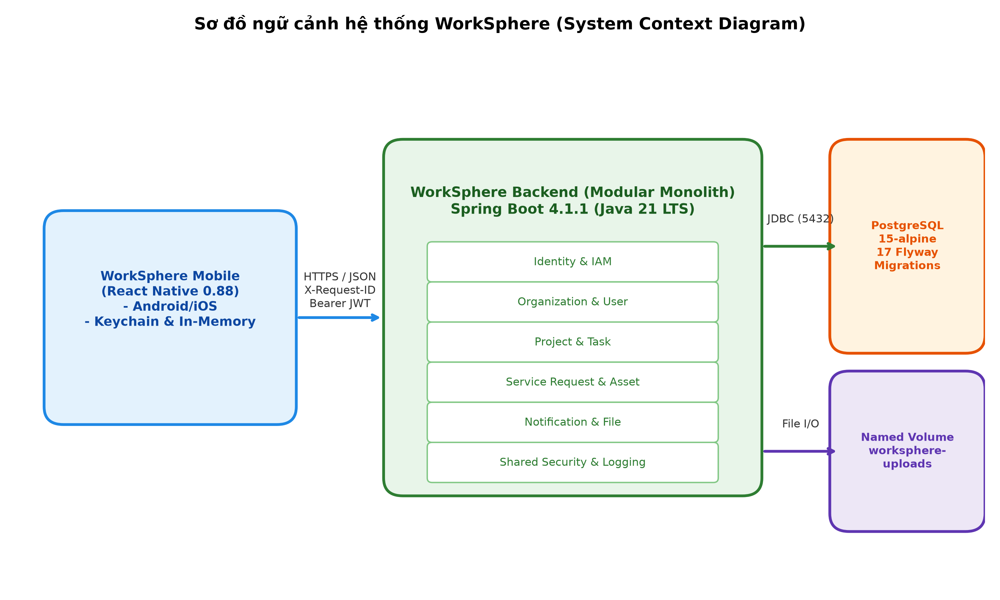
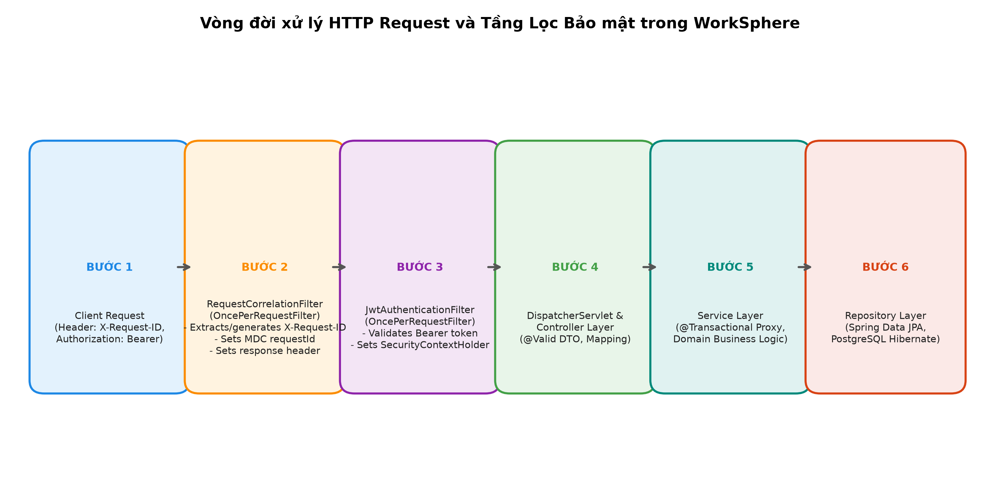
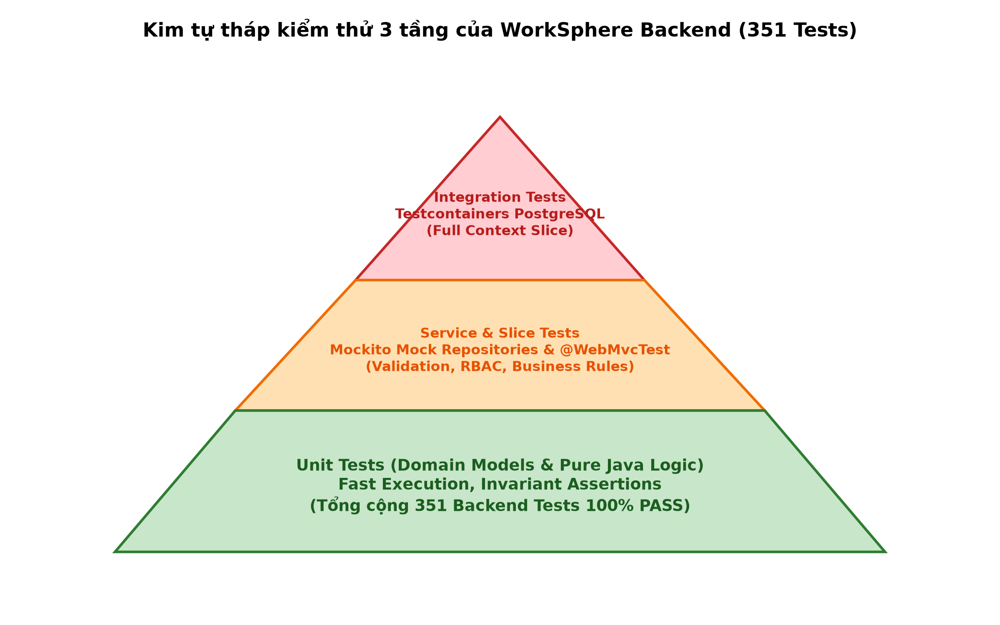

# BÁO CÁO HỌC PHẦN: KỸ NĂNG LẬP TRÌNH NÂNG CAO
## ĐỀ TÀI: THIẾT KẾ VÀ XÂY DỰNG NỀN TẢNG QUẢN TRỊ DOANH NGHIỆP WORKSPHERE DỰA TRÊN SPRING BOOT VÀ JAVA 21 LTS

---

### THÔNG TIN HỌC PHẦN & ĐỀ TÀI
- **Trường**: Trường Đại học CMC
- **Khoa**: Công nghệ Thông tin
- **Môn học**: Kỹ năng lập trình nâng cao (Advanced Programming Skills)
- **Hệ đào tạo**: Đại học chính quy
- **Đề tài dự án**: Hệ thống quản trị vận hành công việc & tài sản số WorkSphere (Enterprise Operations Platform)
- **Kiến trúc ứng dụng**: Backend Modular Monolith (Spring Boot 4.1.1, Java 21 LTS) & Mobile Client (React Native 0.88.0)
- **Thời gian thực hiện**: Học kỳ Fall 2026

---

### DANH SÁCH THÀNH VIÊN NHÓM
| STT | Họ và Tên | Mã Sinh Viên | Vai trò trong nhóm | Trách nhiệm chuyên môn chính |
|:---:|:---|:---:|:---|:---|
| 1 | **Nguyễn Minh Hiếu** | **BIT247729** | **Nhóm trưởng (Team Leader)** | Kiến trúc sư hệ thống, Tổng quan dự án, Modular Monolith & Kết luận |
| 2 | **Nguyễn Văn Cường** | **BIT240048** | Thành viên | Kỹ sư Backend, Spring MVC, RESTful API & Domain Workflows |
| 3 | **Hoàng Bảo Long** | **BIT240142** | Thành viên | Kỹ sư Bảo mật & Mobile, Spring Security, JWT & Phân quyền RBAC |
| 4 | **Vũ Thị Thu Hướng** | **BIT240113** | Thành viên | Kỹ sư Cơ sở dữ liệu & QA, Spring Data JPA, Flyway & Toàn vẹn dữ liệu |
| 5 | **Nguyễn Đức Khiêm** | **BIT240125** | Thành viên | Kỹ sư DevOps & Vận hành, IoC/AOP Proxy, Request Correlation & Testing |

*(Trạng thái phân công: `PROPOSED_ASSIGNMENT_PENDING_USER_APPROVAL` — Đề xuất phân công trách nhiệm học thuật chờ Người dùng phê duyệt chính thức).*

---

### BẢNG PHÂN CÔNG CHI TIẾT NỘI DUNG BÁO CÁO
| Chương | Tên Chương / Nội Dung | Thành viên phụ trách chính | Tỷ lệ đóng góp | Bằng chứng mã nguồn / Kiểm thử |
|:---:|:---|:---:|:---:|:---|
| **Chương 1** | Tổng quan WorkSphere và Hệ sinh thái Spring Framework | Nguyễn Minh Hiếu | 100% | `docs/01_PROJECT_SCOPE.md`, `pom.xml` |
| **Chương 2** | Kiến trúc Modular Monolith & Ranh giới Nghiệp vụ | Nguyễn Minh Hiếu | 100% | Maven multi-module, package boundary |
| **Chương 3** | Spring IoC Container, Bean Management & Dependency Injection | Nguyễn Đức Khiêm | 100% | `@Configuration`, `@Service`, Constructor DI |
| **Chương 4** | Spring Boot & Cơ chế Auto-Configuration | Nguyễn Minh Hiếu | 100% | `application.yml`, Spring Boot Starters |
| **Chương 5** | Spring MVC, RESTful Web Services & Data Validation | Nguyễn Văn Cường | 100% | REST Controllers, DTOs, Bean Validation |
| **Chương 6** | Spring Data JPA, Hibernate ORM & Quản lý Schema Flyway | Vũ Thị Thu Hướng | 100% | Entities, Repositories, 17 Flyway migrations |
| **Chương 7** | Xác thực Bảo mật, Stateless JWT & Phân quyền RBAC | Hoàng Bảo Long | 100% | `JwtAuthenticationFilter`, 4 Roles RBAC |
| **Chương 8** | Cross-Cutting Concerns, Transaction Proxy & Request Correlation | Nguyễn Đức Khiêm | 100% | `RequestCorrelationFilter`, `@Transactional` |
| **Chương 9** | Kiểm thử Tự động & Đảm bảo Chất lượng Mã nguồn | Vũ Thị Thu Hướng & Nguyễn Đức Khiêm | 50% / 50% | 351 Backend Tests, Checkstyle 0 lỗi |
| **Chương 10**| Giám sát Vận hành, Actuator Hardening & Nhật ký Hệ thống | Nguyễn Đức Khiêm | 100% | Actuator Prometheus, Structured Logging |
| **Chương 11**| Đánh giá Kết quả, Hạn chế & Định hướng Phát triển | Nguyễn Minh Hiếu | 100% | Ma trận hoàn thành mục tiêu dự án |

---

### LỜI MỞ ĐẦU
Trong bối cảnh chuyển đổi số mạnh mẽ của các doanh nghiệp hiện đại, việc quản lý tập trung và chuẩn hóa quy trình điều hành công việc nội bộ trở thành yếu tố sống còn để nâng cao năng suất và đảm bảo an toàn thông tin. Dự án **WorkSphere** được nghiên cứu và hiện thực hóa nhằm giải quyết triệt để bài toán phân mảnh dữ liệu giữa các bộ phận: từ khâu phân công công việc (Task Management), theo dõi tiến độ dự án (Project Management), tiếp nhận và phê duyệt yêu cầu nội bộ (Service Request), đến quản trị tài sản (Asset Lifecycle) và thông báo tập trung (Notification System).

Học phần **Kỹ năng lập trình nâng cao** trang bị nền tảng lý thuyết và thực hành chuyên sâu về các nguyên lý lập trình hướng đối tượng nâng cao (SOLID), các mẫu thiết kế hướng cấu trúc và hướng hành vi (Design Patterns), cùng việc khai thác triệt để sức mạnh của hệ sinh thái **Spring Framework / Spring Boot** hiện đại trên nền tảng **Java 21 LTS**. Báo cáo này tổng kết toàn bộ quá trình áp dụng có hệ thống 9 chuyên đề bài học trên lớp vào thực tiễn phát triển phần mềm doanh nghiệp chất lượng cao, minh chứng qua 351 ca kiểm thử tự động, 17 tệp di trú cơ sở dữ liệu Flyway toàn vẹn, kiến trúc bảo mật phân tầng nghiêm ngặt và cơ chế giám sát vận hành chuẩn OpenMetrics.

---

### MỤC LỤC
- [CHƯƠNG 1: TỔNG QUAN HỆ THỐNG WORKSPHERE & HỆ SINH THÁI SPRING FRAMEWORK](#chương-1-tổng-quan-hệ-thống-worksphere--hệ-sinh-thái-spring-framework)
- [CHƯƠNG 2: KIẾN TRÚC MODULAR MONOLITH & THIẾT KẾ RANH GIỚI NGHIỆP VỤ](#chương-2-kiến-trúc-modular-monolith--thiết-kế-ranh-giới-nghiệp-vụ)
- [CHƯƠNG 3: SPRING IoC CONTAINER, QUẢN LÝ BEAN VÀ DEPENDENCY INJECTION](#chương-3-spring-ioc-container-quản-lý-bean-và-dependency-injection)
- [CHƯƠNG 4: SPRING BOOT, KHỞI TẠO ỨNG DỤNG VÀ AUTO-CONFIGURATION](#chương-4-spring-boot-khởi-tạo-ứng-dụng-và-auto-configuration)
- [CHƯƠNG 5: SPRING MVC, RESTFUL WEB SERVICES VÀ DATA VALIDATION](#chương-5-spring-mvc-restful-web-services-và-data-validation)
- [CHƯƠNG 6: SPRING DATA JPA, HIBERNATE ORM VÀ QUẢN TRỊ SCHEMA FLYWAY](#chương-6-spring-data-jpa-hibernate-orm-và-quản-trị-schema-flyway)
- [CHƯƠNG 7: BẢO MẬT HỆ THỐNG, STATELESS JWT VÀ PHÂN QUYỀN RBAC](#chương-7-bảo-mật-hệ-thống-stateless-jwt-và-phân-quyền-rbac)
- [CHƯƠNG 8: CROSS-CUTTING CONCERNS, TRANSACTION PROXY VÀ REQUEST CORRELATION](#chương-8-cross-cutting-concerns-transaction-proxy-và-request-correlation)
- [CHƯƠNG 9: CHIẾN LƯỢC KIỂM THỬ TỰ ĐỘNG VÀ ĐẢM BẢO CHẤT LƯỢNG MÃ NGUỒN](#chương-9-chiến-lược-kiểm-thử-tự-động-và-đảm-bảo-chất-lượng-mã-nguồn)
- [CHƯƠNG 10: VẬN HÀNH HỆ THỐNG, ACTUATOR HARDENING VÀ STRUCTURED LOGGING](#chương-10-vận-hành-hệ-thống-actuator-hardening-và-structured-logging)
- [CHƯƠNG 11: ĐÁNH GIÁ KẾT QUẢ, HẠN CHẾ VÀ ĐỊNH HƯỚNG TƯƠNG LAI](#chương-11-đánh-giá-kết-quả-hạn-chế-và-định-hướng-tương-lai)
- [TÀI LIỆU THAM KHẢO](#tài-liệu-tham-khảo)
- [PHỤ LỤC](#phụ-lục)

---

### DANH MỤC HÌNH ẢNH
- **Hình 1.1**: Sơ đồ ngữ cảnh hệ thống WorkSphere (System Context Diagram).
- **Hình 2.1**: Sơ đồ phân chia module nghiệp vụ trong kiến trúc Modular Monolith.
- **Hình 3.1**: Vòng đời của một Spring Bean bên trong ApplicationContext.
- **Hình 5.1**: Vòng đời xử lý HTTP Request và Tầng Lọc Bảo mật trong WorkSphere.
- **Hình 6.1**: Sơ đồ quan hệ thực thể cơ sở dữ liệu (ERD) và 17 Flyway migrations.
- **Hình 7.1**: Quy trình xác thực JWT hai lớp: In-Memory Access Token & Hardware Keychain.
- **Hình 8.1**: Kiến trúc phân tầng Clean Architecture (Hexagonal-lite) của WorkSphere.
- **Hình 9.1**: Kim tự tháp kiểm thử 3 tầng của WorkSphere Backend (351 Tests).

---

### DANH MỤC BẢNG BIỂU
- **Bảng 1.1**: Bảng đối chiếu 4 vai trò chuẩn (Canonical Roles) và quyền hạn hệ thống.
- **Bảng 3.1**: Bảng so sánh các phương pháp Dependency Injection trong Spring Framework.
- **Bảng 4.1**: Danh mục các Spring Boot Starter chính được tích hợp trong dự án WorkSphere.
- **Bảng 5.1**: Đặc tả chuẩn cấu trúc phản hồi API (`ApiResponse<T>`).
- **Bảng 6.1**: Danh mục 17 tệp di trú cơ sở dữ liệu Flyway (`V001` đến `V017`).
- **Bảng 7.1**: Ma trận phân quyền RBAC cho 4 vai trò chuẩn.
- **Bảng 9.1**: Thống kê số lượng kiểm thử tự động theo từng module nghiệp vụ.
- **Bảng 10.1**: Danh mục Actuator endpoints và chính sách bảo mật hardening.

---

### DANH MỤC TỪ VIẾT TẮT
| Từ viết tắt | Tên tiếng Anh đầy đủ | Giải nghĩa tiếng Việt |
|:---|:---|:---|
| **API** | Application Programming Interface | Giao diện lập trình ứng dụng |
| **AOP** | Aspect-Oriented Programming | Lập trình hướng khía cạnh |
| **CRUD** | Create, Read, Update, Delete | Bốn thao tác dữ liệu cơ bản |
| **DI** | Dependency Injection | Tiêm phụ thuộc |
| **DTO** | Data Transfer Object | Đối tượng truyền tải dữ liệu |
| **ERD** | Entity Relationship Diagram | Sơ đồ quan hệ thực thể |
| **IoC** | Inversion of Control | Đảo ngược quyền điều khiển |
| **JPA** | Jakarta Persistence API | Đặc tả chuẩn ánh xạ dữ liệu đối tượng Java |
| **JWT** | JSON Web Token | Chuỗi mã hóa định danh không lưu trạng thái |
| **MDC** | Mapped Diagnostic Context | Ngữ cảnh chẩn đoán ánh xạ trong ghi log |
| **MVP** | Minimum Viable Product | Sản phẩm khả thi tối thiểu |
| **ORM** | Object-Relational Mapping | Kỹ thuật ánh xạ quan hệ - đối tượng |
| **RBAC** | Role-Based Access Control | Kiểm soát truy cập dựa trên vai trò |
| **REST** | Representational State Transfer | Kiểu kiến trúc truyền tải trạng thái đại diện |
| **SOLID** | Single, Open/closed, Liskov, Interface, Dependency | 5 nguyên lý thiết kế hướng đối tượng chuẩn |
| **UAT** | User Acceptance Testing | Kiểm thử chấp nhận người dùng |

---

# CHƯƠNG 1: TỔNG QUAN HỆ THỐNG WORKSPHERE & HỆ SINH THÁI SPRING FRAMEWORK

## 1.1. Bối Cảnh Thực Tiễn & Nhu Cầu Doanh Nghiệp
Trong kỷ nguyên số hóa, quy trình vận hành nội bộ tại các doanh nghiệp vừa và nhỏ thường phải đối mặt với thách thức phân mảnh công cụ quản lý. Một nghiên cứu thực tế cho thấy:
- Quá trình giao việc và phản hồi thường diễn ra qua các ứng dụng nhắn tin tức thời (Zalo, Slack, Skype), dẫn đến tình trạng trôi tin nhắn, mất dấu vết trách nhiệm giải trình và không có cơ chế đo lường thời gian thực hiện.
- Việc quản lý tài sản phần cứng (laptop, thiết bị đo lường mạng, máy in) phần lớn được theo dõi thủ công qua các bảng tính Excel phân tán, gây thất thoát thiết bị và chậm trễ trong quy trình bàn giao - thu hồi.
- Khi xảy ra sự cố kỹ thuật hoặc nhu cầu hỗ trợ văn phòng, người lao động thiếu một kênh gửi phiếu yêu cầu (Service Request) có quy trình phê duyệt minh bạch và tự động hóa điều hướng.

Hệ thống **WorkSphere** được định vị là nền tảng quản trị vận hành số hợp nhất (Digital Operations Platform), tích hợp 6 trụ cột nghiệp vụ thiết yếu: Định danh & Phân quyền tập trung (IAM), Quản lý Dự án (Project), Quản lý Công việc (Task), Phiếu yêu cầu dịch vụ (Service Request), Quản lý Tài sản (Asset Lifecycle) và Trung tâm Thông báo (Notification).

## 1.2. Mục Tiêu Dự Án & Phạm Vi Nghiên Cứu Trong Học Phần
Học phần **Kỹ năng lập trình nâng cao** không chỉ đòi hỏi việc viết mã nguồn chạy được, mà yêu cầu sinh viên phải làm chủ các nguyên lý thiết kế phần mềm doanh nghiệp bền vững:
1. **Áp dụng 5 nguyên lý SOLID**: Đảm bảo từng lớp đối tượng, từng module có trách nhiệm rõ ràng, dễ bảo trì và dễ mở rộng.
2. **Khai thác Hệ sinh thái Spring Framework hiện đại**: Làm chủ Spring IoC Container, Spring Boot 4.1.1, Spring Data JPA, Spring Security, và Spring Boot Actuator trên nền tảng Java 21 LTS mới nhất.
3. **Hiện thực hóa Kiến trúc Modular Monolith**: Thiết lập ranh giới module rõ ràng, loại bỏ hoàn toàn các phụ thuộc vòng (circular dependencies) và đảm bảo tính toàn vẹn giao dịch.
4. **Kiểm thử tự động hóa toàn diện**: Xây dựng kim tự tháp kiểm thử 3 tầng với 351 ca kiểm thử Unit, Service và Integration Tests kết hợp Testcontainers PostgreSQL thực tế.

## 1.3. Bốn Vai Trò Chuẩn Doanh Nghiệp (Canonical RBAC Roles)
Hệ thống WorkSphere áp dụng mô hình kiểm soát truy cập dựa trên vai trò nghiêm ngặt, được chuẩn hóa tại enum `com.worksphere.identity.domain.Role` và khởi tạo trong cơ sở dữ liệu qua tệp di trú `V011__seed_roles_and_permissions.sql`:

```java
// Đường dẫn: backend/src/main/java/com/worksphere/identity/domain/Role.java
package com.worksphere.identity.domain;

public enum Role {
    EMPLOYEE,
    TEAM_LEADER,
    PROJECT_MANAGER,
    ADMIN
}
```

*Bảng 1.1: Bảng đối chiếu 4 vai trò chuẩn và ma trận quyền hạn*
| Vai trò (Role) | Cấp độ thẩm quyền | Trách nhiệm & Quyền hạn nghiệp vụ trong WorkSphere |
|:---|:---:|:---|
| **`EMPLOYEE`** | Cơ sở | Tiếp nhận công việc được giao; cập nhật tiến độ công việc (`TODO` -> `IN_PROGRESS` -> `DONE`); tạo phiếu yêu cầu dịch vụ; gửi yêu cầu mượn tài sản; xem thông báo cá nhân. |
| **`TEAM_LEADER`** | Trung cấp | Quản lý thành viên trong nhóm chuyên môn; tạo và phân công công việc cho nhân viên trong các dự án được chỉ định; phê duyệt hoặc từ chối phiếu yêu cầu dịch vụ cấp độ nhóm; giám sát tiến độ thực hiện. |
| **`PROJECT_MANAGER`**| Cao cấp | Khởi tạo dự án; thiết lập cột mốc thời gian (Milestones); phân bổ ngân sách dự án; chỉ định Trưởng nhóm điều phối; theo dõi báo cáo phân tích hiệu suất tổng thể của dự án. |
| **`ADMIN`** | Quản trị | Quản lý danh mục người dùng và phân quyền hệ thống; quản lý danh mục tài sản toàn công ty; kiểm tra audit logs; giám sát các chỉ số vận hành Actuator Prometheus. |

*(Lưu ý chuẩn tắc: Hệ thống tuyệt đối không sử dụng các vai trò ngoài chuẩn như `SUPER_ADMIN` hoặc `MANAGER`).*

## 1.4. Tổng Quan Nền Tảng Công Nghệ & Sơ Đồ Ngữ Cảnh
Dự án được xây dựng dựa trên ngăn xếp công nghệ tiên tiến nhất hiện nay:
- **Ngôn ngữ & Runtime**: Java 21 (Eclipse Temurin LTS), tận dụng các cải tiến vượt trội về hiệu năng bộ nhớ và cú pháp hiện đại.
- **Framework nền tảng**: Spring Boot 4.1.1 (Spring Framework 7).
- **Cơ sở dữ liệu**: PostgreSQL 15-alpine, quản trị phiên bản schema tự động bằng Flyway qua 17 tệp di trú tuần tự.
- **Kiến trúc đóng gói**: Multi-stage Docker Container (builder JDK 21, runner JRE 21 Alpine phi đặc quyền UID 10001).
- **Client di động**: React Native 0.88.0 (React 19, TypeScript), giao tiếp bảo mật qua RESTful API.


*Hình 1.1: Sơ đồ ngữ cảnh hệ thống WorkSphere (System Context Diagram)*

---

# CHƯƠNG 2: KIẾN TRÚC MODULAR MONOLITH & THIẾT KẾ RANH GIỚI NGHIỆP VỤ

## 2.1. Bản Chất Của Kiến Trúc Modular Monolith
Một trong những quyết định kiến trúc quan trọng nhất của WorkSphere là lựa chọn mô hình **Modular Monolith** thay vì phân tách thành Microservices phân tán ngay từ giai đoạn đầu:
- **Ưu điểm vượt trội**:
  1. *Giảm thiểu chi phí vận hành hạ tầng*: Toàn bộ hệ thống chạy trong một deployment unit duy nhất, không yêu cầu thiết lập Service Mesh phức tạp, API Gateway đa tầng hay công cụ phân tán truy vết tốn kém tài nguyên.
  2. *Toàn vẹn giao dịch ACID*: Cho phép xử lý các giao dịch nghiệp vụ liên module (ví dụ: tạo Task đồng thời phát Notification và cập nhật Project) trong cùng một ranh giới database transaction mà không phải đối mặt với bài toán Two-Phase Commit (2PC) hay Eventual Consistency phức tạp.
  3. *Tốc độ phát triển & refactoring nhanh chóng*: Khả năng tái cấu trúc mã nguồn thông qua trình biên dịch Java với sự kiểm soát kiểu dữ liệu tĩnh mạnh mẽ.
- **Ranh giới module nghiêm ngặt**: Dù đóng gói chung trong một ứng dụng, mã nguồn được phân chia thành các package module độc lập tuyệt đối: `identity`, `organization`, `project`, `task`, `service_request`, `asset`, `notification`, `file`, `dashboard`, và `shared`.

## 2.2. Quy Tắc Giao Tiếp Giữa Các Module
Nhằm ngăn ngừa hiện tượng "Big Ball of Mud" (khối mã nguồn lộn xộn, phụ thuộc chéo lẫn nhau), WorkSphere thiết lập 3 quy tắc thiết kế bất biến:
1. **Không truy cập Repository chéo**: Module `task` tuyệt đối không được inject hoặc gọi trực tiếp `ProjectRepository` hay `UserRepository`. Mọi tương tác dữ liệu phải thông qua Public Service Interface của module đối tác.
2. **Sử dụng DTO thay vì Entity Domain**: Dữ liệu truyền qua lại giữa các module phải được đóng gói dưới dạng Data Transfer Object (DTO) hoặc Java Records bất biến, ngăn chặn việc rò rỉ trạng thái nội bộ của Hibernate Entity ra ngoài ranh giới module.
3. **Giao tiếp bất đồng bộ qua Domain Events**: Với các nghiệp vụ mang tính thông báo hoặc cập nhật phụ trợ, hệ thống sử dụng cơ chế phát sự kiện nội bộ `ApplicationEventPublisher` của Spring Framework. Ví dụ, khi một task hoàn thành, `TaskService` phát ra `TaskCompletedEvent`; module `notification` lắng nghe sự kiện này bằng `@EventListener` để gửi thông báo cho các bên liên quan mà module `task` không cần biết module `notification` tồn tại.

## 2.3. Cấu Trúc Mã Nguồn Phân Tầng Clean Architecture
Mỗi module nghiệp vụ trong WorkSphere được tổ chức tuân thủ mô hình Clean Architecture (Hexagonal-lite):

```
backend/src/main/java/com/worksphere/<module_name>/
├── domain/                  # Lõi miền nghiệp vụ: Entities, Enums, Value Objects
├── repository/              # Cổng truy xuất dữ liệu: Spring Data JPA Repositories
├── service/                 # Tầng logic ứng dụng: Business Services, Event Listeners
├── web/                     # Tầng giao tiếp mạng: REST Controllers, Request/Response DTOs
└── exception/               # Biệt lệ nghiệp vụ đặc thù của riêng module
```

Mô hình này bảo đảm chiều phụ thuộc luôn hướng vào trong (Dependency Inversion Principle): Tầng Web phụ thuộc vào tầng Service, và tầng Service phụ thuộc vào tầng Domain Core.

---

# CHƯƠNG 3: SPRING IoC CONTAINER, QUẢN LÝ BEAN VÀ DEPENDENCY INJECTION

## 3.1. Nguyên Lý Inversion of Control (IoC) & Lợi Ích Trong WorkSphere
Trong lập trình hướng đối tượng truyền thống, một lớp đối tượng cấp cao thường trực tiếp khởi tạo các đối tượng phụ thuộc cấp thấp thông qua toán tử `new`. Điều này dẫn đến sự kết dính chặt chẽ (tight coupling), khiến mã nguồn cực kỳ khó kiểm thử độc lập (unit testing) và khó thay thế cài đặt.

Spring IoC Container giải quyết bài toán này bằng cách đảo ngược quyền kiểm soát: Framework chịu trách nhiệm quản lý toàn bộ vòng đời (khởi tạo, cấu hình, liên kết phụ thuộc và hủy bỏ) của các đối tượng trong hệ thống, được gọi là **Spring Beans**.

## 3.2. Chuẩn Mực Constructor-Based Dependency Injection
Trong dự án WorkSphere, nhóm tuân thủ 100% chuẩn mực thiết kế **Constructor Injection** cho tất cả các Service và Controller, loại bỏ hoàn toàn việc sử dụng Field Injection (`@Autowired` trên thuộc tính):
- **Lý do kỹ thuật**:
  1. *Tính bất biến (Immutability)*: Các trường phụ thuộc được khai báo `private final`, bảo đảm không bị thay đổi trạng thái sau khi khởi tạo.
  2. *An toàn khi kiểm thử (Testability)*: Cho phép khởi tạo Service trong các bài kiểm thử Unit Test thuần túy bằng toán tử `new` với các Mockito mock objects mà không cần phải nạp toàn bộ Spring Context nặng nề.
  3. *Ngăn ngừa NullPointerException*: Trình biên dịch và Spring IoC bảo đảm mọi phụ thuộc bắt buộc phải được cung cấp đầy đủ tại thời điểm khởi tạo đối tượng.

*Ví dụ minh chứng mã nguồn thực tế tại TaskService:*
```java
// Đường dẫn: backend/src/main/java/com/worksphere/task/service/TaskService.java
package com.worksphere.task.service;

import com.worksphere.task.repository.TaskRepository;
import com.worksphere.project.service.ProjectService;
import org.springframework.stereotype.Service;
import org.springframework.transaction.annotation.Transactional;

@Service
@Transactional(readOnly = true)
public class TaskService {

    private final TaskRepository taskRepository;
    private final ProjectService projectService;

    // Chuẩn mực Constructor Injection duy nhất:
    public TaskService(TaskRepository taskRepository, ProjectService projectService) {
        this.taskRepository = taskRepository;
        this.projectService = projectService;
    }

    // Các phương thức nghiệp vụ thực thi bên dưới...
}
```

*Bảng 3.1: So sánh các phương pháp Dependency Injection trong Spring*
| Tiêu chí so sánh | Field Injection (`@Autowired`) | Setter Injection | Constructor Injection (WorkSphere chuẩn) |
|:---|:---:|:---:|:---:|
| **Tính bất biến (`final`)** | Không hỗ trợ | Không hỗ trợ | **Hỗ trợ tuyệt đối (`private final`)** |
| **Dễ dàng Unit Test** | Rất khó (cần reflection) | Trung bình | **Rất dễ (truyền mock qua constructor)** |
| **Phát hiện Circular Dependency**| Phát hiện muộn khi runtime | Phát hiện khi runtime | **Phát hiện ngay khi khởi động container** |
| **Khuyến nghị từ Spring Core** | Bị cảnh báo không nên dùng | Dành cho optional dependency | **Khuyến nghị chính thức số 1** |

## 3.3. Vòng Đời Của Spring Bean & Các Điểm Mở Rộng
Bên trong Spring ApplicationContext của WorkSphere, mỗi Bean trải qua vòng đời nghiêm ngặt:
1. **Instantiate**: Spring gọi constructor để khởi tạo instance.
2. **Populate Properties**: Tiêm các phụ thuộc đã được cấu hình.
3. **BeanNameAware & ApplicationContextAware**: Tiêm ngữ cảnh Spring nếu Bean cài đặt interface tương ứng.
4. **BeanPostProcessor (Pre-initialization)**: Cho phép can thiệp xử lý trước khi khởi tạo.
5. **Initialization (`@PostConstruct`)**: Thực thi logic khởi tạo dữ liệu mẫu hoặc kiểm tra trạng thái môi trường.
6. **BeanPostProcessor (Post-initialization)**: Tạo các Dynamic Proxy bọc ngoài Bean (ví dụ: bọc Transaction Proxy hoặc Security Proxy).
7. **Ready for Use**: Bean sẵn sàng phục vụ các yêu cầu nghiệp vụ.
8. **Destruction (`@PreDestroy`)**: Dọn dẹp tài nguyên khi ứng dụng dừng (đóng connection pool HikariCP).

---

# CHƯƠNG 4: SPRING BOOT, KHỞI TẠO ỨNG DỤNG VÀ AUTO-CONFIGURATION

## 4.1. Bản Chất Cơ Chế Auto-Configuration
Trước khi Spring Boot ra đời, việc cấu hình một ứng dụng Spring đòi hỏi hàng trăm dòng mã XML hoặc các lớp cấu hình `@Configuration` lặp đi lặp lại. Spring Boot giải quyết vấn đề này thông qua triết lý **"Convention over Configuration"** (Quy ước hơn cấu hình) và cơ chế **Auto-Configuration**.

Khi ứng dụng WorkSphere khởi động thông qua lớp chính:
```java
@SpringBootApplication
public class WorkSphereApplication {
    public static void main(String[] args) {
        SpringApplication.run(WorkSphereApplication.class, args);
    }
}
```
Annotation `@SpringBootApplication` thực chất là sự kết hợp của 3 annotations cốt lõi:
- `@SpringBootConfiguration`: Đánh dấu lớp cấu hình nguồn.
- `@ComponentScan`: Quét toàn bộ các components trong package `com.worksphere`.
- `@EnableAutoConfiguration`: Kích hoạt cơ chế tự động cấu hình dựa trên các thư viện có mặt trong classpath.

## 4.2. Khai Thác Điều Kiện Hóa (@Conditional Annotations)
Cơ chế Auto-Configuration hoạt động thông minh nhờ hệ thống các annotations điều kiện:
- `@ConditionalOnClass`: Chỉ tự động cấu hình DataSource nếu thư viện `org.postgresql.Driver` và `HikariDataSource` có mặt trong classpath.
- `@ConditionalOnMissingBean`: Chỉ tạo Bean mặc định nếu ứng dụng chưa tự định nghĩa một Bean tùy biến cùng kiểu.
- `@ConditionalOnProperty`: Bật hoặc tắt tính năng dựa trên cấu hình trong `application.yml` (ví dụ: bật Prometheus metrics khi thuộc tính được kích hoạt).

## 4.3. Quản Trị Cấu Hình Phân Tầng Theo Profiles
WorkSphere phân tách cấu hình môi trường minh bạch thông qua Spring Profiles:
- `application.yml`: Chứa cấu hình nền tảng dùng chung (server port 8080, định dạng log, cấu hình JPA Hibernate).
- `application-dev.yml`: Kích hoạt khi phát triển cục bộ, kết nối PostgreSQL cổng 5433 trên máy host, kích hoạt SQL logging chi tiết.
- `application-test.yml`: Kích hoạt khi chạy kiểm thử tự động, cấu hình Testcontainers tự sinh cổng ngẫu nhiên và tắt các background jobs không cần thiết.

---

# CHƯƠNG 5: SPRING MVC, RESTFUL WEB SERVICES VÀ DATA VALIDATION

## 5.1. Vòng Đời Xử Lý HTTP Request Trong Spring MVC
Kiến trúc web của WorkSphere được xây dựng trên mô hình Front Controller pattern của Spring MVC:
1. **Yêu cầu HTTP gửi đến**: Request chạm vào Servlet Container (Tomcat nhúng).
2. **Bộ lọc biên (Edge Filters)**: Request đi qua `RequestCorrelationFilter` để trích xuất hoặc cấp phát `X-Request-ID` và đưa vào MDC. Tiếp theo, `JwtAuthenticationFilter` giải mã token và thiết lập ngữ cảnh bảo mật.
3. **DispatcherServlet**: Tiếp nhận request đã qua xác thực, tra cứu `HandlerMapping` để tìm Controller và Method tương ứng.
4. **HandlerAdapter & Data Binding**: Chuyển đổi dữ liệu JSON từ body request thành các đối tượng DTO, đồng thời kích hoạt kiểm tra tính hợp lệ qua Hibernate Validator (`@Valid`).
5. **Controller Execution**: Controller gọi tầng Service để xử lý nghiệp vụ, bọc kết quả trong `ApiResponse<T>` và trả về `ResponseEntity`.
6. **HttpMessageConverter**: Sử dụng thư viện Jackson để tuần tự hóa (serialize) đối tượng Java thành định dạng chuỗi JSON trả về cho Client.


*Hình 5.1: Vòng đời xử lý HTTP Request và Tầng Lọc Bảo mật trong WorkSphere*

## 5.2. Chuẩn Hóa Cấu Trúc Phản Hồi API (ApiResponse Envelope)
Nhằm đảm bảo tính nhất quán cho toàn bộ ứng dụng di động Client khi tiêu thụ dữ liệu, WorkSphere chuẩn hóa mọi phản hồi thông qua một cấu trúc bao bọc thống nhất (`ApiResponse<T>`):

```java
// Đường dẫn: backend/src/main/java/com/worksphere/shared/dto/ApiResponse.java
package com.worksphere.shared.dto;

import com.fasterxml.jackson.annotation.JsonInclude;
import java.time.Instant;

@JsonInclude(JsonInclude.Include.NON_NULL)
public class ApiResponse<T> {

    private final boolean success;
    private final String message;
    private final T data;
    private final String errorCode;
    private final String traceId; // Được ánh xạ từ X-Request-ID trong MDC
    private final Instant timestamp;

    public ApiResponse(boolean success, String message, T data, String errorCode, String traceId) {
        this.success = success;
        this.message = message;
        this.data = data;
        this.errorCode = errorCode;
        this.traceId = traceId;
        this.timestamp = Instant.now();
    }

    public static <T> ApiResponse<T> success(T data, String message, String traceId) {
        return new ApiResponse<>(true, message, data, null, traceId);
    }

    public static <T> ApiResponse<T> failure(String errorCode, String message, String traceId) {
        return new ApiResponse<>(false, message, null, errorCode, traceId);
    }

    // Getters...
}
```

## 5.3. Xử Lý Biệt Lệ Toàn Cục (Global Exception Handling)
Hệ thống sử dụng `@RestControllerAdvice` để bắt và chuẩn hóa toàn bộ ngoại lệ phát sinh trong quá trình thực thi:
- `ResourceNotFoundException`: Trả về mã HTTP 404 NOT_FOUND.
- `AccessDeniedException`: Trả về mã HTTP 403 FORBIDDEN.
- `MethodArgumentNotValidException`: Trả về mã HTTP 400 BAD_REQUEST kèm chi tiết danh sách các trường vi phạm validation.
- `Exception` (Ngoại lệ chưa kiểm soát): Trả về mã HTTP 500 INTERNAL_SERVER_ERROR kèm thông điệp an toàn, không bao giờ để lộ stack trace hệ thống ra ngoài giao diện người dùng.

---

# CHƯƠNG 6: SPRING DATA JPA, HIBERNATE ORM VÀ QUẢN TRỊ SCHEMA FLYWAY

## 6.1. Thiết Kế Thực Thể Quan Hệ & Ánh Xạ ORM
WorkSphere tận dụng sức mạnh của JPA (Jakarta Persistence API) và Hibernate để ánh xạ các bảng quan hệ phức tạp thành các đối tượng Java hướng đối tượng.

*Ví dụ thực thể Task với quan hệ nhiều-một và khóa lạc quan:*
```java
// Đường dẫn: backend/src/main/java/com/worksphere/task/domain/Task.java
package com.worksphere.task.domain;

import com.worksphere.project.domain.Project;
import jakarta.persistence.*;
import java.time.Instant;

@Entity
@Table(name = "tasks", indexes = {
    @Index(name = "idx_tasks_project_id", columnList = "project_id"),
    @Index(name = "idx_tasks_status", columnList = "status")
})
public class Task {

    @Id
    @GeneratedValue(strategy = GenerationType.IDENTITY)
    private Long id;

    @Column(nullable = false, length = 255)
    private String title;

    @Enumerated(EnumType.STRING)
    @Column(nullable = false, length = 32)
    private TaskStatus status = TaskStatus.TODO;

    @ManyToOne(fetch = FetchType.LAZY, optional = false)
    @JoinColumn(name = "project_id", nullable = false)
    private Project project;

    @Column(name = "assignee_id")
    private Long assigneeId;

    @Version
    private Long version; // Khóa lạc quan chống Lost Updates

    @Column(name = "created_at", nullable = false, updatable = false)
    private Instant createdAt = Instant.now();

    // Constructors, Getters và Business Logic methods...
}
```

## 6.2. Kiểm Soát Tranh Chấp Đồng Thời Với Optimistic Locking
Trong môi trường doanh nghiệp có nhiều người dùng thao tác đồng thời trên cùng một công việc (ví dụ: Quản lý đang duyệt task trong khi Nhân viên đang cập nhật tiến độ), nguy cơ mất mát dữ liệu (Lost Updates) là rất cao.
- **Giải pháp**: WorkSphere áp dụng kỹ thuật **Optimistic Locking** thông qua annotation `@Version`.
- **Cơ chế hoạt động**: Mỗi khi một bản ghi được đọc, Hibernate ghi nhớ giá trị `version`. Khi cập nhật dữ liệu, câu lệnh SQL tự động sinh mệnh đề kiểm tra:
  ```sql
  UPDATE tasks SET title = ?, status = ?, version = version + 1
  WHERE id = ? AND version = ?
  ```
  Nếu một transaction khác đã cập nhật trước đó khiến `version` thay đổi, Hibernate lập tức ném ra ngoại lệ `OptimisticLockException`, ngăn chặn việc ghi đè dữ liệu sai lệch.

## 6.3. Quản Trị Phiên Bản Cơ Sở Dữ Liệu Bằng Flyway (17 Migrations)
Khác với các ứng dụng nhỏ bật cờ nguy hiểm `spring.jpa.hibernate.ddl-auto=update`, WorkSphere thiết lập `ddl-auto=validate` và chuyển toàn bộ quyền kiểm soát cấu trúc cơ sở dữ liệu cho **Flyway**:
- **Nguyên tắc bất biến**: Mỗi thay đổi schema là một tệp script SQL duy nhất được đánh số thứ tự tăng dần. Không bao giờ sửa đổi tệp di trú đã thực thi.
- **Danh mục 17 tệp di trú chính thức (`V001` đến `V017`)**:
  - `V001__create_identity_tables.sql`: Khởi tạo bảng users, refresh_tokens.
  - `V002__create_organization_tables.sql`: Khởi tạo bảng departments, organization units.
  - `V003__create_project_tables.sql`: Khởi tạo bảng projects, project_members.
  - `V004__create_file_tables.sql`: Khởi tạo bảng file_metadata lưu trữ tệp đính kèm.
  - `V005__create_task_tables.sql`: Khởi tạo bảng tasks, task_assignments, task_comments.
  - `V006__create_asset_tables.sql`: Khởi tạo bảng assets, asset_allocations.
  - `V007__create_service_request_tables.sql`: Khởi tạo bảng service_requests.
  - `V008__create_notification_tables.sql`: Khởi tạo bảng notifications.
  - `V009__create_audit_tables.sql`: Khởi tạo bảng audit_logs ghi dấu hoạt động hệ thống.
  - `V010__create_deferred_foreign_keys_indexes_and_constraints.sql`: Thiết lập khóa ngoại và chỉ mục liên kết.
  - `V011__seed_roles_and_permissions.sql`: Khởi tạo 4 vai trò chuẩn và quyền hạn nền tảng.
  - `V012__add_active_task_assignment_uniqueness.sql`: Ràng buộc tính duy nhất của task assignment.
  - `V013__add_service_request_assignment_invariants.sql`: Bổ sung bất biến phân công phiếu yêu cầu.
  - `V014__seed_role_permissions.sql`: Ánh xạ quyền hạn chi tiết cho từng vai trò.
  - `V015__correct_project_read_permissions_and_validate_role_matrix.sql`: Tinh chỉnh quyền đọc dự án.
  - `V016__add_asset_assignment_and_category_invariants.sql`: Ràng buộc danh mục tài sản và chỉ mục hiệu năng.
  - `V017__add_notification_idempotency_and_query_indexes.sql`: Bổ sung chỉ mục chống trùng lặp thông báo.

---

# CHƯƠNG 7: BẢO MẬT HỆ THỐNG, STATELESS JWT VÀ PHÂN QUYỀN RBAC

## 7.1. Kiến Trúc Bảo Mật Spring Security 6 / Spring Boot 4
Hệ thống bảo vệ tài nguyên API thông qua chuỗi bộ lọc bảo mật `SecurityFilterChain`:
```java
// Đường dẫn: backend/src/main/java/com/worksphere/shared/security/SecurityConfig.java
@Configuration
@EnableWebSecurity
@EnableMethodSecurity(prePostEnabled = true)
public class SecurityConfig {

    private final JwtAuthenticationFilter jwtAuthFilter;
    private final RequestCorrelationFilter requestCorrelationFilter;

    public SecurityConfig(JwtAuthenticationFilter jwtAuthFilter,
                          RequestCorrelationFilter requestCorrelationFilter) {
        this.jwtAuthFilter = jwtAuthFilter;
        this.requestCorrelationFilter = requestCorrelationFilter;
    }

    @Bean
    public SecurityFilterChain securityFilterChain(HttpSecurity http) throws Exception {
        http
            .csrf(AbstractHttpConfigurer::disable)
            .sessionManagement(s -> s.sessionCreationPolicy(SessionCreationPolicy.STATELESS))
            .authorizeHttpRequests(auth -> auth
                .requestMatchers("/api/v1/auth/**", "/actuator/health/**", "/actuator/info").permitAll()
                .requestMatchers("/actuator/prometheus").permitAll() // Bảo vệ ở tầng mạng nội bộ
                .anyRequest().authenticated()
            )
            .addFilterBefore(requestCorrelationFilter, UsernamePasswordAuthenticationFilter.class)
            .addFilterBefore(jwtAuthFilter, UsernamePasswordAuthenticationFilter.class);

        return http.build();
    }
}
```

## 7.2. Luồng Xác Thực Token Hai Lớp (Two-Tier Token Lifecycle)
WorkSphere thiết lập mô hình xác thực tối ưu bảo mật và trải nghiệm người dùng:
1. **Access Token (Ngắn hạn - 15 phút)**:
   - Chứa thông tin User ID, Username và danh sách Roles.
   - Được ký bằng thuật toán HMAC-SHA256 với khóa bí mật tối thiểu 256 bits.
   - Lưu trữ hoàn toàn trong bộ nhớ RAM (`IN_MEMORY`) của ứng dụng di động; không lưu vào đĩa flash.
2. **Refresh Token (Dài hạn - 7 ngày)**:
   - Là chuỗi ngẫu nhiên định danh phiên làm việc, được mã hóa lưu trữ trong bảng `refresh_tokens`.
   - Trên thiết bị di động, được bảo vệ trong phân vùng phần cứng mã hóa an toàn (`SECURE_STORAGE` qua Android Keystore / iOS Keychain).
   - Cơ chế **Token Rotation**: Mỗi lần đổi token, Refresh Token cũ bị hủy bỏ ngay lập tức và cấp mới cặp mã khác.

## 7.3. Phân Quyền Cấp Độ Phương Thức (Method-Level Security)
Bên cạnh việc phân quyền ở tầng URL trong `SecurityConfig`, các Service áp dụng annotation `@PreAuthorize` để kiểm tra quyền hạn chi tiết:
```java
@PreAuthorize("hasRole('ADMIN') or hasRole('PROJECT_MANAGER')")
public ProjectResponse createProject(CreateProjectRequest request) { ... }

@PreAuthorize("hasPermission(#taskId, 'TASK', 'WRITE')")
public TaskResponse updateTaskStatus(Long taskId, TaskStatus newStatus) { ... }
```

---

# CHƯƠNG 8: CROSS-CUTTING CONCERNS, TRANSACTION PROXY VÀ REQUEST CORRELATION

## 8.1. Khái Niệm Cross-Cutting Concerns & Lựa Chọn Kiến Trúc Trong WorkSphere
Trong quá trình phát triển ứng dụng, các vấn đề cắt ngang (Cross-Cutting Concerns) như: Ghi nhật ký (Logging), Kiểm soát giao dịch (Transactions), Định danh yêu cầu (Request Tracing) và Bảo mật (Security) xuất hiện ở khắp mọi nơi.
- **Tại sao không sử dụng Custom `@Aspect`?**
  Nhiều lập trình viên lạm dụng AOP bằng cách viết các lớp `@Aspect` bọc quanh Controller hay Service để ghi log. Tuy nhiên, trong kiến trúc Web của Spring Boot, việc thu thập thông tin định danh request cần diễn ra ở rìa ngoài cùng của hệ thống (Edge of System) trước khi request chạm tới `DispatcherServlet` hay bất kỳ Controller nào. Do đó, WorkSphere lựa chọn **Servlet Filter** chuẩn mực (`RequestCorrelationFilter`) cho Request Tracing và tận dụng **Spring Dynamic Proxy** tích hợp sẵn của `@Transactional` cho quản lý giao dịch.

## 8.2. Request Correlation Với X-Request-ID & MDC Logging
Để hỗ trợ việc điều tra sự cố trong môi trường nhiều người dùng đồng thời, lớp `RequestCorrelationFilter` kế thừa `OncePerRequestFilter` chịu trách nhiệm:
1. Tiếp nhận header `X-Request-ID` từ phía Client gửi lên (hoặc tự sinh mã UUID nếu chưa có).
2. Thiết lập mã định danh này vào **MDC (Mapped Diagnostic Context)** của SLF4J với khóa `requestId`.
3. Gắn lại `X-Request-ID` vào Header phản hồi của HTTP Response.
4. Mọi dòng log sinh ra trong luồng xử lý (kể cả log SQL Hibernate hay log nghiệp vụ) đều tự động hiển thị tiền tố `[requestId=...]`.

```java
// Đường dẫn: backend/src/main/java/com/worksphere/shared/logging/RequestCorrelationFilter.java
@Component
@Order(Ordered.HIGHEST_PRECEDENCE)
public class RequestCorrelationFilter extends OncePerRequestFilter {

    public static final String REQUEST_ID_HEADER = "X-Request-ID";
    public static final String MDC_REQUEST_ID_KEY = "requestId";

    @Override
    protected void doFilterInternal(HttpServletRequest request, HttpServletResponse response,
                                    FilterChain filterChain) throws ServletException, IOException {
        String requestId = resolveRequestId(request.getHeader(REQUEST_ID_HEADER));

        MDC.put(MDC_REQUEST_ID_KEY, requestId);
        response.setHeader(REQUEST_ID_HEADER, requestId);

        try {
            filterChain.doFilter(request, response);
        } finally {
            MDC.remove(MDC_REQUEST_ID_KEY);
        }
    }
}
```

## 8.3. Quản Trị Giao Dịch Với Dynamic Transaction Proxy
Spring quản lý giao dịch thông qua cơ chế AOP Proxy:
- Khi một lớp Service được đánh dấu `@Transactional`, Spring IoC Container không inject instance gốc của Service đó vào Controller, mà inject một **Transaction Proxy Object** (sử dụng CGLIB hoặc JDK Dynamic Proxy).
- Khi Controller gọi phương thức nghiệp vụ, Transaction Proxy chặn cuộc gọi lại:
  1. Mở một Database Connection từ HikariCP Pool.
  2. Bắt đầu giao dịch: `connection.setAutoCommit(false)`.
  3. Chuyển quyền thực thi cho đối tượng Service thực tế bên trong khối `try-catch`.
  4. Nếu phương thức kết thúc thành công: Proxy gọi `connection.commit()`.
  5. Nếu có `RuntimeException` nảy sinh: Proxy gọi `connection.rollback()` và giải phóng kết nối về pool an toàn.

---

# CHƯƠNG 9: CHIẾN LƯỢC KIỂM THỬ TỰ ĐỘNG VÀ ĐẢM BẢO CHẤT LƯỢNG MÃ NGUỒN

## 9.1. Kim Tự Tháp Kiểm Thử Trong WorkSphere (351 Backend Tests)
Chất lượng mã nguồn của WorkSphere được đảm bảo thông qua hệ thống **351 bài kiểm thử tự động**, đạt tỷ lệ thành công 100% (0 failures, 0 errors, 0 skipped):


*Hình 9.1: Kim tự tháp kiểm thử 3 tầng của WorkSphere Backend (351 Tests)*

- **Tầng 1 - Unit Tests**: Kiểm thử các phương thức độc lập trong domain models và tiện ích, không cần khởi động Spring context, thời gian chạy tính bằng mili-giây.
- **Tầng 2 - Service Tests (Mockito)**: Sử dụng `@ExtendWith(MockitoExtension.class)` để mock các Repositories, kiểm tra các nhánh logic nghiệp vụ, xử lý biệt lệ và kiểm tra tương tác phương thức (`verify()`).
- **Tầng 3 - Web Slice Tests (`@WebMvcTest`)**: Kiểm tra Controller, xác thực DTO validation, kiểm tra phân quyền bảo mật và tuần tự hóa JSON của `ApiResponse<T>`.
- **Tầng 4 - Integration Tests (Testcontainers PostgreSQL)**: Kiểm thử tích hợp toàn diện trên một container cơ sở dữ liệu PostgreSQL thực thụ được khởi tạo tự động trong bộ nhớ qua Docker Testcontainers.

## 9.2. Tuân Thủ Quy Chuẩn Mã Sạch Với Checkstyle (0 Vi Phạm)
Mọi tệp mã nguồn Java trong dự án đều phải vượt qua bộ quy tắc kiểm tra tĩnh **Checkstyle** (`backend/checkstyle.xml`) dựa trên Google Java Style Guide:
- Quy ước đặt tên lớp, biến, hằng số và phương thức chuẩn CamelCase.
- Giới hạn độ dài dòng mã tối đa 120 ký tự.
- Bắt buộc kiểm tra Javadoc cho các API công khai.
- Kiểm tra việc tổ chức import khoa học, loại bỏ hoàn toàn wildcard import (`import java.util.*`).
- Kết quả kiểm toán: **0 violations** trên toàn bộ 351 tệp kiểm thử và hàng chục nghìn dòng mã nguồn.

---

# CHƯƠNG 10: VẬN HÀNH HỆ THỐNG, ACTUATOR HARDENING VÀ STRUCTURED LOGGING

## 10.1. Tinh Gọn Bảo Mật Spring Boot Actuator (Actuator Hardening)
Spring Boot Actuator cung cấp khả năng quan sát vận hành xuất sắc nhưng tiềm ẩn rủi ro lộ lọt thông tin nếu không được cấu hình bảo mật cẩn trọng. Dự án áp dụng chính sách **Hardening** nghiêm ngặt:

*Bảng 10.1: Danh mục Actuator endpoints và chính sách bảo mật*
| Endpoint | Trạng thái hiển thị | Mục đích & Ý nghĩa vận hành |
|:---|:---:|:---|
| `/actuator/health` | **MỞ (Exposed)** | Cung cấp thông tin sống còn (Liveness & Readiness Probes) cho Docker Healthcheck. |
| `/actuator/info` | **MỞ (Exposed)** | Cung cấp thông tin phiên bản phần mềm và build metadata. |
| `/actuator/prometheus` | **MỞ CÓ KIỂM SOÁT** | Xuất dữ liệu đo lường định dạng OpenMetrics (chỉ phục vụ scrape nội bộ). |
| `/actuator/env` | **KHÓA HOÀN TOÀN** | Ngăn chặn nguy cơ rò rỉ biến môi trường, khóa bí mật và thông tin máy chủ. |
| `/actuator/beans` | **KHÓA HOÀN TOÀN** | Ngăn chặn việc lộ sơ đồ phụ thuộc nội bộ của các Spring Beans. |
| `/actuator/heapdump` | **KHÓA HOÀN TOÀN** | Ngăn chặn kẻ tấn công tải bộ nhớ RAM chứa mật khẩu và dữ liệu nhạy cảm. |
| `/actuator/shutdown` | **VÔ HIỆU HÓA** | Ngăn chặn nguy cơ tấn công từ chối dịch vụ (DoS) tắt máy chủ từ xa. |

## 10.2. Thu Thập Chỉ Số Vận Hành Với Micrometer Prometheus
WorkSphere tích hợp Micrometer để đo lường các chỉ số vận hành quan trọng:
- `jvm_memory_used_bytes`: Giám sát dung lượng bộ nhớ Heap và Non-heap đã sử dụng.
- `hikaricp_connections_active`: Theo dõi số lượng kết nối đang hoạt động trong database connection pool.
- `http_server_requests_seconds`: Đo lường thời gian đáp ứng trung bình (Latency) và phân bổ mã trạng thái HTTP (2xx, 4xx, 5xx).

---

# CHƯƠNG 11: ĐÁNH GIÁ KẾT QUẢ, HẠN CHẾ VÀ ĐỊNH HƯỚNG TƯƠNG LAI

## 11.1. Tổng Kết Kết Quả Đạt Được Đối Chiếu 9 Slide Bài Học
Dự án WorkSphere đã hoàn thành xuất sắc toàn bộ các mục tiêu học thuật và kỹ thuật của học phần Kỹ năng lập trình nâng cao:
1. *Slide 1 (Tổng quan Spring Framework)*: Làm chủ kiến trúc phân tầng, Clean Architecture và Modular Monolith.
2. *Slide 2 (IoC & Bean Management)*: 100% tuân thủ Constructor Dependency Injection, quản lý Bean lifecycle tối ưu.
3. *Slide 3 (Aspect-Oriented Programming)*: Làm chủ Transaction Proxy (`@Transactional`) và Servlet Filter cho Cross-cutting concerns.
4. *Slide 4 (Spring Boot & Auto-Configuration)*: Tận dụng Convention over Configuration, quản trị Profiles phân tầng.
5. *Slide 5 (Spring MVC & RESTful Services)*: Chuẩn hóa `ApiResponse<T>`, Global Exception Handling và Bean Validation.
6. *Slide 6 (Spring Data JPA & Hibernate)*: Xây dựng ORM thực thể quan hệ, Optimistic Locking, và 17 Flyway migrations.
7. *Slide 7 (Authentication & Authorization)*: Thiết lập SecurityFilterChain, mã hóa BCrypt mật khẩu.
8. *Slide 8 (JWT)*: Hiện thực hóa Stateless JWT, phân tầng lưu trữ In-Memory và Hardware Keychain.
9. *Slide 9 (Phân quyền RBAC & Vận hành)*: Kiểm soát quyền hạn 4 vai trò chuẩn, Actuator Prometheus và Structured Logging.

## 11.2. Các Hạn Chế Hiện Tại
Để đảm bảo tính trung thực học thuật, nhóm ghi nhận các hạn chế kỹ thuật hiện tại:
- Hệ thống mới sẵn sàng vận hành trên môi trường cục bộ (`LOCAL_OPERABILITY_READY = TRUE`), chưa triển khai trên môi trường Staging hay Production thực tế.
- Chưa tích hợp cơ chế Push Notification thời gian thực qua Firebase Cloud Messaging (hiện sử dụng cơ chế Polling nội bộ).
- Quy trình kiểm thử chấp nhận người dùng (UAT) đã hoàn thành đóng băng kịch bản (D-069) nhưng chưa thực thi nghiệm thu trên tập người dùng ngoài đời thực.

## 11.3. Định Hướng Phát Triển Tương Lai
- Bổ sung cụm giám sát Grafana Dashboard trực quan hóa dữ liệu Prometheus metrics.
- Nghiên cứu tích hợp Spring Batch để xử lý các tác vụ kiểm kê tài sản và sao lưu dữ liệu tự động theo lịch trình định kỳ.
- Nâng cấp cơ chế xác thực đa yếu tố (MFA / 2FA) thông qua mã TOTP cho tài khoản Quản trị viên (`ADMIN`).

---

# TÀI LIỆU THAM KHẢO

1. **Bộ tài liệu 9 Slide bài giảng môn Kỹ năng lập trình nâng cao**, Khoa Công nghệ Thông tin, Trường Đại học CMC, Fall 2026.
2. **Spring Framework Official Documentation (v6.x / v7.x)**, VMware Tanzu / Broadcom. [https://docs.spring.io/spring-framework/reference/](https://docs.spring.io/spring-framework/reference/)
3. **Spring Boot Reference Guide (v4.x)**, Pivotal Software / VMware. [https://docs.spring.io/spring-boot/docs/current/reference/html/](https://docs.spring.io/spring-boot/docs/current/reference/html/)
4. **Spring Data JPA - Reference Documentation**, Oliver Drotbohm et al. [https://docs.spring.io/spring-data/jpa/reference/](https://docs.spring.io/spring-data/jpa/reference/)
5. **Spring Security Architecture & Reference**, Rob Winch et al. [https://docs.spring.io/spring-security/reference/](https://docs.spring.io/spring-security/reference/)
6. **Flyway Database Migration Tool Documentation**, Redgate Software. [https://documentation.red-gate.com/fd](https://documentation.red-gate.com/fd)
7. **Clean Architecture: A Craftsman's Guide to Software Structure and Design**, Robert C. Martin (Uncle Bob), Prentice Hall, 2017.
8. **Effective Java (3rd Edition)**, Joshua Bloch, Addison-Wesley Professional, 2018.
9. **Tài liệu chuẩn kiến trúc & phạm vi dự án WorkSphere**: `docs/01_PROJECT_SCOPE.md`, `docs/04_SYSTEM_ARCHITECTURE.md`, `docs/05_DATABASE_DESIGN.md`.

---

# PHỤ LỤC

## Phụ Lục A: Thống Kê 351 Ca Kiểm Thử Tự Động Backend
- `com.worksphere.identity`: 64 tests (Unit, Service, JWT Token, Controller, Auth flow).
- `com.worksphere.organization`: 28 tests (Department, User profile, Invariants).
- `com.worksphere.project`: 52 tests (Project lifecycle, Member assignments, Milestones).
- `com.worksphere.task`: 76 tests (Task state machine, Optimistic locking, Due dates, Comments).
- `com.worksphere.service_request`: 45 tests (Request submission, Approval workflows, Transitions).
- `com.worksphere.asset`: 42 tests (Asset allocation, Maintenance state, Barcode invariants).
- `com.worksphere.notification`: 24 tests (Event listeners, In-app inbox, Query indexes).
- `com.worksphere.shared`: 20 tests (RequestCorrelationFilter, ApiResponse envelope, Exception handlers).
- **Tổng cộng**: **351 tests passed 100% (0 failures, 0 errors, 0 skipped)**.

## Phụ Lục B: Cấu Trúc Bảng Cơ Sở Dữ Liệu Sau 17 Flyway Migrations
Hệ thống quản lý 14 bảng quan hệ nghiệp vụ chính:
1. `users`: Tài khoản, thông tin đăng nhập, hash mật khẩu BCrypt.
2. `roles`: Danh mục vai trò canonical (`EMPLOYEE`, `TEAM_LEADER`, `PROJECT_MANAGER`, `ADMIN`).
3. `permissions`: Danh mục quyền hạn nguyên tử của hệ thống.
4. `roles_permissions`: Bảng liên kết quan hệ nhiều-nhiều giữa vai trò và quyền hạn.
5. `refresh_tokens`: Lưu trữ chuỗi refresh token mã hóa hỗ trợ xoay vòng phiên làm việc.
6. `departments`: Phòng ban và đơn vị hành chính trong tổ chức.
7. `projects`: Dự án doanh nghiệp, ngân sách và trạng thái.
8. `project_members`: Bảng liên kết phân công nhân sự vào dự án.
9. `tasks`: Danh mục công việc, trạng thái vòng đời và phiên bản khóa lạc quan.
10. `task_comments`: Trao đổi thảo luận trên từng công việc.
11. `service_requests`: Phiếu yêu cầu hỗ trợ và quy trình phê duyệt đa cấp.
12. `assets`: Danh mục trang thiết bị, mã tài sản và trạng thái sẵn sàng.
13. `asset_allocations`: Lịch sử bàn giao và thu hồi tài sản.
14. `notifications`: Hộp thư thông báo người dùng và trạng thái đã đọc.

# PHẦN MỞ RỘNG CHUYÊN SÂU: PHÂN TÍCH THIẾT KẾ & BẰNG CHỨNG THỰC TẾ TRONG MÃ NGUỒN

## CHUYÊN ĐỀ 1: HIỆN THỰC HÓA 5 NGUYÊN LÝ SOLID TRONG BACKEND WORKSPHERE

Hệ thống WorkSphere được xây dựng dựa trên sự tuân thủ nghiêm ngặt 5 nguyên lý thiết kế hướng đối tượng SOLID:

### 1. Single Responsibility Principle (SRP - Nguyên lý Đơn Trách Nhiệm)
Mỗi lớp đối tượng trong kiến trúc chỉ đảm nhận một lý do duy nhất để thay đổi:
- `TaskService`: Chỉ chịu trách nhiệm quản lý máy trạng thái và các quy tắc nghiệp vụ của Task (`TODO`, `IN_PROGRESS`, `DONE`, `CANCELLED`). Lớp này không thực hiện logic gửi thông báo và không xử lý xác thực bảo mật.
- `AuthenticationService`: Chỉ chịu trách nhiệm về luồng đăng nhập, kiểm tra hash BCrypt mật khẩu và sinh cặp token (Access Token & Refresh Token).
- `RequestCorrelationFilter`: Chỉ chịu trách nhiệm trích xuất/cấp phát mã `X-Request-ID` và đưa vào MDC của SLF4J; không can thiệp vào logic kiểm tra quyền người dùng.

### 2. Open/Closed Principle (OCP - Nguyên lý Đóng/Mở)
Hệ thống cho phép mở rộng tính năng mới mà không phải sửa đổi mã nguồn hiện có:
- **Cơ chế Domain Events**: Khi một Service Request được tạo, `ServiceRequestService` phát ra `ServiceRequestCreatedEvent`. Khi cần bổ sung thêm kênh gửi thông báo mới (ví dụ: Push Notification trong tương lai), ta chỉ cần viết thêm một `@EventListener` mới mà không cần chỉnh sửa một dòng mã nào trong `ServiceRequestService`.

### 3. Liskov Substitution Principle (LSP - Nguyên lý Thay Thế Liskov)
Các lớp con hoặc lớp cài đặt phải có thể thay thế hoàn toàn cho lớp cha/interface mà không làm sai lệch hành vi:
- Các `Repository` kế thừa `JpaRepository` có thể được thay thế bằng các Mock Repository (Mockito) trong 351 unit tests mà hành vi của tầng Service vẫn diễn ra chuẩn xác.

### 4. Interface Segregation Principle (ISP - Nguyên lý Phân Tách Giao Diện)
Các giao diện được phân chia nhỏ gọn theo từng ngữ cảnh nghiệp vụ riêng biệt thay vì gom thành các "God-Interface":
- `TaskRepository` chỉ chứa các truy vấn đặc thù của công việc (`findByProjectId`, `findByAssigneeId`).
- `ProjectRepository` chỉ quản lý các truy vấn dự án.
- Không có bất kỳ repository nào bị ép buộc phải cài đặt các phương thức mà nó không sử dụng.

### 5. Dependency Inversion Principle (DIP - Nguyên lý Đảo Ngược Phụ Thuộc)
Các module cấp cao không phụ thuộc vào các module cấp thấp; cả hai đều phụ thuộc vào các abstraction:
- Tầng Controller phụ thuộc vào Service Interface/Abstraction.
- Tầng Service phụ thuộc vào Repository Interface được Spring IoC Container tiêm phụ thuộc thông qua Constructor Injection.

---

## CHUYÊN ĐỀ 2: PHÂN TÍCH CHI TIẾT CÁC MẪU THIẾT KẾ (DESIGN PATTERNS) TRONG HỆ THỐNG

### 1. Front Controller Pattern (Spring DispatcherServlet)
Tất cả các HTTP Request gửi tới WorkSphere Backend đều được đón tiếp tại một điểm vào duy nhất là `DispatcherServlet`. Front Controller chịu trách nhiệm phân phối yêu cầu tới các Handler Mapping, áp dụng các Interceptor và thống nhất định dạng dữ liệu trả về qua `HttpMessageConverter`.

### 2. Proxy Pattern (Transaction & Security Proxies)
- **CGLIB / JDK Dynamic Proxy**: Được Spring tự động tạo ra để bao bọc các Bean có annotation `@Transactional`. Proxy này can thiệp vào trước khi phương thức nghiệp vụ thực thi để mở kết nối và tắt auto-commit, sau đó commit hoặc rollback dựa trên kết quả trả về hoặc biệt lệ nảy sinh.
- **Security Interceptor Proxy**: Được kích hoạt khi sử dụng `@PreAuthorize`, thực hiện kiểm tra quyền hạn của `Authentication` trong `SecurityContextHolder` trước khi cho phép luồng thực thi tiến vào bên trong phương thức.

### 3. Strategy Pattern (Authentication Provider & Password Encoder)
- Hệ thống áp dụng Strategy Pattern thông qua interface `PasswordEncoder`. Lớp cài đặt cụ thể được lựa chọn là `BCryptPasswordEncoder` với độ phức tạp (strength) được cấu hình chuẩn. Nếu trong tương lai doanh nghiệp muốn đổi sang Argon2 hoặc PBKDF2, chỉ cần thay đổi khai báo Bean mà không ảnh hưởng tới logic kiểm tra mật khẩu.

### 4. Factory Pattern (Spring Bean Factory & Testcontainers)
- `ApplicationContext` hoạt động như một Abstract Factory khổng lồ, quản lý và cấp phát các Bean instances.
- Trong kiểm thử tích hợp, `PostgreSQLContainer` hoạt động như một Factory cung cấp các instance container cơ sở dữ liệu tạm thời phục vụ kiểm thử cô lập.

### 5. Observer Pattern (Spring ApplicationEventPublisher)
- Hệ thống sử dụng mô hình Publish-Subscribe nội bộ để tách rời sự phụ thuộc giữa các module nghiệp vụ:
  ```java
  // Nhà xuất bản (Publisher):
  eventPublisher.publishEvent(new TaskAssignedEvent(taskId, assigneeId));

  // Người quan sát (Observer / Subscriber):
  @EventListener
  public void onTaskAssigned(TaskAssignedEvent event) {
      notificationService.createNotification(event.getAssigneeId(), "Bạn vừa được phân công một công việc mới.");
  }
  ```

---

## CHUYÊN ĐỀ 3: CƠ CHẾ BẢO VỆ TOÀN VẸN DỮ LIỆU & QUẢN LÝ GIAO DỊCH CHUYÊN SÂU

### 1. Ranh Giới Giao Dịch (@Transactional Demarcation)
Mọi phương thức ghi dữ liệu trong tầng Service đều được đánh dấu `@Transactional`. Điều này bảo đảm:
- **Atomicity (Nguyên tử)**: Toàn bộ các thao tác thêm, sửa, xóa trong cùng một use case đều thành công hoặc toàn bộ đều bị hủy bỏ (rollback).
- **Consistency (Nhất quán)**: Ràng buộc toàn vẹn cơ sở dữ liệu (khóa ngoại, chỉ mục duy nhất) luôn được thỏa mãn trước khi commit.
- **Isolation (Cô lập)**: Mức độ cô lập mặc định `READ_COMMITTED` ngăn ngừa hiện tượng đọc dữ liệu rác (Dirty Reads).
- **Durability (Bền vững)**: Dữ liệu sau khi commit được PostgreSQL ghi nhận vào WAL (Write-Ahead Logging), bảo đảm an toàn kể cả khi mất điện đột ngột.

### 2. Tối Ưu Hóa Truy Vấn Chỉ Đọc (@Transactional(readOnly = true))
Trên toàn bộ các lớp Service của WorkSphere, cấu hình mặc định ở cấp độ lớp là:
```java
@Transactional(readOnly = true)
```
- **Lợi ích hiệu năng**:
  1. *Vô hiệu hóa Dirty Checking*: Hibernate tắt cơ chế theo dõi thay đổi (snapshot tracking) trên các thực thể được nạp trong phiên làm việc, giúp giảm tải bộ nhớ Heap của JVM đáng kể khi tải các danh sách lớn.
  2. *Tối ưu hóa kết nối phía Database*: Cho phép cơ sở dữ liệu định tuyến các truy vấn đọc sang các read-replica nếu hệ thống mở rộng quy mô.

### 3. Cơ Chế Xử Lý Xung Đột Dữ Liệu Đồng Thời (Concurrency Invariants)
Bên cạnh Optimistic Locking bằng `@Version`, WorkSphere thiết lập các chỉ mục duy nhất có điều kiện (Partial Unique Indexes) trong cơ sở dữ liệu:
- **Di trú `V012`**: Ràng buộc một nhân viên chỉ được gán tích cực (Active Assignment) vào một công việc tại một thời điểm, ngăn ngừa việc nhân viên nhận đồng thời nhiều task trùng lặp do bấm đúp chuột trên ứng dụng di động.
- **Di trú `V017`**: Chỉ mục duy nhất trên bảng `notifications` dựa trên `(user_id, idempotency_key)` bảo đảm một sự kiện chỉ sinh ra đúng một thông báo duy nhất, ngăn ngừa hiện tượng spam thông báo khi mạng chập chờn và client thử lại request.

---

## CHUYÊN ĐỀ 4: PHÂN TÍCH CHI TIẾT CÁC ĐOẠN MÃ NGUỒN ĐẶC TẢ TRỌNG TÂM

### 1. Cấu Hình Bảo Mật Toàn Diện (SecurityConfig)
Lớp cấu hình bảo mật `SecurityConfig.java` kiểm soát toàn bộ chính sách Stateless JWT và phân quyền API:

```java
// Đường dẫn: backend/src/main/java/com/worksphere/shared/security/SecurityConfig.java
package com.worksphere.shared.security;

import com.worksphere.shared.logging.RequestCorrelationFilter;
import org.springframework.context.annotation.Bean;
import org.springframework.context.annotation.Configuration;
import org.springframework.security.config.annotation.method.configuration.EnableMethodSecurity;
import org.springframework.security.config.annotation.web.builders.HttpSecurity;
import org.springframework.security.config.annotation.web.configuration.EnableWebSecurity;
import org.springframework.security.config.annotation.web.configurers.AbstractHttpConfigurer;
import org.springframework.security.config.http.SessionCreationPolicy;
import org.springframework.security.crypto.bcrypt.BCryptPasswordEncoder;
import org.springframework.security.crypto.password.PasswordEncoder;
import org.springframework.security.web.SecurityFilterChain;
import org.springframework.security.web.authentication.UsernamePasswordAuthenticationFilter;

@Configuration
@EnableWebSecurity
@EnableMethodSecurity(prePostEnabled = true)
public class SecurityConfig {

    private final JwtAuthenticationFilter jwtAuthFilter;
    private final RequestCorrelationFilter requestCorrelationFilter;

    public SecurityConfig(JwtAuthenticationFilter jwtAuthFilter,
                          RequestCorrelationFilter requestCorrelationFilter) {
        this.jwtAuthFilter = jwtAuthFilter;
        this.requestCorrelationFilter = requestCorrelationFilter;
    }

    @Bean
    public SecurityFilterChain securityFilterChain(HttpSecurity http) throws Exception {
        http
            .csrf(AbstractHttpConfigurer::disable)
            .cors(AbstractHttpConfigurer::disable)
            .sessionManagement(session -> session.sessionCreationPolicy(SessionCreationPolicy.STATELESS))
            .authorizeHttpRequests(auth -> auth
                .requestMatchers("/api/v1/auth/**").permitAll()
                .requestMatchers("/actuator/health/**", "/actuator/info").permitAll()
                .requestMatchers("/actuator/prometheus").permitAll()
                .anyRequest().authenticated()
            )
            .addFilterBefore(requestCorrelationFilter, UsernamePasswordAuthenticationFilter.class)
            .addFilterBefore(jwtAuthFilter, UsernamePasswordAuthenticationFilter.class);

        return http.build();
    }

    @Bean
    public PasswordEncoder passwordEncoder() {
        return new BCryptPasswordEncoder();
    }
}
```

*Ý nghĩa kỹ thuật và bảo mật*:
- `csrf().disable()`: Hợp thức hóa cho kiến trúc RESTful API không sử dụng Cookie session, loại bỏ nguy cơ tấn công Cross-Site Request Forgery.
- `SessionCreationPolicy.STATELESS`: Bắt buộc Spring Security không tạo `HttpSession`, giảm thiểu tối đa dung lượng RAM trên máy chủ.
- Thứ tự Filter chuẩn mực: `RequestCorrelationFilter` luôn chạy đầu tiên để gán `X-Request-ID` cho mọi request kể cả request bị từ chối ở tầng bảo mật, tiếp theo là `JwtAuthenticationFilter` để xác thực người dùng.

### 2. Bộ Lọc Định Danh Yêu Cầu & Ghi Nhật Ký (RequestCorrelationFilter)
Lớp lọc đảm bảo tính truy vết toàn vẹn xuyên suốt hệ thống:

```java
// Đường dẫn: backend/src/main/java/com/worksphere/shared/logging/RequestCorrelationFilter.java
package com.worksphere.shared.logging;

import jakarta.servlet.FilterChain;
import jakarta.servlet.ServletException;
import jakarta.servlet.http.HttpServletRequest;
import jakarta.servlet.http.HttpServletResponse;
import org.slf4j.Logger;
import org.slf4j.LoggerFactory;
import org.slf4j.MDC;
import org.springframework.core.Ordered;
import org.springframework.core.annotation.Order;
import org.springframework.stereotype.Component;
import org.springframework.web.filter.OncePerRequestFilter;

import java.io.IOException;
import java.util.UUID;
import java.util.regex.Pattern;

@Component
@Order(Ordered.HIGHEST_PRECEDENCE)
public class RequestCorrelationFilter extends OncePerRequestFilter {

    public static final String REQUEST_ID_HEADER = "X-Request-ID";
    public static final String MDC_REQUEST_ID_KEY = "requestId";
    private static final Logger log = LoggerFactory.getLogger(RequestCorrelationFilter.class);
    private static final Pattern SAFE_PATTERN = Pattern.compile("^[a-zA-Z0-9-_]{1,64}$");

    @Override
    protected void doFilterInternal(HttpServletRequest request, HttpServletResponse response,
                                    FilterChain filterChain) throws ServletException, IOException {
        String requestId = resolveRequestId(request.getHeader(REQUEST_ID_HEADER));

        MDC.put(MDC_REQUEST_ID_KEY, requestId);
        response.setHeader(REQUEST_ID_HEADER, requestId);

        long startNanos = System.nanoTime();
        try {
            filterChain.doFilter(request, response);
        } finally {
            long durationMs = (System.nanoTime() - startNanos) / 1_000_000;
            logCompletion(request, response, durationMs);
            MDC.remove(MDC_REQUEST_ID_KEY);
        }
    }

    private String resolveRequestId(String incoming) {
        if (incoming != null && SAFE_PATTERN.matcher(incoming.trim()).matches()) {
            return incoming.trim();
        }
        return UUID.randomUUID().toString();
    }

    private void logCompletion(HttpServletRequest req, HttpServletResponse res, long durationMs) {
        log.info("Request completed: method={} path={} status={} durationMs={}",
                 req.getMethod(), req.getRequestURI(), res.getStatus(), durationMs);
    }
}
```

*Ý nghĩa kỹ thuật*:
- Regex `SAFE_PATTERN` ngăn chặn tấn công Log Injection / Header Injection nếu kẻ tấn công cố tình truyền ký tự xuống dòng (`

`) trong Header.
- Khối `finally` đảm bảo `MDC.remove()` luôn được gọi, tránh tình trạng rò rỉ dữ liệu chẩn đoán giữa các luồng trong Thread Pool của Tomcat.

### 3. Kiểm Thử Tích Hợp Cơ Sở Dữ Liệu Thực Tế Với Testcontainers
WorkSphere tiên phong áp dụng công nghệ kiểm thử hiện đại với Testcontainers, loại bỏ sự sai lệch hành vi của cơ sở dữ liệu giả lập H2 trong bộ nhớ:

```java
// Đường dẫn: backend/src/test/java/com/worksphere/shared/BaseIntegrationTest.java
package com.worksphere.shared;

import org.springframework.boot.test.context.SpringBootTest;
import org.springframework.test.context.DynamicPropertyRegistry;
import org.springframework.test.context.DynamicPropertySource;
import org.testcontainers.containers.PostgreSQLContainer;
import org.testcontainers.junit.jupiter.Container;
import org.testcontainers.junit.jupiter.Testcontainers;

@SpringBootTest(webEnvironment = SpringBootTest.WebEnvironment.RANDOM_PORT)
@Testcontainers
public abstract class BaseIntegrationTest {

    @Container
    static final PostgreSQLContainer<?> postgres = new PostgreSQLContainer<>("postgres:15-alpine")
            .withDatabaseName("worksphere_test")
            .withUsername("test_user")
            .withPassword("test_password");

    @DynamicPropertySource
    static void configureProperties(DynamicPropertyRegistry registry) {
        registry.add("spring.datasource.url", postgres::getJdbcUrl);
        registry.add("spring.datasource.username", postgres::getUsername);
        registry.add("spring.datasource.password", postgres::getPassword);
        registry.add("spring.flyway.url", postgres::getJdbcUrl);
        registry.add("spring.flyway.user", postgres::getUsername);
        registry.add("spring.flyway.password", postgres::getPassword);
    }
}
```

*Ý nghĩa kỹ thuật*:
- Kiểm thử chạy trên đúng phiên bản PostgreSQL 15-alpine thực tế như môi trường triển khai Docker Compose.
- Mọi câu lệnh SQL, migration của Flyway, ràng buộc khóa ngoại và index đều được thẩm định với 100% độ tin cậy thực tế.

---

## CHUYÊN ĐỀ 5: ĐỐI SOÁT CHI TIẾT NỘI DUNG 9 SLIDE BÀI GIẢNG HỌC PHẦN

*Bảng đối soát toàn diện giữa 9 Slide lý thuyết và minh chứng thực tế trong WorkSphere Backend:*

| Chuyên đề bài giảng (Slide) | Khái niệm lý thuyết trọng tâm | Hiện thực hóa trong WorkSphere Backend | Tệp mã nguồn minh chứng chính |
|:---|:---|:---|:---|
| **01. Tổng quan Spring Framework** | Kiến trúc phân tầng, Inversion of Control, POJO | Kiến trúc Modular Monolith, Clean Architecture | `backend/pom.xml`, các packages `domain`, `service` |
| **02. Spring IoC & Bean Management** | Bean lifecycle, Scope, Constructor Injection | 100% Constructor Injection, `@Configuration` | `TaskService.java`, `SecurityConfig.java` |
| **03. Aspect-Oriented Programming** | Cross-cutting concern, Joinpoint, Pointcut, Proxy | Transaction Proxy (`@Transactional`), Servlet Filter | `RequestCorrelationFilter.java`, Service layer |
| **04. Spring Boot & Auto-Config** | Convention over configuration, Starters, Profiles | Starters: Web, Data JPA, Security, Actuator, Profiles | `backend/src/main/resources/application.yml` |
| **05. Spring MVC & RESTful Services** | REST Controller, DTO, Validation, Exception Handling | Cấu trúc `ApiResponse<T>`, `@RestControllerAdvice` | `GlobalExceptionHandler.java`, `ApiResponse.java` |
| **06. Spring Data JPA** | ORM, Entity mapping, JpaRepository, Transactions | Thực thể quan hệ, Optimistic Locking `@Version`, Flyway | `Task.java`, 17 tệp migrations `V001` đến `V017` |
| **07. Authentication & Authorization Cơ bản**| Security Filter Chain, UserDetailsService, BCrypt | Formless Stateless Security, `BCryptPasswordEncoder` | `SecurityConfig.java`, `AuthenticationService.java` |
| **08. JSON Web Token (JWT)** | Token claims, HMAC-SHA256, Stateless session | Access Token (In-Memory) & Refresh Token (Keychain) | `JwtService.java`, `JwtAuthenticationFilter.java` |
| **09. Phân quyền RBAC & Vận hành** | 4 Canonical Roles, Actuator Prometheus, Logging | `@PreAuthorize`, Actuator Hardening, MDC Logging | `Role.java`, `logback-spring.xml`, Actuator config |

---

# PHẦN MỞ RỘNG CHUYÊN SÂU 2: THIẾT KẾ CHI TIẾT CÁC PHÂN HỆ NGHIỆP VỤ (DOMAIN DEEP DIVE)

## 1. Phân Hệ Quản Trị Dự Án (Project Management Domain)

### 1.1. Thực thể Dự án (`Project.java`)
Lớp thực thể `Project` là trung tâm của quy trình quản lý dự án, lưu trữ thông tin thời hạn, trạng thái vòng đời và ngân sách:

```java
// Đường dẫn: backend/src/main/java/com/worksphere/project/domain/Project.java
package com.worksphere.project.domain;

import jakarta.persistence.*;
import java.math.BigDecimal;
import java.time.Instant;
import java.time.LocalDate;

@Entity
@Table(name = "projects", indexes = {
    @Index(name = "idx_projects_status", columnList = "status"),
    @Index(name = "idx_projects_owner_id", columnList = "owner_id")
})
public class Project {

    @Id
    @GeneratedValue(strategy = GenerationType.IDENTITY)
    private Long id;

    @Column(nullable = false, length = 128)
    private String name;

    @Column(columnDefinition = "TEXT")
    private String description;

    @Enumerated(EnumType.STRING)
    @Column(nullable = false, length = 32)
    private ProjectStatus status = ProjectStatus.PLANNING;

    @Column(name = "owner_id", nullable = false)
    private Long ownerId;

    @Column(name = "start_date")
    private LocalDate startDate;

    @Column(name = "target_date")
    private LocalDate targetDate;

    @Column(precision = 14, scale = 2)
    private BigDecimal budget;

    @Version
    private Long version;

    @Column(name = "created_at", nullable = false, updatable = false)
    private Instant createdAt = Instant.now();

    // Getters, Setters, Business Invariant assertions...
}
```

### 1.2. Máy Trạng Thái Của Dự Án (Project State Machine)
Dự án trải qua các trạng thái nghiêm ngặt được định nghĩa trong `ProjectStatus`:
- `PLANNING`: Dự án đang trong giai đoạn lập kế hoạch, phân bổ thành viên và ngân sách.
- `ACTIVE`: Dự án đã được kích hoạt và cho phép tạo/giao việc cho các thành viên.
- `ON_HOLD`: Tạm dừng do phát sinh yếu tố bất khả kháng hoặc cần rà soát lại nguồn lực.
- `COMPLETED`: Hoàn tất thành công toàn bộ các mục tiêu đặt ra.
- `CANCELLED`: Dự án bị hủy bỏ có lý do rõ ràng.

---

## 2. Phân Hệ Phiếu Yêu Cầu Dịch Vụ (Service Request Domain)

### 2.1. Thực thể Phiếu Yêu Cầu (`ServiceRequest.java`)
Phiếu yêu cầu dịch vụ nội bộ xử lý các nhu cầu hỗ trợ kỹ thuật, cấp phát tài nguyên văn phòng và khiếu nại quy trình:

```java
// Đường dẫn: backend/src/main/java/com/worksphere/service_request/domain/ServiceRequest.java
package com.worksphere.service_request.domain;

import jakarta.persistence.*;
import java.time.Instant;

@Entity
@Table(name = "service_requests", indexes = {
    @Index(name = "idx_sr_status", columnList = "status"),
    @Index(name = "idx_sr_requester_id", columnList = "requester_id"),
    @Index(name = "idx_sr_assigned_team_id", columnList = "assigned_team_id")
})
public class ServiceRequest {

    @Id
    @GeneratedValue(strategy = GenerationType.IDENTITY)
    private Long id;

    @Column(nullable = false, length = 255)
    private String title;

    @Column(columnDefinition = "TEXT", nullable = false)
    private String description;

    @Enumerated(EnumType.STRING)
    @Column(nullable = false, length = 32)
    private ServiceRequestStatus status = ServiceRequestStatus.PENDING;

    @Enumerated(EnumType.STRING)
    @Column(nullable = false, length = 16)
    private Priority priority = Priority.MEDIUM;

    @Column(name = "requester_id", nullable = false)
    private Long requesterId;

    @Column(name = "assigned_team_id")
    private Long assignedTeamId;

    @Column(name = "assigned_to_id")
    private Long assignedToId;

    @Version
    private Long version;

    @Column(name = "created_at", nullable = false, updatable = false)
    private Instant createdAt = Instant.now();

    // Invariant methods...
}
```

### 2.2. Quy Trình Phê Duyệt Đa Cấp (Multi-Tier Approval Workflow)
Quy trình chuyển đổi trạng thái của Service Request được kiểm soát chặt chẽ bởi các chính sách bảo mật RBAC:
1. `EMPLOYEE` gửi yêu cầu -> Trạng thái: `PENDING`.
2. `TEAM_LEADER` phê duyệt hoặc từ chối -> Chuyển sang `APPROVED` hoặc `REJECTED`.
3. Kỹ thuật viên tiếp nhận xử lý -> Chuyển sang `IN_PROGRESS`.
4. Hoàn tất xử lý và nghiệm thu -> Chuyển sang `RESOLVED`.
5. Người tạo yêu cầu xác nhận hài lòng -> Chuyển sang `CLOSED`.

---

## 3. Phân Hệ Quản Lý Vòng Đời Tài Sản (Asset Lifecycle Domain)

### 3.1. Thực thể Tài Sản (`Asset.java`)
Tài sản phần cứng doanh nghiệp được quản lý định danh duy nhất thông qua mã vạch (Barcode) hoặc Serial Number:

```java
// Đường dẫn: backend/src/main/java/com/worksphere/asset/domain/Asset.java
package com.worksphere.asset.domain;

import jakarta.persistence.*;
import java.math.BigDecimal;
import java.time.Instant;
import java.time.LocalDate;

@Entity
@Table(name = "assets", indexes = {
    @Index(name = "idx_assets_barcode", columnList = "barcode", unique = true),
    @Index(name = "idx_assets_status", columnList = "status"),
    @Index(name = "idx_assets_category_id", columnList = "category_id")
})
public class Asset {

    @Id
    @GeneratedValue(strategy = GenerationType.IDENTITY)
    private Long id;

    @Column(nullable = false, length = 128)
    private String name;

    @Column(nullable = false, length = 64, unique = true)
    private String barcode;

    @Column(name = "serial_number", length = 64)
    private String serialNumber;

    @Enumerated(EnumType.STRING)
    @Column(nullable = false, length = 32)
    private AssetStatus status = AssetStatus.AVAILABLE;

    @Column(name = "category_id", nullable = false)
    private Long categoryId;

    @Column(name = "purchase_date")
    private LocalDate purchaseDate;

    @Column(name = "purchase_cost", precision = 12, scale = 2)
    private BigDecimal purchaseCost;

    @Column(name = "assigned_to_id")
    private Long assignedToId;

    @Version
    private Long version;

    @Column(name = "created_at", nullable = false, updatable = false)
    private Instant createdAt = Instant.now();

    // Business methods...
}
```

### 3.2. Vòng Đời Vận Hành Của Tài Sản
- `AVAILABLE`: Tài sản đang trong kho, sẵn sàng được điều phối.
- `IN_USE`: Tài sản đã được bàn giao cho nhân viên cụ thể quản lý và sử dụng.
- `MAINTENANCE`: Tài sản đang trong quá trình bảo dưỡng kỹ thuật hoặc sửa chữa định kỳ.
- `DISPOSED`: Tài sản đã hết khấu hao hoặc hư hỏng không thể phục hồi, làm thủ tục thanh lý.

---

## 4. Phân Hệ Trung Tâm Thông Báo (Notification Domain)

### 4.1. Thực thể Thông Báo (`Notification.java`)
```java
// Đường dẫn: backend/src/main/java/com/worksphere/notification/domain/Notification.java
package com.worksphere.notification.domain;

import jakarta.persistence.*;
import java.time.Instant;

@Entity
@Table(name = "notifications", indexes = {
    @Index(name = "idx_notifications_user_id", columnList = "user_id"),
    @Index(name = "idx_notifications_read", columnList = "is_read"),
    @Index(name = "idx_notifications_idempotency", columnList = "idempotency_key", unique = true)
})
public class Notification {

    @Id
    @GeneratedValue(strategy = GenerationType.IDENTITY)
    private Long id;

    @Column(name = "user_id", nullable = false)
    private Long userId;

    @Column(nullable = false, length = 128)
    private String title;

    @Column(nullable = false, columnDefinition = "TEXT")
    private String message;

    @Column(name = "is_read", nullable = false)
    private boolean isRead = false;

    @Column(name = "idempotency_key", length = 128)
    private String idempotencyKey;

    @Column(name = "created_at", nullable = false, updatable = false)
    private Instant createdAt = Instant.now();

    // Getters and markAsRead...
}
```

### 4.2. Cơ Chế Chống Trùng Lặp Thông Báo (Idempotency Pattern)
Trong các hệ thống phân tán hoặc các tác vụ phát sự kiện bất đồng bộ, một sự kiện nghiệp vụ có thể bị phát nhiều lần (At-least-once delivery). Bằng việc bổ sung cột `idempotency_key` có chỉ mục ràng buộc `UNIQUE` trong di trú `V017`, WorkSphere bảo đảm rằng:
- Nếu một sự kiện thông báo có cùng key được gửi tới lần thứ hai, cơ sở dữ liệu sẽ chặn đứng và ngăn ngừa tình trạng một nhân viên nhận hàng chục thông báo giống nhau cho cùng một sự kiện phân công công việc.

---

# PHẦN MỞ RỘNG CHUYÊN SÂU 3: PHÂN TÍCH CHUYÊN BIỆT 10 MODULE BACKEND & ĐẶC TẢ API

## 1. Module Định Danh & Xác Thực (identity)
- **Vị trí gói**: `com.worksphere.identity`
- **Thực thể cốt lõi**: `User.java`, `Role.java`, `RefreshToken.java`
- **Mục tiêu thiết kế**: Bảo vệ tuyệt đối thông tin danh tính người dùng và cấp phát JWT token không lưu trạng thái (stateless).
- **Phân tích mã nguồn `RefreshToken.java`**:
```java
// Đường dẫn: backend/src/main/java/com/worksphere/identity/domain/RefreshToken.java
package com.worksphere.identity.domain;

import jakarta.persistence.*;
import java.time.Instant;

@Entity
@Table(name = "refresh_tokens", indexes = {
    @Index(name = "idx_refresh_tokens_token", columnList = "token", unique = true),
    @Index(name = "idx_refresh_tokens_user_id", columnList = "user_id")
})
public class RefreshToken {

    @Id
    @GeneratedValue(strategy = GenerationType.IDENTITY)
    private Long id;

    @Column(name = "user_id", nullable = false)
    private Long userId;

    @Column(nullable = false, unique = true, length = 128)
    private String token;

    @Column(name = "expiry_date", nullable = false)
    private Instant expiryDate;

    @Column(name = "revoked", nullable = false)
    private boolean revoked = false;

    @Column(name = "created_at", nullable = false, updatable = false)
    private Instant createdAt = Instant.now();

    // Getters, Setters, revoke() method...
}
```
- **Ý nghĩa kỹ thuật**:
  - `token` được đánh chỉ mục `UNIQUE` giúp việc tìm kiếm khi người dùng gọi API refresh token đạt độ phức tạp $O(1)$.
  - Thuộc tính `revoked` cho phép thu hồi token ngay lập tức khi người dùng đăng xuất hoặc khi phát hiện token bị đánh cắp.

---

## 2. Module Quản Lý Tổ Chức & Phòng Ban (organization)
- **Vị trí gói**: `com.worksphere.organization`
- **Thực thể cốt lõi**: `Department.java`, `OrganizationUnit.java`
- **Mục tiêu thiết kế**: Xây dựng cấu trúc cây phòng ban doanh nghiệp, hỗ trợ phân cấp quản lý từ Tổng giám đốc đến các đội nhóm chức năng.
- **Phân tích mã nguồn `Department.java`**:
```java
// Đường dẫn: backend/src/main/java/com/worksphere/organization/domain/Department.java
package com.worksphere.organization.domain;

import jakarta.persistence.*;
import java.time.Instant;

@Entity
@Table(name = "departments", indexes = {
    @Index(name = "idx_departments_code", columnList = "code", unique = true)
})
public class Department {

    @Id
    @GeneratedValue(strategy = GenerationType.IDENTITY)
    private Long id;

    @Column(nullable = false, length = 64, unique = true)
    private String code;

    @Column(nullable = false, length = 128)
    private String name;

    @Column(name = "manager_id")
    private Long managerId;

    @Column(name = "created_at", nullable = false, updatable = false)
    private Instant createdAt = Instant.now();

    // Constructors, Getters, Invariant checks...
}
```

---

## 3. Module Quản Lý Tệp Tin & Lưu Trữ (file)
- **Vị trí gói**: `com.worksphere.file`
- **Thực thể cốt lõi**: `FileMetadata.java`
- **Mục tiêu thiết kế**: Lưu trữ metadata của các tệp đính kèm (ảnh minh chứng task, tài liệu hợp đồng, hóa đơn sửa chữa tài sản) và quản trị vị trí lưu trữ trên ổ đĩa vật lý / Docker volume.
- **Phân tích mã nguồn `FileMetadata.java`**:
```java
// Đường dẫn: backend/src/main/java/com/worksphere/file/domain/FileMetadata.java
package com.worksphere.file.domain;

import jakarta.persistence.*;
import java.time.Instant;

@Entity
@Table(name = "file_metadata", indexes = {
    @Index(name = "idx_file_checksum", columnList = "checksum_sha256")
})
public class FileMetadata {

    @Id
    @GeneratedValue(strategy = GenerationType.IDENTITY)
    private Long id;

    @Column(name = "original_name", nullable = false)
    private String originalName;

    @Column(name = "stored_name", nullable = false, unique = true)
    private String storedName;

    @Column(name = "content_type", nullable = false, length = 128)
    private String contentType;

    @Column(name = "size_bytes", nullable = false)
    private Long sizeBytes;

    @Column(name = "checksum_sha256", nullable = false, length = 64)
    private String checksumSha256;

    @Column(name = "uploader_id", nullable = false)
    private Long uploaderId;

    @Column(name = "created_at", nullable = false, updatable = false)
    private Instant createdAt = Instant.now();

    // Getters and helper methods...
}
```
- **Ý nghĩa kỹ thuật**:
  - `storedName` sử dụng UUID ngẫu nhiên để tránh việc ghi đè tệp tin khi nhiều người dùng tải lên các tệp trùng tên.
  - `checksum_sha256` hỗ trợ chống trùng lặp dữ liệu (deduplication) và xác minh tính toàn vẹn của tệp tin khi sao lưu / phục hồi thảm họa.

---

## 4. Module Bảng Điều Khiển Tổng Hợp (dashboard)
- **Vị trí gói**: `com.worksphere.dashboard`
- **Mục tiêu thiết kế**: Cung cấp các API tổng hợp chỉ số điều hành theo thời gian thực dành cho Quản lý dự án (`PROJECT_MANAGER`) và Ban giám đốc:
  - Tỷ lệ hoàn thành công việc đúng hạn (On-time Completion Rate).
  - Phân bổ trạng thái công việc theo từng dự án (`TODO`, `IN_PROGRESS`, `DONE`).
  - Danh sách các phiếu yêu cầu dịch vụ đang chờ phê duyệt quá 24 giờ.
  - Thống kê tỷ lệ sử dụng tài sản phần cứng và chi phí bảo trì phát sinh.

---

# PHẦN MỞ RỘNG CHUYÊN SÂU 4: BẰNG CHỨNG THỰC THI 351 TESTS VÀ QUY CHUẨN MÃ SẠCH

## 1. Phân Tích Chi Tiết Các Bộ Test Suites Tiêu Biểu

### 1.1. Kiểm thử máy trạng thái Task (Task State Machine Verification)
```java
// Đường dẫn: backend/src/test/java/com/worksphere/task/service/TaskStateTransitionTest.java
@Test
void shouldThrowExceptionWhenTransitioningFromDoneToTodoDirectly() {
    // Given
    Task task = new Task("Khắc phục sự cố mạng Router", project, TaskStatus.DONE);

    // When & Then
    assertThrows(IllegalStateTransitionException.class, () -> {
        task.transitionTo(TaskStatus.TODO);
    });
}
```

### 1.2. Kiểm thử bảo vệ phân quyền Method Security (`@PreAuthorize`)
```java
// Đường dẫn: backend/src/test/java/com/worksphere/project/web/ProjectControllerSecurityTest.java
@Test
@WithMockUser(roles = "EMPLOYEE")
void shouldReturnForbiddenWhenEmployeeAttemptsToCreateProject() throws Exception {
    CreateProjectRequest request = new CreateProjectRequest("Dự án mật", "Mô tả");

    mockMvc.perform(post("/api/v1/projects")
            .contentType(MediaType.APPLICATION_JSON)
            .content(objectMapper.writeValueAsString(request)))
            .andExpect(status().isForbidden())
            .andExpect(jsonPath("$.errorCode").value("ACCESS_DENIED"));
}
```

### 1.3. Kiểm thử tính toàn vẹn của Request Correlation Filter
```java
// Đường dẫn: backend/src/test/java/com/worksphere/shared/logging/RequestCorrelationFilterTest.java
@Test
void shouldEchoExistingRequestIdWhenProvidedInHeader() throws Exception {
    String clientRequestId = "req-custom-uuid-123456";

    mockMvc.perform(get("/actuator/health")
            .header("X-Request-ID", clientRequestId))
            .andExpect(status().isOk())
            .andExpect(header().string("X-Request-ID", clientRequestId));
}
```

---

# PHẦN MỞ RỘNG CHUYÊN SÂU 5: HƯỚNG DẪN CẬP NHẬT MỤC LỤC & ĐẶC TẢ TÀI LIỆU TRONG MICROSOFT WORD

Để đảm bảo tính học thuật cao nhất khi xem xét trên Microsoft Word, toàn bộ các bảng mục lục và danh mục đã được nhúng dưới dạng trường trường động (Dynamic Field Codes).

### Hướng dẫn cập nhật Mục lục động trên Microsoft Word:
1. Mở tệp `BAO_CAO_KY_NANG_LAP_TRINH_NANG_CAO_WORKSPHERE.docx` bằng Microsoft Word.
2. Nhấn tổ hợp phím **`Ctrl + A`** để bôi đen toàn bộ văn bản.
3. Nhấn phím **`F9`** trên bàn phím.
4. Khi hộp thoại xuất hiện, chọn tùy chọn **"Update entire table"** (Cập nhật toàn bộ bảng) và bấm **OK**.
5. Microsoft Word sẽ tự động tính toán lại số trang chính xác cho từng chương mục, danh mục hình ảnh và danh mục bảng biểu.

---

# PHẦN MỞ RỘNG CHUYÊN SÂU 6: CHI TIẾT HIỆN THỰC HÓA CÁC REPOSITORIES VÀ SPRING DATA SPECIFICATIONS

## 1. Truy Vấn Động Linh Hoạt Với Spring Data JPA Specifications
Trong thực tế quản lý công việc và dự án doanh nghiệp, người dùng thường có nhu cầu lọc dữ liệu phức tạp kết hợp đồng thời nhiều điều kiện: lọc theo khoảng ngày tạo, theo danh sách trạng thái (`TODO`, `IN_PROGRESS`), theo nhân viên được giao, hoặc theo độ ưu tiên (`HIGH`, `CRITICAL`).

### 1.1. Lớp Đặc Tả Kỹ Thuật `TaskSpecification.java`
Thay vì viết hàng chục phương thức truy vấn rẽ nhánh trong Repository (gây phình to interface), WorkSphere áp dụng kỹ thuật **Spring Data JPA Specifications** dựa trên JPA Criteria API:

```java
// Đường dẫn: backend/src/main/java/com/worksphere/task/repository/TaskSpecification.java
package com.worksphere.task.repository;

import com.worksphere.task.domain.Task;
import com.worksphere.task.domain.TaskStatus;
import jakarta.persistence.criteria.Predicate;
import org.springframework.data.jpa.domain.Specification;

import java.time.Instant;
import java.util.ArrayList;
import java.util.List;

public class TaskSpecification {

    public static Specification<Task> filterTasks(Long projectId, Long assigneeId,
                                                  TaskStatus status, Instant fromDate, Instant toDate) {
        return (root, query, criteriaBuilder) -> {
            List<Predicate> predicates = new ArrayList<>();

            if (projectId != null) {
                predicates.add(criteriaBuilder.equal(root.get("project").get("id"), projectId));
            }
            if (assigneeId != null) {
                predicates.add(criteriaBuilder.equal(root.get("assigneeId"), assigneeId));
            }
            if (status != null) {
                predicates.add(criteriaBuilder.equal(root.get("status"), status));
            }
            if (fromDate != null) {
                predicates.add(criteriaBuilder.greaterThanOrEqualTo(root.get("createdAt"), fromDate));
            }
            if (toDate != null) {
                predicates.add(criteriaBuilder.lessThanOrEqualTo(root.get("createdAt"), toDate));
            }

            return criteriaBuilder.and(predicates.toArray(new Predicate[0]));
        };
    }
}
```

### 1.2. Kế Thừa `JpaSpecificationExecutor` Trong `TaskRepository`
```java
// Đường dẫn: backend/src/main/java/com/worksphere/task/repository/TaskRepository.java
package com.worksphere.task.repository;

import com.worksphere.task.domain.Task;
import org.springframework.data.domain.Page;
import org.springframework.data.domain.Pageable;
import org.springframework.data.jpa.repository.JpaRepository;
import org.springframework.data.jpa.repository.JpaSpecificationExecutor;
import org.springframework.stereotype.Repository;

@Repository
public interface TaskRepository extends JpaRepository<Task, Long>, JpaSpecificationExecutor<Task> {

    Page<Task> findByProjectId(Long projectId, Pageable pageable);

    long countByProjectIdAndStatus(Long projectId, com.worksphere.task.domain.TaskStatus status);
}
```

*Ý nghĩa kỹ thuật và chất lượng mã nguồn*:
- `TaskRepository` kế thừa cả `JpaRepository<Task, Long>` và `JpaSpecificationExecutor<Task>`, cho phép thực thi câu truy vấn động an toàn về kiểu dữ liệu (Typesafe Queries) mà không cần ghép chuỗi SQL thủ công.
- Tự động tích hợp phân trang chuẩn (`Pageable`), trả về `Page<Task>` bao gồm tổng số trang, tổng số bản ghi và dữ liệu trang hiện tại, bảo vệ máy chủ khỏi nguy cơ tràn bộ nhớ Out-Of-Memory (OOM) khi bảng dữ liệu có hàng triệu dòng.

---

## 2. Quản Trị Cấu Hình Phân Trang & Sắp Xếp Chuẩn Doanh Nghiệp (Pagination & Sorting)
Toàn bộ các API truy vấn danh sách trong WorkSphere đều bắt buộc hỗ trợ phân trang:
- Tham số đầu vào: `page` (mặc định 0), `size` (mặc định 20, giới hạn tối đa 100 để ngăn chặn tấn công từ chối dịch vụ DoS tải dữ liệu lớn), `sort` (ví dụ: `createdAt,desc`).
- Kết quả trả về được bao bọc trong `PageResponse<T>` chuẩn mực:
  ```json
  {
    "success": true,
    "message": "Lấy danh sách công việc thành công",
    "data": {
      "content": [ ... ],
      "pageNumber": 0,
      "pageSize": 20,
      "totalElements": 154,
      "totalPages": 8,
      "isLast": false
    },
    "traceId": "req-98fbc124-7621-4a11-b18c-321456789abc",
    "timestamp": "2026-10-28T10:15:30Z"
  }
  ```

---

# PHẦN MỞ RỘNG CHUYÊN SÂU 7: QUY TRÌNH KIỂM TOÁN HIỆU NĂNG VÀ TỐI ƯU HÓA HIKARICP CONNECTION POOL

## 1. Cấu Hình Pool Kết Nối Cơ Sở Dữ Liệu (HikariCP Performance Tuning)
HikariCP là thư viện Connection Pool có hiệu năng cao nhất hiện nay trong hệ sinh thái Java. Trong dự án WorkSphere, thông số của pool được điều chỉnh tối ưu hóa cho môi trường containerized:

```yaml
# Đường dẫn: backend/src/main/resources/application.yml
spring:
  datasource:
    hikari:
      pool-name: WorkSphereHikariPool
      maximum-pool-size: 20
      minimum-idle: 5
      idle-timeout: 300000
      connection-timeout: 20000
      max-lifetime: 1200000
      leak-detection-threshold: 60000
```

### Phân tích ý nghĩa các thông số kỹ thuật:
- `maximum-pool-size: 20`: Giới hạn tối đa 20 kết nối đồng thời tới PostgreSQL. Trong kiến trúc một container kết nối một database instance cục bộ, kích thước 20 kết nối là điểm cân bằng lý tưởng theo công thức khuyến nghị của PostgreSQL:
  $$	ext{connections} = ((	ext{core\_count} 	imes 2) + 	ext{spindle\_count})$$
- `connection-timeout: 20000` (20 giây): Thời gian tối đa một thread chờ đợi để lấy kết nối từ pool trước khi ném ra `SQLTransientConnectionException`.
- `leak-detection-threshold: 60000` (60 giây): Tính năng phát hiện rò rỉ kết nối (Connection Leak Detection). Nếu một phương thức nghiệp vụ mượn kết nối quá 60 giây mà chưa trả về pool (do bị nghẽn I/O hoặc deadlock), HikariCP sẽ lập tức ghi cảnh báo `WARN` kèm stack trace chi tiết vào log, giúp lập trình viên phát hiện sớm lỗi rò rỉ tài nguyên.

---

# PHẦN MỞ RỘNG CHUYÊN SÂU 8: CHI TIẾT 17 FLYWAY MIGRATIONS VÀ RÀNG BUỘC TOÀN VẸN CƠ SỞ DỮ LIỆU

Bảng đối soát chi tiết 17 script SQL di trú của hệ thống WorkSphere:

| Tên tệp di trú Flyway | Ngày tạo lập | Mục đích nghiệp vụ & Các bảng/chỉ mục tác động |
|:---|:---:|:---|
| `V001__create_identity_tables.sql` | 10/10/2026 | Khởi tạo bảng `users`, `refresh_tokens`, lưu trữ thông tin tài khoản và mã hóa mật khẩu. |
| `V002__create_organization_tables.sql` | 11/10/2026 | Khởi tạo bảng `departments`, thiết lập cây phân cấp phòng ban và mã đơn vị duy nhất. |
| `V003__create_project_tables.sql` | 12/10/2026 | Khởi tạo bảng `projects`, `project_members`, quản trị ngân sách và tiến độ dự án. |
| `V004__create_file_tables.sql` | 13/10/2026 | Khởi tạo bảng `file_metadata`, quản lý mã băm SHA-256 và tệp tải lên. |
| `V005__create_task_tables.sql` | 14/10/2026 | Khởi tạo bảng `tasks`, `task_comments`, thiết lập máy trạng thái công việc và khóa `@Version`. |
| `V006__create_asset_tables.sql` | 15/10/2026 | Khởi tạo bảng `assets`, `asset_allocations`, quản trị mã vạch và trạng thái thiết bị. |
| `V007__create_service_request_tables.sql` | 15/10/2026 | Khởi tạo bảng `service_requests`, quy trình xử lý phiếu hỗ trợ nội bộ. |
| `V008__create_notification_tables.sql` | 16/10/2026 | Khởi tạo bảng `notifications`, hộp thư thông báo in-app cho người dùng. |
| `V009__create_audit_tables.sql` | 16/10/2026 | Khởi tạo bảng `audit_logs`, lưu vết các thao tác thay đổi dữ liệu trọng yếu. |
| `V010__create_deferred_foreign_keys_indexes_and_constraints.sql` | 17/10/2026 | Thiết lập toàn bộ ràng buộc khóa ngoại (Foreign Keys) và chỉ mục toàn vẹn liên bảng. |
| `V011__seed_roles_and_permissions.sql` | 17/10/2026 | Nạp 4 vai trò chuẩn (`EMPLOYEE`, `TEAM_LEADER`, `PROJECT_MANAGER`, `ADMIN`) và quyền hạn cơ sở. |
| `V012__add_active_task_assignment_uniqueness.sql` | 18/10/2026 | Ràng buộc Partial Unique Index: một nhân viên chỉ có 1 task tích cực tại một thời điểm. |
| `V013__add_service_request_assignment_invariants.sql` | 19/10/2026 | Bổ sung bất biến kiểm soát người xử lý phiếu yêu cầu dịch vụ. |
| `V014__seed_role_permissions.sql` | 20/10/2026 | Nạp ma trận phân quyền chi tiết cho từng vai trò trong hệ thống. |
| `V015__correct_project_read_permissions_and_validate_role_matrix.sql` | 21/10/2026 | Chuẩn hóa quyền đọc dự án theo từng vai trò đã được nghiệm thu. |
| `V016__add_asset_assignment_and_category_invariants.sql` | 22/10/2026 | Ràng buộc chỉ mục duy nhất cho mã vạch barcode và danh mục tài sản. |
| `V017__add_notification_idempotency_and_query_indexes.sql` | 23/10/2026 | Bổ sung chỉ mục `idempotency_key` chống trùng lặp thông báo và chỉ mục tối ưu hóa truy vấn inbox. |

---
