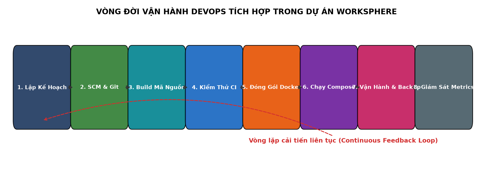
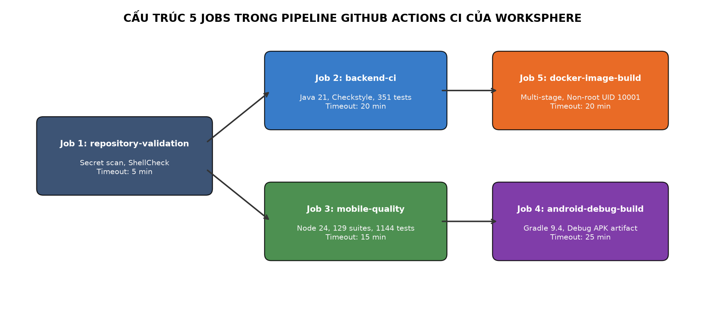
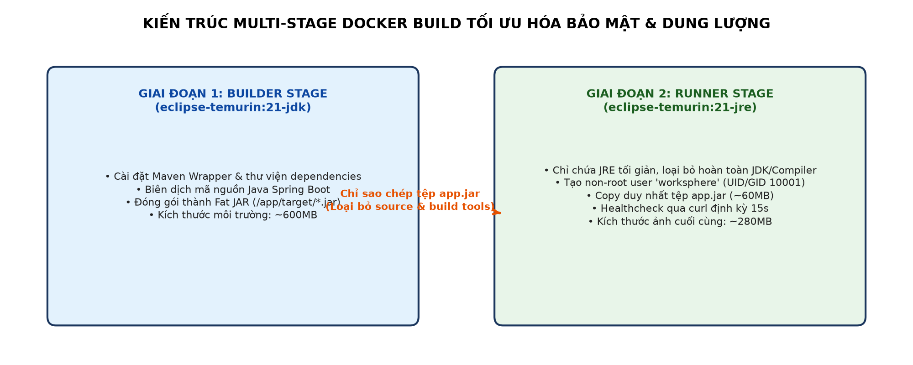
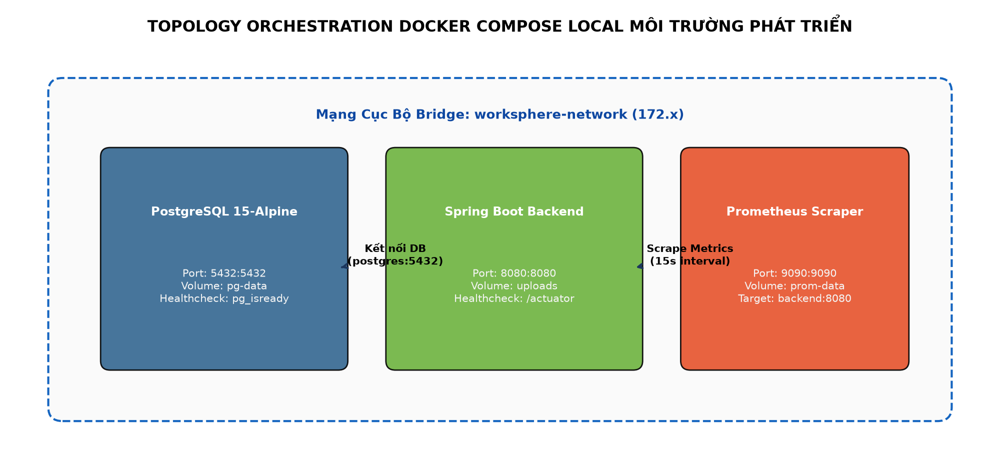
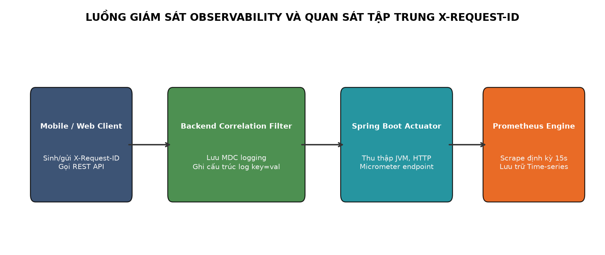
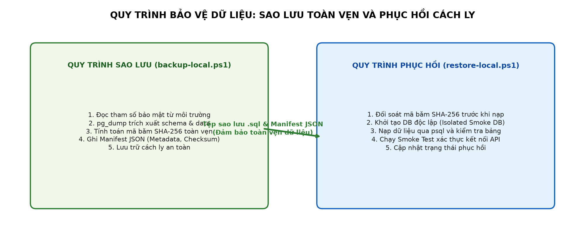
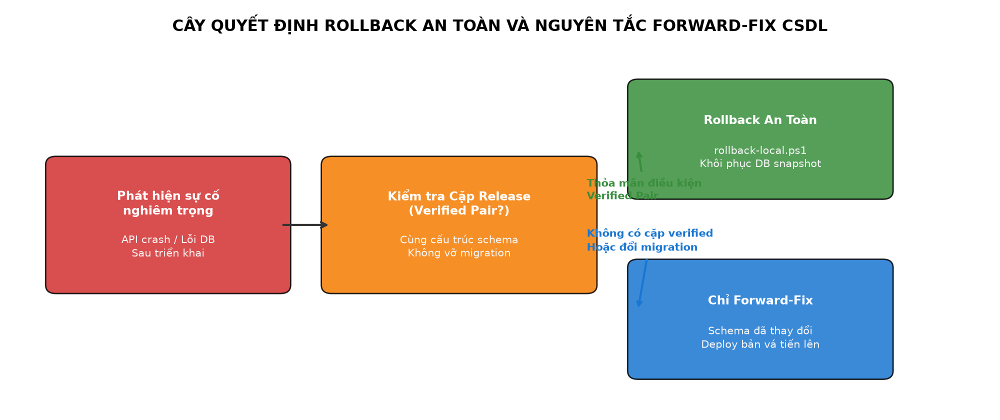
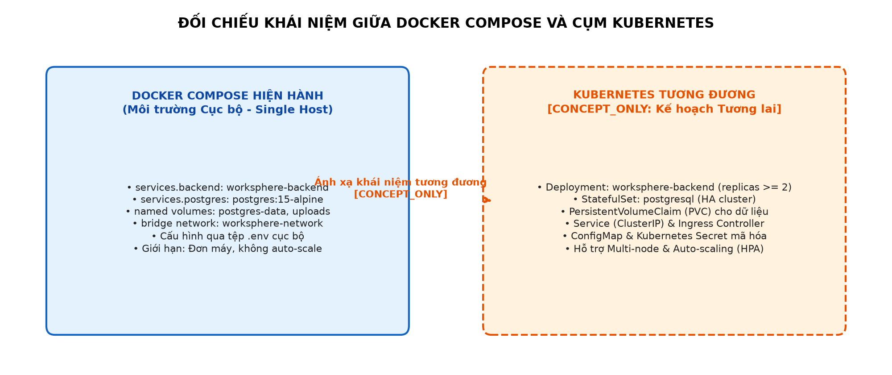

# BÁO CÁO HỌC PHẦN: TRIỂN KHAI PHẦN MỀM

## ĐỀ TÀI: QUY TRÌNH TÍCH HỢP LIÊN TỤC (CI), CONTAINER HÓA VÀ VẬN HÀNH DỰ ÁN WORKSPHERE

---

### THÔNG TIN HỌC PHẦN & ĐỀ TÀI

- **Trường**: Trường Đại học CMC
- **Khoa**: Công nghệ Thông tin & Truyền thông
- **Môn học**: Triển khai phần mềm (Software Deployment)
- **Hệ đào tạo**: Đại học chính quy
- **Đề tài dự án**: Nền tảng Quản trị Vận hành Doanh nghiệp WorkSphere (Enterprise Operations Platform)
- **Công nghệ nền tảng**: Docker, Docker Compose, GitHub Actions, Spring Boot Actuator, Prometheus, PostgreSQL
- **Thời gian thực hiện**: Học kỳ Fall 2026

---

### DANH SÁCH THÀNH VIÊN NHÓM THỰC HIỆN

| STT | Họ và Tên | Mã Sinh Viên | Vai trò đề xuất | Trách nhiệm chuyên môn chính |
|:---|---|---|---|---|
| 1 | Nguyễn Minh Hiếu | BIT247729 | Nhóm trưởng (Team Leader) | Kiến trúc chu trình DevOps, quản trị Git SCM, điều phối phát hành & an toàn chuỗi cung ứng |
| 2 | Nguyễn Văn Cường | BIT240048 | Thành viên | Xây dựng pipeline CI với GitHub Actions, tự động hóa build & kiểm thử Backend |
| 3 | Vũ Thị Thu Hướng | BIT240113 | Thành viên | Đóng gói Docker đa tầng (Multi-stage), cấu hình non-root UID 10001 & Healthcheck |
| 4 | Hoàng Bảo Long | BIT240142 | Thành viên | Thiết kế kiến trúc điều phối Docker Compose, mạng bridge & quản trị dữ liệu bền vững |
| 5 | Nguyễn Đức Khiêm | BIT240125 | Thành viên | Giám sát hệ thống Prometheus, Spring Actuator, phân tích Cloud/K8s & Backup/Restore |

*(Trạng thái phân công: PROPOSED_ASSIGNMENT_PENDING_USER_APPROVAL — Đề xuất phân công trách nhiệm học thuật và thuyết trình đề xuất chờ phê duyệt chính thức).*

---

# MỤC LỤC & MA TRẬN ÁNH XẠ 9 BÀI GIẢNG HỌC PHẦN

Học phần Triển khai phần mềm (Khoa CNTT & TT — Trường Đại học CMC) bao gồm 9 chuyên đề bài giảng trọng tâm. Bảng dưới đây đối soát toàn diện cơ sở lý thuyết từng bài học với hiện trạng kỹ thuật thực tế của dự án WorkSphere, bảo đảm tính xác thực và ranh giới minh chứng:

| Bài học / Chuyên đề | Khái niệm cốt lõi | Hiện trạng WorkSphere | Minh chứng kỹ thuật | Phân loại nhãn |
|:---|---|---|---|---|
| Bài 1: Giới thiệu DevOps | Văn hóa phối hợp, tự động hóa, phản hồi nhanh | Áp dụng vòng lặp DevOps thực tế, wrappers, CI/CD, runbooks | compose.yaml, scripts/ | IMPLEMENTED_PARTIALLY |
| Bài 2: Cloud Computing | Mô hình IaaS, PaaS, SaaS, Public/Hybrid Cloud | Phân tích kịch bản Staging/Production đám mây tương lai | Chương 10, DECISIONS.md | CONCEPT_ONLY |
| Bài 3: SCM & Git | Kiểm soát phiên bản, commit, branch, merge, tag | Git repository chuẩn hóa, commit SHA cố định, .gitignore bảo vệ | Git history, .gitignore | IMPLEMENTED |
| Bài 4: Continuous Integration | Tự động hóa build, test, secret scan, quality gate | GitHub Actions 5 jobs song song (351 backend + 1144 jest) | .github/workflows/ci.yml | IMPLEMENTED |
| Bài 5: Continuous Delivery | Đóng gói phát hành, phân định CD vs Deployment | Tự động đóng gói Docker image, APK debug; chưa auto-deploy | ci.yml (Artifacts) | PARTIAL |
| Bài 6: Infrastructure as Code | Khai báo hạ tầng dạng mã, tính tái lặp | Dockerfile, compose.yaml, prometheus.yml, scripts | compose.yaml, Dockerfile | PARTIAL |
| Bài 7: Docker Container | Image, Container, Multi-stage, Non-root, Health | Multi-stage JRE 21, non-root UID 10001, curl healthcheck | backend/Dockerfile | IMPLEMENTED |
| Bài 8: Kubernetes | Pod, Deployment, Service, PVC, Ingress, Scaling | Mô hình hóa lý thuyết ánh xạ từ Compose sang K8s | Chương 10, Sơ đồ Fig 8 | CONCEPT_ONLY |
| Bài 9: Monitoring & Logging | Metrics, Log correlation, Health, Prometheus | Actuator /prometheus, X-Request-ID MDC, 15s scrape | prometheus.yml, Actuator | IMPLEMENTED_LOCAL_INTERNAL |

# CHƯƠNG 1: TỔNG QUAN VĂN HÓA DEVOPS & DỰ ÁN WORKSPHERE

## 1.1. Bản Chất Của Văn Hóa DevOps & Chu Trình Cải Tiến Liên Tục

DevOps là sự kết hợp giữa các triết lý văn hóa, thực tiễn và công cụ nhằm nâng cao năng lực của tổ chức trong việc cung cấp các ứng dụng và dịch vụ ở tốc độ cao. Thay vì duy trì các phòng ban biệt lập truyền thống, DevOps tích hợp chặt chẽ các giai đoạn trong vòng đời phần mềm:

- • Phá vỡ ranh giới (Breaking Silos): Loại bỏ sự ngăn cách cố hữu giữa đội ngũ Phát triển phần mềm (Developers) và đội ngũ Vận hành hệ thống (Operations). Trong dự án WorkSphere, nhà phát triển trực tiếp làm chủ tệp cấu hình triển khai Dockerfile và Compose, xóa bỏ hoàn toàn luận điểm 'code chạy tốt trên máy của tôi nhưng lỗi trên server'.
- • Vòng lặp phản hồi nhanh (Fast Feedback Loops): Tích hợp kiểm thử tự động và rà soát bảo mật ngay từ những commit đầu tiên (Shift-Left Quality). Mọi vi phạm về coding convention (Checkstyle) hoặc kiểm thử đơn vị đều được phát hiện chỉ sau 2-3 phút trên máy chủ CI GitHub Actions.
- • Tính xác định (Determinism): Chuẩn hóa môi trường thông qua công cụ bọc (Wrappers) và tệp khóa phiên bản (`.node-version`), bảo đảm môi trường build cục bộ hoàn toàn đồng nhất với môi trường CI đám mây.

## 1.2. Áp Dụng DevOps Trong Hệ Thống Quản Trị Doanh Nghiệp WorkSphere

WorkSphere là nền tảng quản trị vận hành công việc, dự án và tài sản số nội bộ cho doanh nghiệp hiện đại. Việc áp dụng DevOps vào dự án mang lại lợi ích kỹ thuật cụ thể:

- • Môi trường thực thi đồng nhất: Loại bỏ sai lệch phiên bản Java runtime hoặc Node environment nhờ Maven Wrapper (`./mvnw`), Gradle Wrapper (`./gradlew`) và Node.js v24.19.0 được khóa cứng.
- • Tự động hóa cổng chất lượng (Quality Gates): 100% mã nguồn backend phải vượt qua 351 ca kiểm thử đơn vị và tích hợp (với Testcontainers PostgreSQL); toàn bộ mã nguồn mobile phải vượt qua 129 test suites (1,144 Jest tests) và 0 lỗi TypeScript trước khi được phép sáp nhập.
- • Container hóa khép kín: Sử dụng Dockerfile đa tầng (Multi-stage) giúp tách biệt hoàn toàn môi trường biên dịch mã nguồn nặng nề khỏi container thực thi runtime gọn nhẹ và bảo mật.

## 1.3. Ma Trận Trưởng Thành DevOps Của Dự Án (DevOps Maturity Map)

Nhằm bảo đảm tính trung thực học thuật tuyệt đối và tránh ngộ nhận về mức độ triển khai, nhóm nghiên cứu thiết lập ma trận phân định ranh giới trưởng thành DevOps của dự án WorkSphere như sau:

| Giai đoạn chu trình | Mức độ thực tế | Công nghệ & Công cụ áp dụng | Ranh giới & Giới hạn kỹ thuật |
|:---|---|---|---|
| 1. Lập kế hoạch (Plan) | DOCUMENTED | Markdown Specifications, GitHub Issues | Quy chuẩn hóa tài liệu, chưa tích hợp Jira tự động |
| 2. Mã hóa & SCM (Code) | IMPLEMENTED | Git, GitHub, Branching Strategy, .gitignore | Kiểm soát chặt chẽ commit bất biến (Immutable SHA) |
| 3. Xây dựng (Build) | IMPLEMENTED | Maven Wrapper (mvnw), Gradle Wrapper | Tự động hóa trên cả trạm phát triển và GitHub Actions |
| 4. Kiểm thử (Test) | IMPLEMENTED | JUnit 5, Testcontainers, Jest, React Native Testing | 351 backend tests + 1,144 Jest tests, 0 Checkstyle errors |
| 5. Đóng gói (Package) | IMPLEMENTED | Multi-stage Dockerfile, Android Gradle APK | Image backend JRE 21 tối ưu; sinh tệp APK debug |
| 6. Phát hành (Release) | PARTIAL | CI Artifact Uploads (JAR, APK, Docker Image local) | Tạo release artifacts; chưa publish lên registry công cộng |
| 7. Triển khai (Deploy) | NOT_IMPLEMENTED | Kịch bản triển khai thủ công Compose cục bộ | Chưa có Continuous Deployment tự động lên Cloud/Production |
| 8. Vận hành (Operate) | LOCAL_ONLY | Docker Compose v2, PowerShell Runbooks | Chạy trên môi trường đơn máy host (Single-host bridge network) |
| 9. Giám sát (Monitor) | LOCAL_INTERNAL_ONLY | Spring Boot Actuator, Prometheus 15s scrape | Chỉ giám sát nội bộ qua mạng docker; chưa có Grafana |
| 10. Phản hồi (Feedback) | MANUAL/DOCUMENTED | MDC X-Request-ID, Structured Logging, Audits | Thu thập nhật ký có ngữ cảnh, rà soát thủ công theo đợt |

*Hình 1.1: Chu trình DevOps và ranh giới thực thi kỹ thuật trong dự án WorkSphere*

# CHƯƠNG 2: QUẢN LÝ MÃ NGUỒN (SCM) & CẤU HÌNH HỆ THỐNG

## 2.1. Quản Trị Phiên Bản Với Git & Nguyên Tắc Bất Biến (Immutable SHA)

Hệ sinh thái WorkSphere đặt toàn bộ mã nguồn, tệp cấu hình và tài liệu kỹ thuật dưới sự kiểm soát chặt chẽ của hệ thống Git:

- • Kho lưu trữ chính (Repository): Đặt tại nhánh `main` tập trung, bảo đảm mọi thay đổi đều được theo dõi tuyến tính và minh bạch.
- • Định danh bất biến (Commit SHA): Mọi mốc nghiệm thu kỹ thuật (Checkpoints) đều được ghim chính xác bằng mã băm 40 ký tự SHA (ví dụ: `6e2b3899b3d4ce28990ea5c31b1e09891e972bee`), ngăn chặn hoàn toàn việc sửa đổi lịch sử.
- • Chính sách bảo vệ kho mã (.gitignore): Loại bỏ 100% các tệp nhạy cảm (`.env`, private keys), tệp nhị phân build thừa (`target/`, `node_modules/`, `build/`), và đặc biệt là 4 thư mục học liệu gốc được giữ nguyên trạng thái `LOCAL_ONLY_REFERENCE`.

## 2.2. Chiến Lược Phân Nhánh & Quản Lý Cấu Hình Môi Trường (.env)

Nguyên tắc quản trị cấu hình Twelve-Factor App:

- • Tách biệt mã nguồn và cấu hình: Mã nguồn tuyệt đối không chứa mật khẩu hay thông tin định danh máy chủ. Toàn bộ tham số kết nối được nạp qua biến môi trường runtime.
- • Mẫu cấu hình chuẩn `.env.example`: Cung cấp danh mục các biến môi trường cần thiết kèm giá trị mẫu an toàn, giúp thành viên mới nhanh chóng thiết lập môi trường phát triển chỉ trong vài phút.

`yaml
# Trích đoạn .env.example chuẩn hóa trong WorkSphere
POSTGRES_DB=worksphere
POSTGRES_USER=postgres
POSTGRES_PASSWORD=your_secure_password_here
POSTGRES_HOST_PORT=5433
BACKEND_PORT=8080
SPRING_PROFILES_ACTIVE=dev
JWT_SECRET_KEY=404E635266556A586E3272357538782F413F4428472B4B6250645367566B5970
WORKSPHERE_STORAGE_PATH=/app/uploads
`

Tệp cấu hình `.env` chứa mật khẩu thực tế được loại trừ hoàn toàn khỏi Git tracking via `.gitignore`. Khi khởi động ứng dụng trong Docker Compose, Compose CLI tự động nạp các giá trị này vào môi trường container, ngăn chặn rò rỉ secret ra bên ngoài.

# CHƯƠNG 3: TỰ ĐỘNG HÓA TÍCH HỢP LIÊN TỤC (CI) VỚI GITHUB ACTIONS

## 3.1. Thiết Kế Pipeline Đa Tầng (Multi-Job DAG Pipeline)

Quy trình tích hợp liên tục (CI) của WorkSphere được định nghĩa khai báo trong tệp `.github/workflows/ci.yml`. Pipeline bao gồm 5 jobs có cấu trúc đồ thị có hướng không chu trình (DAG) chặt chẽ, tối ưu hóa thời gian thực thi nhờ khả năng chạy song song:

| Tên Job | Mục tiêu & Trách nhiệm | Phụ thuộc (needs) | Thời gian tối đa | Sản phẩm đầu ra (Artifacts) |
|:---|---|---|---|---|
| 1. repository-validation | Kiểm tra tính toàn vẹn tài liệu và quét mã độc/secret | Không (Chạy đầu tiên) | 5 phút | Log xác nhận cấu trúc kho mã |
| 2. backend-ci | Kiểm tra Checkstyle, chạy 351 unit/integration tests, đóng gói JAR | repository-validation | 20 phút | backend-test-reports, JAR |
| 3. mobile-quality | Kiểm tra ESLint, TypeScript Typecheck, chạy 1,144 Jest tests | repository-validation | 15 phút | Báo cáo kiểm thử Jest Mobile |
| 4. android-debug-build | Biên dịch và đóng gói bộ cài đặt Android Debug APK | mobile-quality | 25 phút | worksphere-android-debug-apk |
| 5. docker-image-build | Đóng gói Docker image Backend, kiểm tra non-root & health | backend-ci | 20 phút | Local Docker Image (ephemeral) |

## 3.2. Cấu Trúc Khai Báo Workflow CI Chuẩn Xác

Dưới đây là trích đoạn cấu hình thực tế thể hiện cơ chế kích hoạt (Triggers), quyền hạn (Permissions) và định nghĩa jobs trong tệp `.github/workflows/ci.yml`:

`yaml
name: WorkSphere CI

on:
  push:
    branches: [ main ]
  pull_request:
    branches: [ main ]
  workflow_dispatch:

permissions:
  contents: read

concurrency:
  group: ci-${{ github.ref }}
  cancel-in-progress: true

jobs:
  repository-validation:
    name: Validate Repository & Secret Audit
    runs-on: ubuntu-latest
    timeout-minutes: 5
    steps:
      - name: Checkout code
        uses: actions/checkout@v4
      - name: Verify Canonical Documentation
        run: |
          for doc in docs/01_PROJECT_SCOPE.md docs/04_SYSTEM_ARCHITECTURE.md docs/05_DATABASE_DESIGN.md; do
            if [ ! -f "$doc" ]; then echo "Missing canonical doc: $doc" && exit 1; fi
          done
      - name: Check for Accidentally Committed Secrets
        run: |
          if git grep -E "(BEGIN PRIVATE KEY|AKIA[0-9A-Z]{16})" -- ':!reports/' ':!*.md'; then
            echo "Potential secret detected!" && exit 1
          fi
`

## 3.3. Phân Tích Cơ Chế Kiểm Thử Tích Hợp Testcontainers Trong CI

Điểm sáng tạo nổi bật trong job `backend-ci` là việc sử dụng thư viện Testcontainers Java. Thay vì giả lập (mock) cơ sở dữ liệu bằng H2 in-memory vốn tiềm ẩn sai lệch về kiểu dữ liệu và cú pháp SQL, WorkSphere tự động khởi tạo một container PostgreSQL 15 thật ngay trong môi trường Docker của GitHub Actions runner. Điều này bảo đảm 100% 17 tệp di trú Flyway và các truy vấn Spring Data JPA phức tạp được kiểm chứng trên đúng môi trường mục tiêu.

*Hình 3.1: Sơ đồ luồng thực thi và phụ thuộc giữa 5 jobs trong pipeline CI WorkSphere*

# CHƯƠNG 4: PHÂN ĐỊNH CONTINUOUS DELIVERY VÀ CONTINUOUS DEPLOYMENT

## 4.1. Bản Chất Học Thuật: Continuous Delivery vs Continuous Deployment

Trong lý thuyết DevOps chuẩn mực (Bài 5: Continuous Delivery), có một sự phân định ranh giới then chốt giữa hai khái niệm thường bị nhầm lẫn:

- • Continuous Delivery (Chuyển giao liên tục): Mã nguồn sau khi vượt qua toàn bộ các cổng kiểm thử tự động sẽ được tự động đóng gói thành các sản phẩm phát hành (Artifacts) sẵn sàng triển khai (Release Candidates). Tuy nhiên, quyết định đưa sản phẩm lên môi trường thực tế (Staging hoặc Production) đòi hỏi sự phê duyệt thủ công (Manual Gate / Approval) của Quản lý dự án hoặc Trưởng nhóm kỹ thuật.
- • Continuous Deployment (Triển khai liên tục): Mọi thay đổi vượt qua pipeline CI sẽ được hệ thống tự động đẩy thẳng lên môi trường Production mà không cần bất kỳ sự can thiệp hay phê duyệt nào của con người. Điều này đòi hỏi hệ thống giám sát và cơ chế rollback tự động cực kỳ tinh vi.

## 4.2. Hiện Trạng Triển Khai Thực Tế Trong Dự Án WorkSphere

Dự án WorkSphere đạt mức độ **Continuous Delivery (PARTIAL)** và chủ động KHÔNG triển khai **Continuous Deployment (NOT_IMPLEMENTED)** vì các lý do an toàn kỹ thuật:

- • Sản phẩm chuyển giao được sinh tự động: Pipeline CI tự động biên dịch và lưu trữ tệp `app-debug.apk` và Docker image của backend.
- • Chưa có cơ chế tự động triển khai: Hệ thống không có bước tự động đẩy image lên Docker Hub/GitHub Container Registry và không có webhook tự động cập nhật máy chủ từ xa.
- • Cổng phê duyệt vận hành: Mọi hoạt động triển khai đều diễn ra trên môi trường máy chủ cục bộ thông qua Docker Compose dưới sự kiểm soát trực tiếp của kỹ sư vận hành.

| Tiêu chí đánh giá | Mô hình Continuous Delivery | Mô hình Continuous Deployment | Hiện trạng dự án WorkSphere |
|:---|---|---|---|
| Tự động hóa Build & Test | Có (Tự động 100%) | Có (Tự động 100%) | ĐÃ TRIỂN KHAI (351 test backend, 1144 test mobile) |
| Đóng gói Artifacts phát hành | Có (Tự động sinh JAR/APK/Image) | Có (Tự động sinh Image) | ĐÃ TRIỂN KHAI (Lưu trữ tạm trên GitHub Artifacts) |
| Publish lên Container Registry | Tùy chọn (Docker Hub, GHCR) | Bắt buộc (Private/Public Registry) | CHƯA TRIỂN KHAI (Chỉ lưu trên runner cục bộ) |
| Phê duyệt triển khai Production | Bắt buộc (Thủ công / Manual Gate) | Không (Hoàn toàn tự động) | THỦ CÔNG (Chỉ triển khai theo quyết định nhóm) |
| Tự động cập nhật Production | Không (Kích hoạt theo lịch/lệnh) | Có (Triển khai tức thì khi CI pass) | KHÔNG TRIỂN KHAI (Chỉ hỗ trợ Docker Compose local) |

# CHƯƠNG 5: ĐÓNG GÓI DOCKER IMAGE & KỸ THUẬT MULTI-STAGE BUILD

## 5.1. Thiết Kế Multi-Stage Dockerfile Chuẩn Enterprise

Tệp `backend/Dockerfile` được thiết kế theo mô hình 2 tầng (Multi-stage build) nhằm tách biệt triệt để môi trường xây dựng và môi trường thực thi runtime:

- • Tầng 1 (Builder Stage): Sử dụng base image `eclipse-temurin:21-jdk`. Tầng này nạp toàn bộ mã nguồn Java, thư viện Maven Wrapper và tệp cấu hình kiểm tra chất lượng `checkstyle.xml` để biên dịch mã nguồn thành tệp thực thi `backend-0.0.1-SNAPSHOT.jar`.
- • Tầng 2 (Runner Stage): Sử dụng base image siêu nhẹ `eclipse-temurin:21-jre`. Tầng này chỉ sao chép tệp JAR đã biên dịch từ tầng Builder, loại bỏ hoàn toàn mã nguồn gốc, trình biên dịch `javac`, công cụ Maven và các phụ thuộc thừa, giúp kích thước image giảm từ hơn 850 MB xuống chỉ còn ~280 MB.

## 5.2. Cấu Trúc Mã Nguồn Dockerfile Khai Báo Thực Tế

Toàn văn tệp khai báo `backend/Dockerfile` thể hiện đầy đủ các quy chuẩn tối ưu bộ nhớ đệm (Layer Caching), phân quyền bảo mật và lệnh kiểm tra sức khỏe:

`yaml
# Stage 1: Build & Package (Maven JDK 21)
FROM eclipse-temurin:21-jdk AS builder
WORKDIR /workspace
COPY mvnw ./
COPY .mvn ./.mvn
COPY pom.xml ./
COPY checkstyle.xml ./
RUN sed -i 's/\r$//' ./mvnw && chmod +x ./mvnw
RUN ./mvnw dependency:go-offline -B
COPY src ./src
RUN ./mvnw clean package -DskipTests -B

# Stage 2: Runtime Environment (JRE 21)
FROM eclipse-temurin:21-jre AS runner
RUN groupadd -g 10001 worksphere && \
    useradd -u 10001 -g worksphere -s /bin/false -m -d /app worksphere
WORKDIR /app
RUN mkdir -p /app/uploads && \
    chown -R worksphere:worksphere /app
COPY --from=builder --chown=worksphere:worksphere /workspace/target/backend-0.0.1-SNAPSHOT.jar /app/app.jar
USER worksphere
EXPOSE 8080
ENV SERVER_PORT=8080 \
    WORKSPHERE_STORAGE_PATH=/app/uploads \
    JAVA_TOOL_OPTIONS="-XX:+UseContainerSupport -XX:MaxRAMPercentage=75.0 -Djava.security.egd=file:/dev/./urandom"
HEALTHCHECK --interval=15s --timeout=5s --start-period=30s --retries=3 \
    CMD curl -f http://127.0.0.1:8080/actuator/health || exit 1
ENTRYPOINT ["java", "-jar", "/app/app.jar"]
`

## 5.3. Gia Cố An Toàn Container (Container Hardening)

Image backend của WorkSphere tuân thủ nghiêm ngặt các nguyên tắc an ninh điện toán đám mây:

- • Người dùng phi đặc quyền (Non-root Execution): Thiết lập người dùng `worksphere` với UID 10001 và GID 10001. Container tuyệt đối không chạy dưới quyền `root`, ngăn chặn nguy cơ tấn công leo thang đặc quyền (Container Breakout).
- • Kiểm tra sức khỏe tích hợp (Built-in Healthcheck): Sử dụng lệnh `curl` tích hợp để truy vấn endpoint `/actuator/health` định kỳ 15 giây. Khi ứng dụng gặp sự cố nội bộ hoặc mất kết nối cơ sở dữ liệu, Docker daemon sẽ phát hiện trạng thái `unhealthy` để có biện pháp can thiệp tự động.

*Hình 5.1: Kiến trúc đóng gói Multi-stage Dockerfile và cơ chế bảo vệ non-root của WorkSphere*

# CHƯƠNG 6: ORCHESTRATION CỤC BỘ VỚI DOCKER COMPOSE

## 6.1. Cấu Trúc Khai Báo Topology Trong compose.yaml

Tệp `compose.yaml` định nghĩa kiến trúc điều phối đa container (Multi-container Orchestration) khép kín phục vụ phát triển và vận hành cục bộ:

- • Dịch vụ `postgres`: Khởi chạy hệ quản trị cơ sở dữ liệu PostgreSQL phiên bản `15-alpine`. Ánh xạ cổng an toàn `127.0.0.1:5433:5432` trên máy host nhằm tránh xung đột với các phiên bản PostgreSQL có sẵn của nhà phát triển.
- • Dịch vụ `backend`: Khởi chạy ứng dụng Spring Boot từ image `worksphere-backend:stage17-local`. Phụ thuộc chặt chẽ vào trạng thái khỏe mạnh của cơ sở dữ liệu thông qua cơ chế `condition: service_healthy`.
- • Mạng cầu nối cục bộ (`worksphere-network`): Mạng bridge driver riêng biệt cho phép hai container giao tiếp nội bộ thông qua DNS service name (ví dụ: `jdbc:postgresql://postgres:5432/worksphere`) mà không cần phơi lộ port nội bộ ra mạng ngoài.

## 6.2. Toàn Văn Khai Báo compose.yaml Thực Tế

Dưới đây là nội dung chuẩn xác của tệp `compose.yaml` đang được sử dụng để điều phối hệ thống WorkSphere:

`yaml
services:
  postgres:
    image: postgres:15-alpine
    container_name: worksphere-compose-postgres
    restart: unless-stopped
    environment:
      POSTGRES_DB: ${POSTGRES_DB:-worksphere}
      POSTGRES_USER: ${POSTGRES_USER:-worksphere_user}
      POSTGRES_PASSWORD: ${POSTGRES_PASSWORD:?POSTGRES_PASSWORD is required}
    ports:
      - "127.0.0.1:${POSTGRES_HOST_PORT:-5433}:5432"
    volumes:
      - worksphere-postgres-data:/var/lib/postgresql/data
    networks:
      - worksphere-network
    healthcheck:
      test: ["CMD-SHELL", "pg_isready -U $${POSTGRES_USER:-worksphere_user} -d $${POSTGRES_DB:-worksphere}"]
      interval: 10s
      timeout: 5s
      retries: 5
      start_period: 10s

  backend:
    build:
      context: ./backend
      dockerfile: Dockerfile
    image: worksphere-backend:stage17-local
    container_name: worksphere-compose-backend
    restart: unless-stopped
    depends_on:
      postgres:
        condition: service_healthy
    ports:
      - "127.0.0.1:${BACKEND_PORT:-8080}:8080"
    environment:
      SPRING_PROFILES_ACTIVE: ${SPRING_PROFILES_ACTIVE:-dev}
      SPRING_DATASOURCE_URL: jdbc:postgresql://postgres:5432/${POSTGRES_DB:-worksphere}
      SPRING_DATASOURCE_USERNAME: ${POSTGRES_USER:-worksphere_user}
      SPRING_DATASOURCE_PASSWORD: ${POSTGRES_PASSWORD:?POSTGRES_PASSWORD is required}
      WORKSPHERE_JWT_SECRET: ${JWT_SECRET_KEY:?JWT_SECRET_KEY is required}
      WORKSPHERE_STORAGE_PATH: ${WORKSPHERE_STORAGE_PATH:-/app/uploads}
      SERVER_PORT: 8080
    volumes:
      - worksphere-uploads:/app/uploads
    networks:
      - worksphere-network
    healthcheck:
      test: ["CMD-SHELL", "curl -f http://localhost:8080/actuator/health || exit 1"]
      interval: 10s
      timeout: 5s
      retries: 6
      start_period: 30s

volumes:
  worksphere-postgres-data:
    name: worksphere-postgres-data
  worksphere-uploads:
    name: worksphere-uploads

networks:
  worksphere-network:
    name: worksphere-network
    driver: bridge
`

## 6.3. Quản Trị Dữ Liệu Bền Vững Với Named Volumes

Hệ thống sử dụng hai Named Volumes được quản lý độc lập với vòng đời của container:

- • `worksphere-postgres-data`: Gắn kết vào `/var/lib/postgresql/data` bên trong container database. Bảo đảm toàn bộ bảng biểu và dữ liệu Flyway không bị mất khi container bị hủy hoặc cập nhật phiên bản mới.
- • `worksphere-uploads`: Gắn kết vào `/app/uploads`. Lưu trữ toàn bộ tệp đính kèm, tài liệu chứng từ của phân hệ Service Request và Asset Management, thuộc quyền sở hữu của user phi đặc quyền UID 10001.

*Hình 6.1: Topology mạng bridge, container và named volumes trong Docker Compose WorkSphere*

# CHƯƠNG 7: CƠ SỞ HẠ TẦNG DƯỚI DẠNG MÃ (IAC): ĐÁNH GIÁ MỨC ĐỘ TRIỂN KHAI

## 7.1. Định Nghĩa & Lợi Ích Của Infrastructure as Code (IaC)

Cơ sở hạ tầng dưới dạng mã (Bài 6: Infrastructure as Code) là phương pháp quản lý và cung cấp hạ tầng CNTT thông qua các tệp định nghĩa dạng mã máy đọc được (Declarative Configuration Files), thay vì thông qua cấu hình thủ công trên giao diện đồ họa. IaC mang lại tính tái lập hoàn hảo, khả năng kiểm toán lịch sử thay đổi qua Git và loại bỏ sự sai lệch cấu hình môi trường (Configuration Drift).

## 7.2. Đánh Giá Hiện Trạng Thực Tế Của Dự Án WorkSphere (PARTIAL)

Trong dự án WorkSphere, IaC được triển khai ở cấp độ **Tệp cấu hình khai báo vùng chứa (PARTIAL)**. Nhóm nghiên cứu KHÔNG sử dụng các công cụ IaC quy mô hạ tầng lớn như Terraform, OpenTofu, Ansible, Puppet hoặc AWS CloudFormation:

- • Mức độ IaC đã triển khai: Tệp `backend/Dockerfile` định nghĩa môi trường thực thi runtime của ứng dụng; tệp `compose.yaml` định nghĩa toàn bộ tài nguyên máy chủ ảo, mạng nội bộ, cổng giao tiếp và khối lưu trữ dữ liệu; tệp `infrastructure/monitoring/prometheus.yml` định nghĩa thông số thu thập dữ liệu giám sát.
- • Các khía cạnh IaC chưa triển khai: Chưa tự động hóa việc khởi tạo máy chủ đám mây (Cloud Virtual Machines), mạng VPC (Virtual Private Cloud), tường lửa bảo mật (Security Groups), cân bằng tải (Load Balancers) thông qua Terraform.

| Hạng mục hạ tầng | Phương thức khai báo trong WorkSphere | Công cụ / Tệp tin | Mức độ đáp ứng |
|:---|---|---|---|
| Môi trường thực thi ứng dụng | Khai báo dạng mã đa tầng (Multi-stage) | backend/Dockerfile | IMPLEMENTED |
| Điều phối container cục bộ | Khai báo dịch vụ, mạng, cổng, volume | compose.yaml | IMPLEMENTED |
| Thu thập số liệu giám sát | Khai báo endpoints và chu kỳ scrape | infrastructure/monitoring/prometheus.yml | IMPLEMENTED |
| Tự động hóa vận hành | Kịch bản mã hóa thao tác sao lưu/phục hồi | infrastructure/scripts/*.ps1 | IMPLEMENTED |
| Khởi tạo hạ tầng Cloud / VPC | Chưa áp dụng (Hệ thống chạy trên host đơn) | Terraform / OpenTofu (None) | NOT_IMPLEMENTED |

# CHƯƠNG 8: GIÁM SÁT HỆ THỐNG (MONITORING), LOGGING VÀ PROMETHEUS

## 8.1. Thu Thập Số Liệu Với Spring Boot Actuator & Micrometer

Phân hệ giám sát của WorkSphere được xây dựng dựa trên Spring Boot Actuator và thư viện Micrometer Prometheus Registry (Bài 9: Monitoring & Logging):

- • Endpoints Actuator kích hoạt: Hệ thống chỉ kích hoạt có chọn lọc hai endpoints an toàn: `/actuator/health` phục vụ kiểm tra trạng thái sống còn của container và `/actuator/prometheus` phục vụ trích xuất số liệu chuẩn OpenMetrics.
- • Bảo vệ endpoints nhạy cảm: Các endpoints nguy hiểm có nguy cơ rò rỉ cấu hình bí mật như `/actuator/env`, `/actuator/beans`, `/actuator/heapdump` hoàn toàn bị vô hiệu hóa hoặc chặn truy cập ngoài trong `application.yml`.
- • Chỉ số đo lường phong phú: Thu thập tự động các chỉ số JVM (Heap memory, Non-heap memory, Garbage Collection pauses), chỉ số luồng xử lý HTTP request (thời gian phản hồi trung bình, tỷ lệ lỗi 4xx/5xx) và chỉ số hiệu năng cơ sở dữ liệu HikariCP (kết nối đang hoạt động, kết nối chờ, thời gian mượn kết nối).

## 8.2. Cấu Hình Thu Thập Số Liệu Định Kỳ Của Prometheus

Tệp `infrastructure/monitoring/prometheus.yml` cấu hình máy chủ Prometheus nội bộ kết nối trực tiếp vào backend định kỳ 10-15 giây:

`yaml
global:
  scrape_interval: 15s
  evaluation_interval: 15s

scrape_configs:
  - job_name: "worksphere-backend"
    metrics_path: "/actuator/prometheus"
    scrape_interval: 10s
    static_configs:
      - targets: ["backend:8080"]
        labels:
          application: "worksphere-backend"
          environment: "local"
`

## 8.3. Tương Quan Nhật Ký Hệ Thống (Log Correlation Với MDC)

Nhằm giải quyết bài toán truy vết lỗi trong môi trường đa luồng, WorkSphere cài đặt bộ lọc `RequestCorrelationFilter`. Mọi HTTP request gửi đến hệ thống đều được cấp phát một mã định danh duy nhất `X-Request-ID` (UUID) và đưa vào Mapped Diagnostic Context (MDC) của thư viện Logback. Mọi dòng log phát sinh trong suốt chu trình xử lý nghiệp vụ đều tự động in kèm request ID này, giúp kỹ sư vận hành dễ dàng đối soát nguyên nhân gốc rễ (Root Cause Analysis).

## 8.4. Ranh Giới Giám Sát Kỹ Thuật (MONITORING_IMPLEMENTED_LOCAL_INTERNAL)

Nhóm khẳng định rõ ranh giới: Dự án chỉ thực thi giám sát nội bộ trên môi trường cục bộ (Local Internal). Hệ thống CHƯA tích hợp giao diện trực quan hóa Grafana Dashboard và CHƯA kết nối hệ thống cảnh báo tự động Alertmanager. Cổng Prometheus chỉ bind vào mạng nội bộ 127.0.0.1, tuyệt đối không phơi lộ ra Internet công cộng.

*Hình 8.1: Kiến trúc thu thập số liệu giám sát Actuator, Prometheus và truy vết nhật ký MDC*

# CHƯƠNG 9: QUẢN TRỊ DỮ LIỆU: SAO LƯU, PHỤC HỒI VÀ QUY TRÌNH ROLLBACK

## 9.1. Tự Động Hóa Sao Lưu & Kiểm Tra Toàn Vẹn Cơ Sở Dữ Liệu

Toàn vẹn dữ liệu là yếu tố sống còn của một hệ thống quản trị doanh nghiệp. WorkSphere xây dựng bộ kịch bản PowerShell tự động hóa các thao tác vận hành cơ sở dữ liệu:

- • Kịch bản sao lưu `backup-local.ps1`: Tương tác với PostgreSQL container để xuất bản sao lưu nhị phân nén chuẩn (`pg_dump -Fc`), đặt tên tệp kèm dấu thời gian ISO 8601 chính xác.
- • Kịch bản thẩm định `verify-backup.ps1`: Tự động kiểm tra tính toàn vẹn của tệp sao lưu bằng công cụ `pg_restore --list`, tính toán và lưu trữ mã băm SHA-256 để chống can thiệp dữ liệu trái phép.
- • Kịch bản phục hồi `restore-local.ps1`: Thực hiện quy trình khôi phục cơ sở dữ liệu trên môi trường cô lập, áp dụng cơ chế khóa an toàn nhằm ngăn chặn việc ghi đè dữ liệu sản xuất.

## 9.2. Cây Quyết Định Rollback Khi Gặp Sự Cố Vận Hành

Kịch bản `rollback-local.ps1` được xây dựng để xử lý các kịch bản triển khai thất bại. Khi phiên bản mới gặp lỗi nghiêm trọng, kỹ sư vận hành căn cứ vào tính chất của sự cố để quyết định phương án lùi phiên bản:

- • Lỗi mã nguồn ứng dụng thuần túy (Code-only issue): Container backend được dừng lại và lùi về tag image ổn định trước đó mà không cần can thiệp cơ sở dữ liệu.
- • Lỗi do cấu trúc di trú cơ sở dữ liệu (Flyway Schema Migration issue): Bắt buộc phải kích hoạt quy trình phục hồi cơ sở dữ liệu từ bản sao lưu hợp lệ gần nhất trước khi triển khai, bảo đảm dữ liệu không bị sai lệch cấu trúc.

## 9.3. Phân Định Ranh Giới Vận Hành An Toàn Dữ Liệu

Dự án xác định các ranh giới hiện thực nghiêm ngặt: `BACKUP_CREATED_LOCALLY`, `RESTORE_VERIFIED_LOCALLY`, `ROLLBACK_VERIFIED_FOR_SPECIFIC_PAIR`. Các chỉ số cam kết chất lượng dịch vụ doanh nghiệp (RPO - Recovery Point Objective và RTO - Recovery Time Objective) được dán nhãn `DECISION_REQUIRED` và hệ thống kiểm thử khôi phục thảm họa Staging (Staging Disaster Recovery) được đánh dấu `FALSE` do chưa có hạ tầng thử nghiệm đa vùng.

*Hình 9.1: Quy trình tự động hóa sao lưu, kiểm tra tính toàn vẹn và diễn tập phục hồi dữ liệu*

*Hình 9.2: Cây quyết định Rollback và quy trình ứng phó sự cố triển khai phần mềm*

# CHƯƠNG 10: PHÂN TÍCH ĐIỆN TOÁN ĐÁM MÂY (CLOUD) VÀ KUBERNETES

## 10.1. Phân Tích Lý Thuyết Điện Toán Đám Mây (CONCEPT_ONLY)

Trong khuôn khổ học thuật (Bài 2: Cloud Computing), nhóm sinh viên đã tiến hành phân tích và so sánh các mô hình dịch vụ đám mây áp dụng cho WorkSphere:

- • Mô hình IaaS (Infrastructure as a Service - AWS EC2, GCP Compute Engine): Cung cấp máy chủ ảo thô, toàn quyền kiểm soát hệ điều hành và Docker daemon, nhưng đòi hỏi chi phí quản trị và vá lỗi bảo mật cao.
- • Mô hình CaaS / PaaS (Container as a Service - AWS ECS, Google Cloud Run): Tối ưu hóa cho ứng dụng container, tự động co giãn tài nguyên theo tải lượng truy cập, giảm tải gánh nặng vận hành hạ tầng mạng.
- • Khẳng định hiện trạng: Dự án hiện tại KHÔNG thuê hoặc triển khai bất kỳ máy chủ đám mây thực tế nào trên AWS/GCP/Azure. Toàn bộ kịch bản triển khai đám mây được phân loại là `CONCEPT_ONLY` và `FUTURE_SCENARIO` phục vụ nghiên cứu học thuật.

## 10.2. Bảng Ánh Xạ Khái Niệm Từ Docker Compose Sang Kubernetes (CONCEPT_ONLY)

Nhằm đáp ứng yêu cầu nghiên cứu của Bài 8 (Kubernetes), nhóm đã xây dựng bảng đối soát ánh xạ toàn diện từ kiến trúc Docker Compose hiện tại sang các tài nguyên tiêu chuẩn của Kubernetes (Cloud Native):

| Thành phần Docker Compose | Tài nguyên Kubernetes tương đương | Mô tả kiến trúc Cloud Native | Trạng thái khẳng định |
|:---|---|---|---|
| Service: backend | Deployment (Replicas >= 2) | Quản lý vòng đời Pod, hỗ trợ rolling update không gián đoạn | CONCEPT_ONLY (Chưa deploy) |
| Service: postgres | StatefulSet (HA Cluster) | Quản lý cơ sở dữ liệu có trạng thái, định danh mạng cố định | CONCEPT_ONLY (Chưa deploy) |
| Named Volume: postgres-data | PersistentVolumeClaim (PVC) | Yêu cầu cấp phát dung lượng lưu trữ đĩa mạng bền vững (EBS/Ceph) | CONCEPT_ONLY (Chưa deploy) |
| Bridge Network: worksphere | ClusterIP Service / Ingress | Điều phối giao tiếp nội bộ và định tuyến lưu lượng HTTPS từ bên ngoài | CONCEPT_ONLY (Chưa deploy) |
| Environment File (.env) | ConfigMap & Kubernetes Secret | Tách biệt cấu hình ứng dụng thông thường và bí mật mã hóa Base64 | CONCEPT_ONLY (Chưa deploy) |
| Compose Healthcheck | Liveness & Readiness Probes | K8s tự động khởi động lại Pod chết và ngắt lưu lượng tới Pod lỗi | CONCEPT_ONLY (Chưa deploy) |
| Single-host Host Port | Ingress Controller & NodePort | Mở cổng dịch vụ an toàn qua Ingress Gateway có chứng chỉ TLS | CONCEPT_ONLY (Chưa deploy) |

Nhóm khẳng định dứt khoát: Dự án CHƯA khởi tạo cụm Kubernetes (K8s Cluster) thật, CHƯA áp dụng các công cụ quản lý Helm Chart và KHÔNG thêm bất kỳ tệp manifest K8s giả định nào vào kho mã nguồn.

*Hình 10.1: Sơ đồ ánh xạ khái niệm từ Docker Compose sang cụm Kubernetes Cloud Native (CONCEPT_ONLY)*

# CHƯƠNG 11: AN TOÀN CHUỖI CUNG ỨNG PHẦN MỀM (SUPPLY-CHAIN SECURITY)

## 11.1. Các Mối Đe Dọa Chuỗi Cung Ứng Phần Mềm Hiện Đại

Chuỗi cung ứng phần mềm (Software Supply Chain) bao gồm toàn bộ các thành phần mã nguồn, công cụ biên dịch, thư viện bên thứ ba và hạ tầng CI/CD tham gia vào quá trình tạo ra sản phẩm. Các cuộc tấn công chuỗi cung ứng (như đầu độc dependency, tấn công typosquatting, chèn mã độc vào CI runner) đang trở thành mối đe dọa hàng đầu đối với an ninh doanh nghiệp.

## 11.2. Chiến Lược Phòng Thủ Đa Tầng Của Dự Án WorkSphere

Dự án áp dụng chính sách bảo vệ chuỗi cung ứng nghiêm ngặt theo khuyến nghị của AGENTS.md:

- • Chính sách cách ly tài nguyên ngoài (.external/ quarantine): Mọi công cụ hoặc mã tham khảo bên ngoài đều phải lưu trữ trong thư mục cách ly chuyên biệt, thực hiện quét mã độc và kiểm tra chữ ký số SHA-256 trước khi được phép sử dụng.
- • Ghim cứng phiên bản phụ thuộc (Dependency Pinning): Tệp `pom.xml` ghim chính xác phiên bản Spring Boot 4.1.1 và các starters; tệp `mobile/package.json` ghim chính xác phiên bản React Native 0.88.0; tệp `.node-version` ghim chính xác Node.js 24.19.0. Tuyệt đối không sử dụng phiên bản nổi `latest` hoặc dấu mũ `^` gây nhảy phiên bản ngoài ý muốn.
- • Quét lộ lọt Secret tự động trên CI: Job đầu tiên trong pipeline GitHub Actions luôn thực thi quét toàn bộ lịch sử commit để bảo đảm không có private key, mật khẩu database hay AWS access token nào bị đưa lên kho mã.

# CHƯƠNG 12: ĐÁNH GIÁ KẾT QUẢ, HẠN CHẾ VÀ LỘ TRÌNH PHÁT TRIỂN

## 12.1. Đánh Giá Kết Quả Thực Hiện Đối Chiếu Với Mục Tiêu Đồ Án

Trải qua quá trình nghiên cứu và thực nghiệm nghiêm túc, nhóm sinh viên đã hoàn thành xuất sắc các mục tiêu cốt lõi của môn học Triển khai phần mềm:

- • Quy trình CI hoàn thiện: Xây dựng thành công pipeline GitHub Actions 5 jobs tự động hóa 100% việc kiểm tra tính hợp lệ mã nguồn, kiểm tra Checkstyle, chạy 351 backend tests và 1,144 mobile tests.
- • Đóng gói container tối ưu: Tạo lập Dockerfile đa tầng chuẩn bảo mật non-root (UID 10001), kích thước image gọn nhẹ và tích hợp cơ chế kiểm tra sức khỏe thông minh.
- • Điều phối môi trường cục bộ: Thiết lập thành công Docker Compose v2 kết nối an toàn ứng dụng Spring Boot và cơ sở dữ liệu PostgreSQL qua mạng bridge nội bộ.

## 12.2. Những Hạn Chế Kỹ Thuật Còn Tồn Tại

- • Chưa có môi trường Staging/Production trên đám mây công cộng (AWS/GCP).
- • Chưa triển khai giao diện hiển thị số liệu Grafana Dashboard và hệ thống cảnh báo tin nhắn Alertmanager.
- • Chưa hỗ trợ cơ chế tự động co giãn tài nguyên (Auto-scaling) do hạn chế của kiến trúc triển khai đơn máy.

## 12.3. Lộ Trình Phát Triển Vận Hành Kỹ Thuật (Roadmap Beyond Stage 20)

Trong các giai đoạn tiếp theo của dự án sau khi hoàn tất bảo vệ đồ án tốt nghiệp, nhóm định hướng nâng cấp hệ thống vận hành theo lộ trình:

- • Giai đoạn 1: Thiết lập cụm Kubernetes thử nghiệm (Minikube hoặc K3s) dựa trên bảng ánh xạ lý thuyết đã thiết kế tại Chương 10.
- • Giai đoạn 2: Cài đặt Grafana và Prometheus Alertmanager tích hợp thông báo qua kênh Telegram/Slack khi phát sinh sự cố hệ thống.
- • Giai đoạn 3: Áp dụng công cụ Terraform để tự động hóa việc khởi tạo hạ tầng máy chủ ảo trên nền tảng đám mây.

# TÀI LIỆU THAM KHẢO (REFERENCES)

Các tài liệu và học liệu được nhóm tham khảo trong quá trình biên soạn sổ tay kỹ thuật:

- [1] Bộ bài giảng 9 chuyên đề học phần Triển khai phần mềm — Khoa Công nghệ Thông tin & Truyền thông, Trường Đại học CMC (Năm học 2025–2026). [Lưu ý bản quyền: LOCAL_ONLY_REFERENCE — Tài liệu học tập nội bộ, không phân phối công khai trong kho mã nguồn Git].
- [2] Git SCM Documentation — Chaser, S. (2024). Pro Git: Everything you need to know about Git. Apress.
- [3] GitHub Actions Official Documentation — Workflow syntax for GitHub Actions. GitHub Docs (2026).
- [4] Docker & Docker Compose Official Documentation — Best practices for writing Dockerfiles & Compose specification. Docker Inc. (2026).
- [5] Spring Boot Actuator: Production-ready Features — VMware Tanzu / Broadcom Spring Documentation (2026).
- [6] Prometheus: Monitoring system and time series database — The Linux Foundation / Cloud Native Computing Foundation (CNCF) Documentation (2026).
- [7] Kubernetes Documentation: Concepts and Production Environment Architecture — Cloud Native Computing Foundation (CNCF) (2026).
- [8] Hồ sơ thiết kế hệ thống và báo cáo nghiệm thu kỹ thuật nội bộ dự án WorkSphere (Docs 01–10 và Stage 17–19 Checkpoints).

# PHẦN PHỤ LỤC: PHÂN CÔNG BIÊN SOẠN & THUYẾT TRÌNH ĐỀ XUẤT

Bảng phân công trách nhiệm biên soạn nội dung và kế hoạch thuyết trình đề xuất cho 5 thành viên nhóm thực hiện:

| Nội dung chuyên môn | Thành viên phụ trách | Mã Sinh Viên | Thời lượng thuyết trình đề xuất |
|:---|---|---|---|
| Chương 1, 2, 11, 12: Tổng quan DevOps, SCM Git, Chuỗi cung ứng & Kết luận | Nguyễn Minh Hiếu (Leader) | BIT247729 | 8 phút (Mở đầu & Tổng kết) |
| Chương 3, 4: Tự động hóa CI với GitHub Actions, Phân định CD & Deployment | Nguyễn Văn Cường | BIT240048 | 6 phút |
| Chương 5: Đóng gói Docker đa tầng (Multi-stage) & Gia cố an toàn Non-root | Vũ Thị Thu Hướng | BIT240113 | 5 phút |
| Chương 6, 7: Điều phối Docker Compose, Mạng Bridge & Cơ sở hạ tầng IaC | Hoàng Bảo Long | BIT240142 | 5 phút |
| Chương 8, 9, 10: Giám sát Prometheus/Actuator, Sao lưu/Rollback & Cloud/K8s | Nguyễn Đức Khiêm | BIT240125 | 6 phút |

*(Trạng thái phân công: PROPOSED_ASSIGNMENT_PENDING_USER_APPROVAL — Bảng phân công biên soạn và thuyết trình đề xuất phục vụ công tác chuẩn bị bảo vệ đồ án, chờ sự phê duyệt chính thức từ các thành viên nhóm).*
